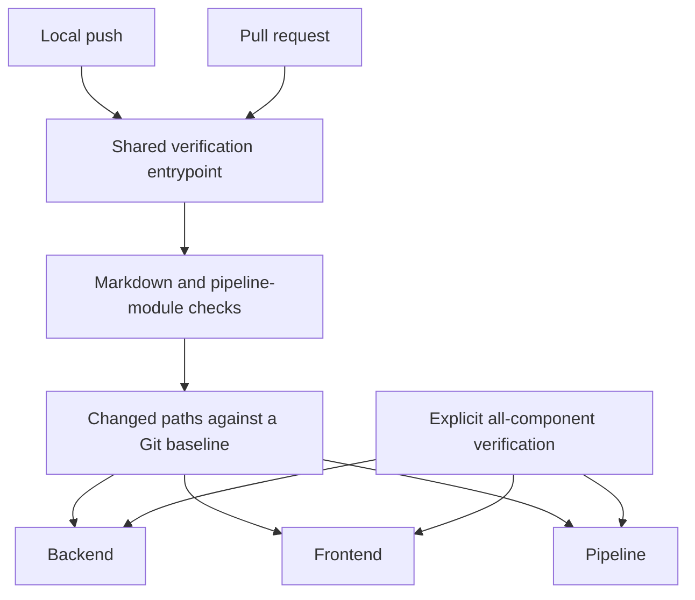

# Pipeline design

> Standard: Agentic Engineering Standards v1.2.0

## Purpose

One verification path serves local pushes and pull requests. Shared checks always run; affected-component selection avoids rebuilding unrelated application components.

Backend, frontend and pipeline gates own independent build boundaries in pinned environments. Selection follows path ownership, not file type: frontend-owned changes select the frontend gate; standalone living-doc changes retain shared checks without selecting an application component.

## Verification boundary

Git ancestry defines the change under review. The pre-push hook verifies the actual outgoing checkout, while pull-request CI compares the candidate with its target branch. A failed stage stops verification rather than producing a partial success.

The pipeline module owns path-selection policy and component execution. The shared entrypoint owns orchestration; the hook owns outgoing-revision safety. [Contracts](contracts.md) identifies their authoritative sources, and [operations](operational.md) explains how to invoke them.
