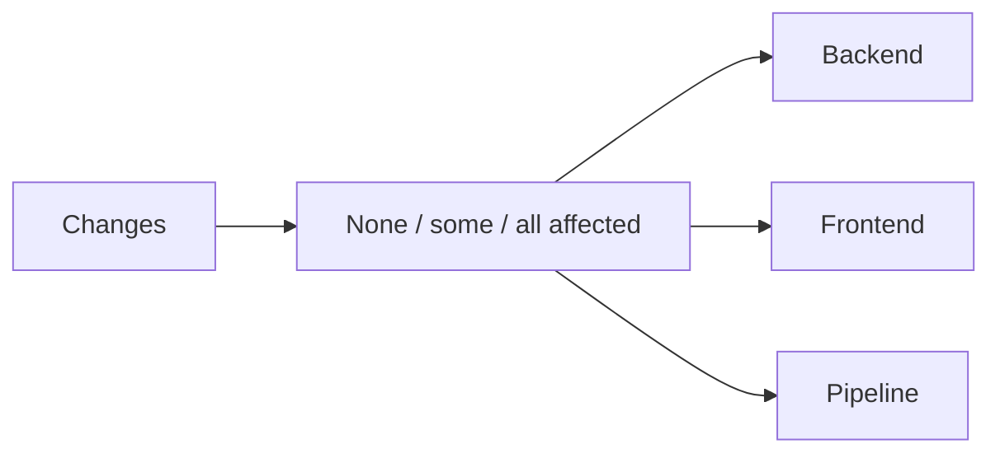

# Pipeline design

> Standard: Agentic Engineering Standards v1.2.0

## Overview

The pipeline maps changed paths to independent backend, frontend, and pipeline checks. Documentation-only changes select no Dagger component; the shared verification entrypoint still checks Markdown and the pipeline module. `verify --all` runs every component check regardless of the diff.

## Component ownership

- `backend/` changes run the backend gate in a pinned JDK and sbt container.
- `frontend/` changes run the frontend gate in a pinned Node container.
- `.dagger/`, `dagger.json`, `.mise.toml`, `.github/`, `.githooks/`, `scripts/`, and `.agents/skills/sdd/scripts/` changes select the pipeline gate.
- The pipeline module owns path selection and containerized component checks.
- `scripts/verify` owns the shared local/CI gate sequence; `.githooks/pre-push` owns validation of outgoing revisions and base selection.
