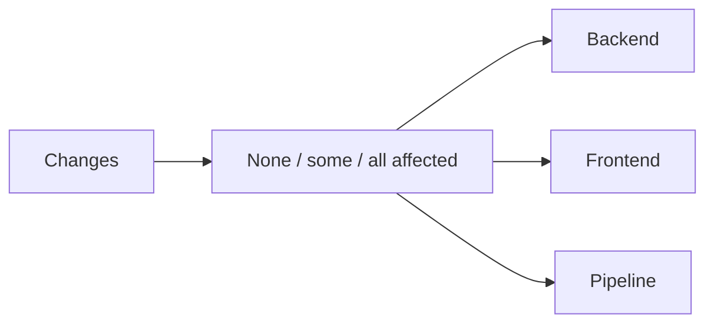

# Pipeline design

> Standard: Agentic Engineering Standards v1.2.0

## Overview

The pipeline maps changed paths to independent backend, frontend, and pipeline checks. Documentation-only changes select no component. `verify --all` runs every check regardless of the diff.

## Component ownership

- `backend/` changes run the Scala compiler in a pinned JDK and sbt container.
- `frontend/` changes validate the static HTML entry point in a pinned Node container.
- `.dagger/`, `dagger.json`, and `.github/` changes run the Dagger module's type, lint, format, and unit-test gates.
- The pipeline module owns path selection and containerized component checks.
