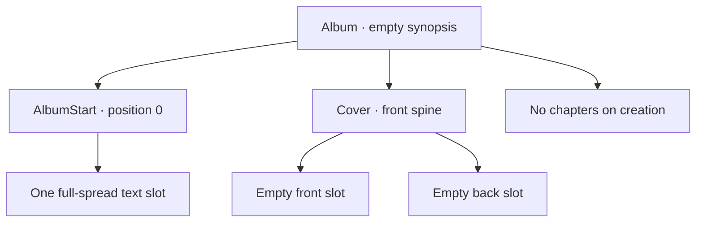

# Album dashboard and open

**Date:** 2026-10-07

**Classification:** feature

**Grounded in:**

- UI spike: six-album pages, centered add/edit popups, directional paging, and card-to-read-only-open.
- Persistence spike: create/read, blank-title rejection, missing vs. incomplete, rollback; V1 has no built-in template.

## What & Why

Replace the static entry point with a persisted-album dashboard at `/` where users add or rename albums, then open each album read-only at `/albums/{id}`.

## Domain / Design Notes

- The frontend is SolidJS/TypeScript. Use a typed, same-origin API client; fakes are test-only.

| Method and path | Request | Success |
|---|---|---|
| `GET /api/albums?page={page}` | `page` defaults to `1`; six per page | `200 {albums, page, pageSize, totalAlbums, totalPages}` |
| `POST /api/albums` | `{title}` | `201 {id, title, createdAt}` |
| `PATCH /api/albums/{id}` | `{title}` | `200 {id, title, createdAt}` |
| `GET /api/albums/{id}` | — | `200` full persisted composition |
| `DELETE /api/albums/{id}` | — | `204` no body |

- An out-of-range page returns the last page; an empty collection returns page `1` with `totalPages: 0`.
- Generate a stable UUID and immutable UTC `createdAt` for each album; list newest-first.
- Seed several `AlbumStart` spread templates for new databases and V1 upgrades; the template list API returns all of them, and clients supply no template ID.
- Creating an album uses the `AlbumStart` template with the lowest ID.
- Album titles are nonempty after trimming; create and rename trim input before validation.
- SQLite enforces declared primary/foreign keys and unique chapter positions, with foreign-key checks enabled on every connection.
- The use case checks chapter positions are `0..19`.
- V1 does not enforce template-kind, required-slot, or cover-side shape; create/open use cases validate these composition rules.
- Creation validates and writes the complete initial shape in one transaction; open rejects incomplete persisted shape.
- Incomplete persisted state fails as `service_failure`, without exposing an internal composition code.

**Composition response**

| Member | Shape |
|---|---|
| `album` | `{id, title, synopsis}` |
| `start` | `{id, templateId, slots, placements}`; slots preserve template order and kind. |
| `cover` | `{spineOwner, front, back}`; each side is `{id, placement}`, with `null` for an empty placement. |
| `chapters` | Position-ordered `{chapter, start, photos, spreads}` entries; `[]` when absent. |
| Values | IDs are canonical UUID strings; absent optional values are `null`; empty collections are `[]`. |

New albums have one full-spread text slot, empty cover placements, and no chapters; slot and placement associations use stable IDs and arrays preserve domain order.

## Acceptance Criteria

### Dashboard

- `/` shows “Album Layout Studio” with subdued “Album dashboard”.
- Show six newest-first cards per page and centered Previous / Page / Next controls.
- Page changes slide directionally; keep the current page visible while loading.
- Cards use a 42:28 cover area, bottom title extension, compact type, and turquoise focus halo.
- Empty covers use a turquoise/azure placeholder; selecting a card opens `/albums/{id}`.
- Show loading, successful-empty, and retryable list-error states.

### Add and edit

- Center both popups; support keyboard and pointer use, restoring focus on close.
- Trim titles; blank input shows validation and remains available to correct.
- Blank or whitespace-only titles return `400` with validation feedback; no title-specific error code.
- Create closes its popup and adds a card; opening remains a separate user action.
- Rename updates only the title; failure preserves the edit input and shows an error.
- Delete requires explicit confirmation; cancel leaves the album unchanged.
- Successful deletion removes the card; pagination falls back to the last available page.

### Open and persist

- Selecting, directly opening, or reloading `/albums/{id}` loads that album read-only.
- `GET` returns the complete composition shape defined above, including empty arrays and slot associations.
- Show loading until complete composition arrives; failed loads never render partial success.
- New albums have no chapters and empty start/cover placements.
- Create the valid initial composition atomically using the `AlbumStart` template with the lowest ID.
- The dashboard fetches all `AlbumStart` templates for display; loading and failure states follow the same rules as albums.
- Malformed or unknown IDs on read, rename, or delete share `404 album_not_found`.
- Service/incomplete-state failures use `500 service_failure`.
- Service failures offer Retry; missing albums offer a route back to the dashboard.
- The backend serves app assets and API on one origin; `/api/*` remains JSON.
- A browser journey creates, lists, opens, reloads, renames, and deletes using real persistence.

## Doc Sync

- `specs/design.md` — Architecture constraints: state that all backend APIs use REST over HTTP.
- `specs/contracts.md` — Contract inventory: point to the generated OpenAPI specification for the album API contract.
