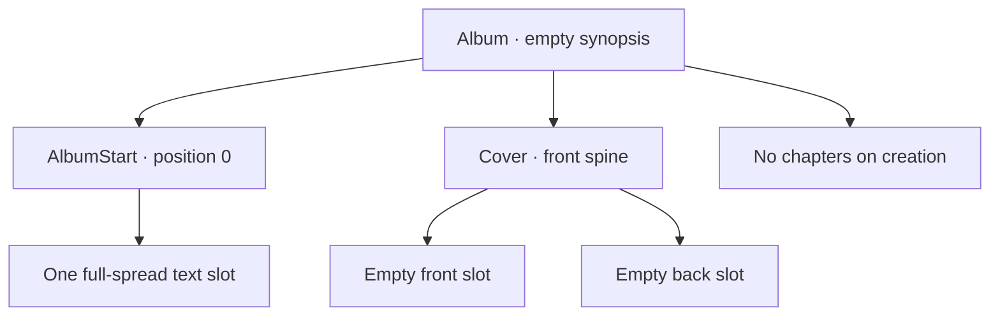

# Album dashboard and open

**Date:** 2026-10-07

**Classification:** feature

**Grounded in:**

- UI spike: six-album pages, centered add/edit popups, directional paging, and card-to-read-only-open.
- Persistence spike: create/read, blank-title rejection, missing vs. incomplete, rollback; V1 has no built-in template.

## What & Why

Replace the static entry point with a persisted-album dashboard at `/`.
Users add or rename albums, then open each read-only at `/albums/{id}`.

## Domain / Design Notes

- The frontend is SolidJS/TypeScript. Use a typed, same-origin API client; fakes are test-only.
- The album API is RESTful:

  | Method and path | Request | Success |
  |---|---|---|
  | `GET /api/albums?page={page}` | `page` defaults to `1`; six per page | `200 {albums, page, pageSize, totalAlbums, totalPages}` |
  | `POST /api/albums` | `{title}` | `201 {id, title, createdAt}` |
  | `PATCH /api/albums/{id}` | `{title}` | `200 {id, title, createdAt}` |
  | `GET /api/albums/{id}` | — | `200` full persisted composition |

- An out-of-range page returns the last page; an empty collection returns page `1` with `totalPages: 0`.
- Generate a stable UUID and immutable UTC `createdAt` for each album; list newest-first.
- Seed one built-in `AlbumStart` template for new databases and V1 upgrades; clients supply no template ID.
- Album titles are nonempty after trimming; create and rename trim input before validation.
- SQLite enforces keys and ownership constraints; the create use case enforces completeness in one transaction.
- Open returns persisted album, spread, slot, placement, and chapter state; absent collections are empty arrays.
- Incomplete persisted state fails as `service_failure`, without exposing an internal composition code.

## Acceptance Criteria

### Dashboard

- `/` shows “Album Layout Studio” with subdued “Album dashboard”.
- Show six newest-first cards per page and centered Previous / Page / Next controls.
- Page changes slide directionally; keep the current page visible while loading.
- Cards use a 42:28 cover area, bottom title extension, compact type, and turquoise focus halo.
- Empty covers use a turquoise/azure placeholder; selecting a card opens `/albums/{id}`.
- Show loading, successful-empty, and retryable list-error states.

### Add and edit

- Center both popups; support keyboard and pointer use, restoring focus on close.
- Trim titles; blank input shows validation and remains available to correct.
- Blank or whitespace-only titles return `400` with validation feedback; no title-specific error code.
- Create closes its popup and adds a card; opening remains a separate user action.
- Rename updates only the title; failure preserves the edit input and shows an error.

### Open and persist

- Selecting, directly opening, or reloading `/albums/{id}` loads that album read-only.
- Show loading until complete composition arrives; failed loads never render partial success.
- New albums have no chapters and empty start/cover placements.
- Create the valid initial composition atomically using the seeded built-in template.
- Malformed and unknown IDs share `404 album_not_found`; service/incomplete-state failures use `500 service_failure`.
- Service failures offer Retry; missing albums offer a route back to the dashboard.
- The backend serves app assets and API on one origin; `/api/*` remains JSON.
- A browser journey creates, lists, opens, reloads, and renames using real persistence.

## Doc Sync

- `specs/design.md` — Architecture constraints: identify the album API as RESTful.
- `specs/contracts.md` — Contract inventory: point to the generated OpenAPI specification for the album API contract.
