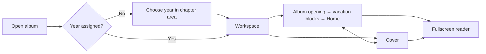

# Album workspace structure

**Date:** 2026-10-25

**Classification:** feature

**Grounded in:**

- HTTP/SQLite/browser spike: late-added vacations, Home, year setup, country search, metadata changes and persisted reloads.
- Canvas spike: full-spread geometry, Spreads / Cover toggle, animated sidebar and fullscreen navigation; confirmed by the maintainer on 2026-10-25.

## What & Why

Replace the metadata-only album page with a chapter workspace where an editor can build a year's album incrementally and select its parts for read-only preview.

## Domain / Design Notes

### Album and chapters

- A year identifies at most one album. Assigning it sets the stored title to `Journey of the Shepherds <year>`; the year stays fixed once chapters exist.
- Existing yearless albums retain their identity, synopsis and composition when a year is assigned. Year-based titles are generated rather than freely renamed.
- Vacations sort by first day, then last day, then chapter ID. Home is optional, explicitly added, unique within its album and always last.
- The chapter name is its entered location/name. Home has country and folder metadata, with its period derived from the album year.
- Wire dates are inclusive calendar days, `YYYY-MM-DD`; stored visit periods run from UTC midnight on the first day to midnight after the last day.
- A chapter save, its reference associations, initial opening and chronological positions commit atomically; metadata changes preserve existing composition.

| Rule | Enforcement |
|---|---|
| Unique album year | Database unique constraint |
| At most one Home per album | Database partial unique constraint |
| Unique non-null chapter folder and chapter position within an album | Database unique constraints |
| Valid identities and country/album/chapter associations | Database primary/foreign keys and application ownership validation |
| At most 65 interior spreads (130 pages), counting album/chapter openings and photo spreads, excluding Cover | Application validation |
| Valid calendar periods, Home's derived period, contained relative folders | Application validation |
| Chronological positions and complete opening slots | Application transaction |

### HTTP contract

Album metadata reads remain separate from workspace reads.

- Album list/read entries additionally expose `year`, nullable before assignment; existing fields retain their meanings.
- For an assigned year, the existing rename operation accepts only the generated title; another title returns `400 {message}`. Yearless-album rename is unchanged.

| Method and path | Request | Success |
|---|---|---|
| `GET /api/albums/{id}/workspace` | — | `200 {year, photoRoot, chapters, spreads, countries}` |
| `PUT /api/albums/{id}/year` | `{year}` | `200 {year, title}` |
| `POST /api/albums/{id}/chapters` | `{kind, ...details}` | `201 {id}` |
| `PUT /api/albums/{id}/chapters/{chapterId}` | Type-specific details | `200 {id}` |

| Value | Shape |
|---|---|
| `year` | Integer `1900..2100`, or `null` before assignment |
| Vacation details | `{name, country, start, end, sourceFolder}` |
| Home details | `{country, sourceFolder}` |
| `kind` | `"vacation"` or `"home"`; selected on creation |
| Chapter | `{id, kind, name, country, start, end, sourceFolder, description}` |
| Spread | `{id, chapter, kind, slots}`; `chapter` is `null` for the album opening |
| Slot | `{id, kind, x, y, width, height}`; `kind` is `"photo"` or `"text"` |
| Country | `{id, name, code}`; chapter/request `country` identifies one of these records |

- IDs are canonical UUID strings; absent folders are `null`, and empty collections are `[]`. Chapter `name` is `Home` for Home; its returned dates span its year.
- Spread kinds are `"album_start"`, `"chapter_start"` and `"photos_only"`; chapter blocks follow their chapter opening with photo spreads in persisted order.
- Malformed JSON, invalid fields/references, duplicate year/Home/folder and spread-capacity violations return `400 {message}` with readable feedback.
- Malformed or missing album IDs return `404 {code: "album_not_found"}`; missing or foreign chapter targets return `404 {code: "chapter_not_found"}`.
- Infrastructure or incomplete-composition failures return `500 {code: "service_failure"}`. JSON uses `application/json`; failed writes leave persisted state unchanged.

### Reference data and composition

- Populate all 249 ISO 3166-1 countries/territories. Vacation name/country changes affect that chapter, not other chapters sharing reference data.
- Seed the 27 Saal chapter-start layouts from the existing catalog. The lowest-ID default is `Text + 2P + 2L`: four photo slots and one text column.
- Chapter creation copies the default template's complete geometry into an empty opening. Existing spreads retain their matching templates, slot IDs and geometry.
- Coordinates are percentages of the full spread axes; preview at the physical `2381.102 × 765.354` aspect ratio, independently of occupied-slot extrema.
- Persist folders relative to the backend-visible `/photos` root. Suggest `<year>/selection/<location>` or `<year>/selection/Home`; display the joined full path.
- Folders may be unset or not yet exist. Accept contained relative paths; reject absolute paths, parent traversal and duplicate assigned chapter folders.

## Acceptance Criteria

### Year and workspace

- A yearless album shows year setup in the chapter area, defaulting to the browser's current year.
- Saving a valid unused year replaces setup with the chapter outline and persists the canonical album title.
- Year-assigned albums display that title on the dashboard and omit free-form rename; yearless albums retain the existing dashboard controls.
- Invalid or duplicate years retain the setup value with readable feedback; an album with chapters rejects a changed year.
- Show one workspace heading, `A year in photographs / <year>`, beneath Back to albums.
- The browser tab displays a site favicon served by the application.
- The outline starts with Album opening, then numbered chapter blocks; an album without chapters still opens its initial spread.
- Adding a missed vacation or changing its dates repositions its whole block; Home remains last.
- The workspace offers chapter creation and metadata changes, without chapter deletion or manual ordering.

### Chapter details

| Type | Editable fields | Displayed period |
|---|---|---|
| Vacation | Location/name, country, first/last day, photo folder | `dd/mm/yyyy - dd/mm/yyyy` |
| Home | Country, photo folder | `Throughout the year` |

- Add chapter initially offers only the type selector while Home is available; choosing a type reveals its fields.
- Once Home exists, omit the type selector and open Add chapter directly as a vacation; editing Home retains its type.
- Default a new chapter's country to Romania. Search country names/codes locally from the top of the picker, with keyboard selection and explicit no-match feedback.
- Vacation date years initially use the album year and remain independently editable, including trips outside that year or across New Year.
- Accept a same-day vacation; reject impossible or reversed dates. Name is required after trimming, and country must identify a catalog entry.
- Suggest the folder from the nominal album year and chapter name; preserve a manually entered override as other fields change.
- Creating a chapter selects its persisted opening with the default layout and empty photo slots.
- Selecting a chapter establishes its workspace context. Clicking a metadata value opens chapter details; there is no separate Edit chapter action.
- Save/reload preserves chapter identity, type, metadata and composition; editing uses saved country/folder values rather than new-chapter defaults.
- Failed saves retain entered values with inline, legible errors. Pending saves expose status and prevent duplicate submissions.
- Dialogs support keyboard/pointer use, Escape/cancel and focus restoration.
- At 64 interior spreads, chapter creation can add its opening; at 65, creation is unavailable with a visible reason and rejected saves leave state unchanged.

### Selection and canvas

- Album opening, chapter openings, individual photo spreads and Cover are addressable within `/albums/{id}`.
- `?part=cover` selects Cover; `?part=<chapterId>` selects its opening; `?part=<spreadId>` selects that spread; an absent part selects Album opening.
- Direct links, reload and browser Back restore the selected part; a foreign or missing part shows feedback and Go to album opening.
- Spreads / Cover is a toggle that remembers the last interior selection. A direct Cover load returns to Album opening when no interior selection exists.
- Cover hides the chapter outline and shows `Journey of the Shepherds <year>` with the front/back distinction.
- Cover credits read `by Cosmin & Mara` through 2025 and `by Cosmin, Mara & Iacob` from 2026.
- Load persisted spread geometry and owner text read-only; empty photo areas remain unlabeled.
- Maximize canvas width with comfortable outer gutters, compact headers, thin preview framing and inconspicuous metadata.
- Distinguish metadata labels from values; show the full folder path, for example `/photos/2027/selection/Home`.
- Sidebar-local chevrons animate collapse/reopen while the canvas resizes; narrow screens collapse vertically and reduced-motion users get an immediate transition.
- Collapsed chapter controls are inaccessible; keyboard focus transfers to the visible toggle, and the selected part remains unchanged.
- Keep the workspace and dialogs usable on narrow screens without horizontal page overflow.
- Loading and retryable failure states precede usable workspace content; missing albums retain the dashboard return path.

### Reader

- One global Reader control enters browser fullscreen from either Cover or Spreads, hiding workspace chrome and metadata.
- Fit the current canvas without stretching or cropping; cover and spread previews retain their respective proportions.
- Left/right arrows traverse Cover, Album opening and all chapter spreads in order, crossing chapter boundaries without wrapping.
- Reveal reader controls on pointer hover or keyboard focus; endpoint controls are unavailable with accessible explanations.
- Escape or Exit reader retains the current part, restores workspace chrome and returns focus to Reader.
- A fullscreen failure shows readable feedback and leaves the normal workspace usable.

## Doc Sync

- `specs/design.md` — Album workflow: record year setup, chapter details, workspace selection, reader behavior and the site favicon.
- `specs/design.md` — Domain model and Album composition: replace the chapter cap with the 65-spread/130-page capacity, excluding Cover.
- `specs/design.md` — Album composition and Values: record year-based identity, vacation/Home ordering, optional folders and inclusive calendar-date semantics.
- `specs/design.md` — Templates and covers: record the default chapter opening, percentage geometry, cover title/credits and the supported page ceiling.
- `specs/contracts.md` — Contract inventory: include chapter-start/country seeds and point to the expanded HTTP contract.
- `specs/http-api.openapi.json` — Paths and schemas: add workspace, year and chapter operations, including generated-title validation on existing rename.
- `specs/operational.md` — Local service: identify `/photos` as the backend-visible photo root used for workspace folder display.

## Out of Scope

- Template/layout changes, photo discovery/rendering and composition editing.
- Gear selection and print-accurate cover geometry.
