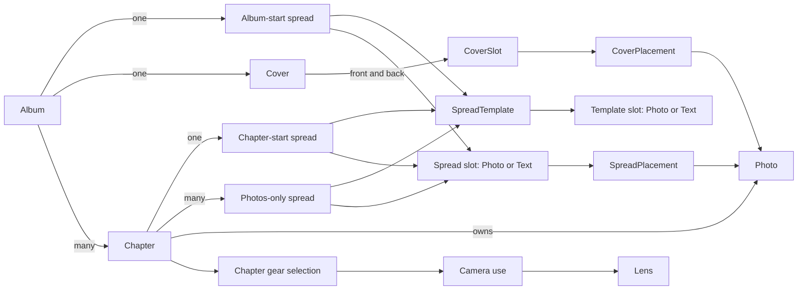

# Photography domain model

> Standard: [Agentic Engineering Standards](https://github.com/Adobe-AIFoundations/agentic-workflow-standards) v1.2.0. Lifetime: open from creation through implementation, archived per [the SDD skill's Archive PR phase](../../../../.agents/skills/sdd/SKILL.md).

**Date:** 2026-10-06

**Classification:** feature

**Grounded in:** A domain-modelling session.

**Implementation status:** PR #11 adds the declarative Scala domain types. Relational, lifecycle, and geometry invariants remain requirements for future use cases and adapters; they are not implemented as domain behavior.

## What & Why



These concepts are shared by the frontend and backend.

Define the domain model for the album layout tool.

## Domain / Design Notes

```scala
final case class Album(id: AlbumId, title: AlbumName, synopsis: String)
final case class Chapter(id: ChapterId, album: AlbumId, destination: DestinationId, description: String, period: VisitPeriod, position: PositionInAlbum, sourceFolder: RelativeLocation)
final case class Photo(id: PhotoId, chapter: ChapterId, source: RelativeLocation, maybeThumbnail: Option[RelativeLocation], maybeCapturedAt: Option[Instant], dimensions: PhotoDimensions, maybeCaption: Option[String])
final case class PhotoDimensions(width: PixelCount, height: PixelCount)
final case class VisitPeriod(start: Instant, end: Instant)

enum SpreadTemplateKind:
  case AlbumStart, ChapterStart, PhotosOnly

enum SpreadTemplateSlot:
  case Photo(box: SlotBox)
  case Text(box: SlotBox)

final case class SpreadTemplate(id: SpreadTemplateId, name: SpreadTemplateName, kind: SpreadTemplateKind, slots: NonEmptySet[SpreadTemplateSlot])

enum SpreadEdge:
  case Top, Bottom, Left, Right

final case class SlotBox(x: PositionOnSpread, y: PositionOnSpread, width: DistanceWithinSpread, height: DistanceWithinSpread)

enum SpreadSlot:
  case Photo(id: PhotoSpreadSlotId, spread: SpreadId, box: SlotBox, bleed: Set[SpreadEdge])
  case Text(id: TextSpreadSlotId, spread: SpreadId, box: SlotBox)

enum SpreadOwner:
  case Album(id: AlbumId)
  case Chapter(id: ChapterId)

sealed trait Spread:
  def id: SpreadId
  def template: SpreadTemplateId
  def kind: SpreadTemplateKind
  def owner: SpreadOwner

object Spread:
  final case class AlbumStart(id: SpreadId, album: AlbumId, template: SpreadTemplateId) extends Spread:
    val kind = SpreadTemplateKind.AlbumStart
    val owner = SpreadOwner.Album(album)

  final case class ChapterStart(id: SpreadId, chapter: ChapterId, template: SpreadTemplateId) extends Spread:
    val kind = SpreadTemplateKind.ChapterStart
    val owner = SpreadOwner.Chapter(chapter)

  final case class PhotosOnly(id: SpreadId, chapter: ChapterId, position: PositionInChapter, template: SpreadTemplateId) extends Spread:
    val kind = SpreadTemplateKind.PhotosOnly
    val owner = SpreadOwner.Chapter(chapter)

enum SpineOwner:
  case Front, Back

final case class Cover(album: AlbumId, spineOwner: SpineOwner, front: CoverSlot, back: CoverSlot)
final case class CoverSlot(id: CoverSlotId)

final case class Shift(x: InDesignPoints, y: InDesignPoints)
final case class PhotoTransform(shift: Shift, mirrored: Boolean, zoom: Zoom)
enum CaptionCorner:
  case TopLeft, TopRight, BottomLeft, BottomRight

final case class SpreadPlacement(id: SpreadPlacementId, slot: PhotoSpreadSlotId, photo: PhotoId, transform: PhotoTransform, captionCorner: CaptionCorner)
final case class CoverPlacement(id: CoverPlacementId, slot: CoverSlotId, photo: PhotoId, transform: PhotoTransform)

final case class Country(id: CountryId, code: CountryCode, name: CountryName, flag: AbsoluteLocation)
final case class Destination(id: DestinationId, name: DestinationName, country: CountryId)

enum CameraKind:
  case FixedLens, InterchangeableLens
final case class Camera(id: CameraId, code: CameraExifCode, friendlyName: CameraName, kind: CameraKind)
final case class Lens(id: LensId, code: LensExifCode, friendlyName: LensName, camera: CameraId)
enum CameraUse:
  case FixedLens
  case Interchangeable(lenses: NonEmptySet[LensId])
type GearSelection = NonEmptyMap[CameraId, CameraUse]
final case class ChapterGearSelection(chapter: ChapterId, selection: GearSelection)

final case class EditorSession(id: SessionId, owner: EditorId, lastHeartbeat: Instant)
enum EditingTarget:
  case Spread(id: SpreadId)
  case Cover(album: AlbumId)
final case class EditingLock(target: EditingTarget, session: SessionId)

enum DomainRejection:
  case ChapterLimitReached
  case ChapterPositionOccupied
  case DuplicatePhotoSource
  case DuplicateChapterSourceFolder
  case DuplicateReferenceCode
  case SpreadPositionOccupied
  case SpreadTemplateKindMismatch
  case InvalidSpreadTemplate
  case PhotoAlreadyPlaced
  case PhotoDoesNotCoverSlot
  case PhotoFromDifferentAlbum
  case SlotOccupied
  case PhotoFromDifferentChapter
  case InvalidGearSelection
  case LensRequiresInterchangeableCamera
  case IncompleteCover
```

## Invariants

- Each `Chapter` belongs to one `Album`; each `Photo` belongs to one `Chapter`.
- Chapter source folders are relative to the album photo root, and photo sources are relative to their chapter folder; locations cannot escape their owning root.
- Photo dimensions are positive pixel counts. Country codes contain two uppercase ASCII letters. Domain-specific names are nonempty.
- A persisted editor session is live from its last heartbeat through its derived expiry, excluding the expiry instant.

## Acceptance Criteria

- `Cover` is keyed by its album; a cover slot ID cannot be used by a spread placement, and a text-slot ID cannot be used by a photo placement.
- `Album` has exactly one `AlbumStart` and one `Cover`. Each `Chapter` has exactly one `ChapterStart`; an album has at most 20 chapters with unique positions `0..19`. Adding a 21st chapter is rejected as `ChapterLimitReached`; reusing a chapter position is rejected as `ChapterPositionOccupied`. Each spread retains its `SpreadTemplateId`; applying a template with a different kind is rejected as `SpreadTemplateKindMismatch`.
- `AlbumStart` and `ChapterStart` occupy implicit position zero; `PhotosOnly.position` begins at one.
- `PhotosOnly` positions are unique within a chapter; reusing one is rejected as `SpreadPositionOccupied`.
- Creating or changing a chapter to use a source folder already assigned to another chapter is rejected as `DuplicateChapterSourceFolder`.
- Photo source locations are unique within a chapter; duplicates are rejected as `DuplicatePhotoSource`. Country codes, camera EXIF codes, and lens EXIF codes are unique within their respective entity kinds; duplicates are rejected as `DuplicateReferenceCode`.
- A template must have exactly one text slot for album/chapter starts and only photo slots for `PhotosOnly`; invalid templates are rejected as `InvalidSpreadTemplate`.
- Applying a spread template creates the corresponding typed spread slots and copies each template slot's `SlotBox`. New photo slots have no bleed edges; only photo slots can have manually assigned bleed edges. Spread-slot order is spatial; no separate slot-order value is stored.
- Text slots render their owning album or chapter fields and have no separate text placement.
- Every `SlotBox` uses absolute positions and positive distances in InDesign points and fits within the Saal Digital 42 × 28 cm format's `2381.102 × 765.354 pt` two-page spread.
- A cover always has front and back slots with distinct `CoverSlotId`s. Its finished interior page count is twice the number of spreads in the album. Select the smallest listed Saal Digital cover specification whose page count is at least the finished interior count; counts above 130 use the 130-page specification. `SpineOwner` identifies the panel whose photo frame extends across the spine. Cover slots have no `SlotBox` or bleed edges. Cover placements are separate entities created only when a photo is assigned. A cover may remain incomplete while composed; completion requires placements for both slots, and attempting to complete it earlier is rejected as `IncompleteCover`.
- Each photo has at most one placement in an album, and each slot has at most one placement; duplicate assignments are rejected as `PhotoAlreadyPlaced` or `SlotOccupied`. Chapter spread placements may use only photos from their chapter; `AlbumStart` and cover placements may use any photo in the album. A photo from another chapter in the same album is rejected as `PhotoFromDifferentChapter`; a photo from another album is rejected as `PhotoFromDifferentAlbum`. A placed photo's transform consists of two-axis point shift, mirroring, and positive zoom with no independent upper limit; transforms that fail to cover the entire slot are rejected as `PhotoDoesNotCoverSlot`.
- `VisitPeriod` requires `start < end`. Country flags are absolute filesystem locations.
- A Lens belongs only to an `InterchangeableLens` camera; attempting to associate one with a `FixedLens` camera is rejected as `LensRequiresInterchangeableCamera`. A `FixedLens` camera uses `CameraUse.FixedLens`; an `InterchangeableLens` camera uses a nonempty `Interchangeable` lens set containing only its own lenses. Mismatched camera use or selecting a lens from another camera is rejected as `InvalidGearSelection`.
- An `EditorId` identifies one browser profile pseudonymously and remains stable across its tabs and reconnects. It is distinct from `User-Agent` metadata and any display alias, and does not authenticate a person. `EditorSession.id` identifies the active session; each `EditorId` has at most one live `EditorSession`.
- When a browser profile has no live session, its active tab creates one without a takeover prompt.
- Opening the app in another tab for the same `EditorId` while a session is live prompts the user to switch to the new tab or keep the existing tab. Keeping the existing tab leaves the new tab inactive and creates no session. Switching atomically removes the old `EditorSession`, releases its editing locks, and creates a new session for the same `EditorId`; requests using the old `SessionId` can no longer edit or renew the session.
- Business-rule rejections are `DomainRejection` cases. Missing records, lock/session outcomes, infrastructure failures, and changed/unchanged mutation reporting belong to the use-case layer.

## Doc Sync

- `specs/design.md` — Domain model: record finalized ownership and composition, template-instantiated spreads, page-count-specific Saal cover geometry, and one live editor session per browser profile with explicit tab takeover.

## Out of Scope

- TypeScript projections of the Scala domain model.
