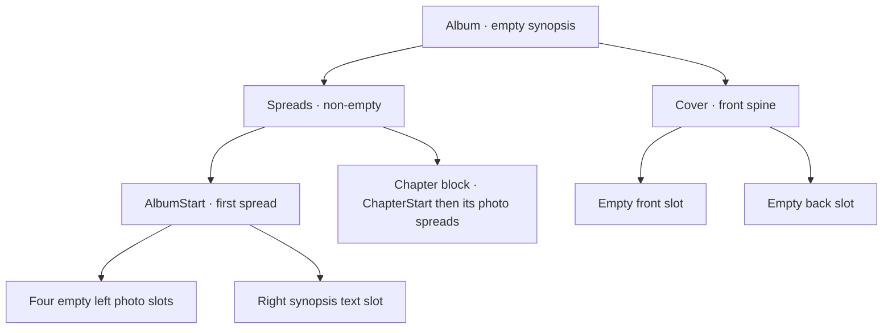

# Album dashboard and open

**Date:** 2026-10-07

**Classification:** feature

**Grounded in:**

- UI spike: six-album pages, centered add/edit popups, directional paging, and card-to-read-only-open.
- Persistence spike: create/read, blank-title rejection, missing vs. incomplete, rollback; V1 has no built-in template.

## What & Why

Replace the static entry point with a persisted-album dashboard at `/` where users add or rename albums, then open each album read-only at `/albums/{id}`.

## Domain / Design Notes

- The frontend is SolidJS/TypeScript. Use a typed, same-origin API client; fakes are test-only.

| Method and path | Request | Success |
|---|---|---|
| `GET /api/albums?page={page}` | `page` defaults to `1`; six per page | `200 {albums, page, pageSize, totalAlbums, totalPages}` |
| `POST /api/albums` | `{title}` | `201 {id, title, createdAt}` |
| `PATCH /api/albums/{id}` | `{title}` | `200 {id, title, createdAt}` |
| `GET /api/albums/{id}` | — | `200 {id, title, synopsis, createdAt}` |
| `DELETE /api/albums/{id}` | — | `204` no body |
| `GET /api/templates/album-start` | — | `200 {templates: [{id, name, slots: [{kind, x, y, width, height}]}]}` |

- An out-of-range page returns the last page; an empty collection returns page `1` with `totalPages: 0`.
- List entries contain `{id, title, createdAt}`. A supplied page must be a 32-bit integer; values below `1` select the first page, and malformed or repeated page parameters return `400 {message}`.
- JSON title requests require a string `title`; malformed JSON, missing or non-string titles, and blank trimmed titles return `400 {message}` with human-readable validation feedback.
- Missing-album responses are `{code: "album_not_found"}`; service-failure responses are `{code: "service_failure"}`. JSON responses use `application/json`.
- Template listing preserves ascending template-ID order and each template's slot order. Slot `kind` is `"photo"` or `"text"`; coordinates retain the catalog's geometry units.
- Generate a stable UUID and immutable UTC `createdAt` for each album; list newest-first.
- Seed four `AlbumStart` layouts from the legacy catalog: `1 Full L + Synopsis R`, `2×2 L + Synopsis R`, `3+2 L + Synopsis R`, and `P+2L L + Synopsis R`. Preserve their slot order and Saal 42×28 geometry, with synopsis always on the right; the template list API returns all four, and clients supply no template ID.
- Creating an album uses the `AlbumStart` template with the lowest ID.
- Album titles are nonempty after trimming; create and rename trim input before validation.
- SQLite enforces declared primary/foreign keys and unique chapter positions, with foreign-key checks enabled on every connection.
- Valid persisted albums have chapter positions `0..19`, matching spread/template kinds, all required template slots, and both cover sides. Application validation enforces these composition rules beyond database constraints.
- Creation validates and writes the complete initial shape in one transaction.

**Composition shape**

| Member | Shape |
|---|---|
| `album` | `{id, title, synopsis}`; metadata only. |
| `spreads` | Non-empty ordered list. The first spread is an `AlbumStart`; it is followed by chapter blocks, each a `ChapterStart` followed by that chapter's photo spreads. Each spread is `{id, templateId, slots, placements}` with slots in template order. |
| `cover` | `{spineOwner, front, back}`; each side is `{id, placement}`, with `null` for an empty placement. |
| Values | IDs are canonical UUID strings; absent optional values are `null`; empty collections are `[]`. |

New albums have a single `AlbumStart` spread with all slots of the selected template and empty placements. The lowest-ID seed is `2×2 L + Synopsis R`: four photo slots on the left and one synopsis text slot on the right. Slot and placement associations use stable IDs and arrays preserve template order.

## Tradeoffs Accepted

- Structured JSON validation and encoding add a JSON integration dependency at the HTTP boundary.

## Acceptance Criteria

### Dashboard

- `/` shows “Album Layout Studio” with subdued “Album dashboard”.
- Show six newest-first cards per page and centered Previous / Page / Next controls.
- Page changes slide directionally; keep the current page visible while loading.
- Cards use a 42:28 cover area, bottom title extension, compact type, and turquoise focus halo.
- Empty covers use a turquoise/azure placeholder; selecting a card opens `/albums/{id}`.
- Keep a single Add album action at the top right.
- An empty album collection leaves the album area blank.
- Show loading and retryable list-error states.

### Add and edit

- Center both popups; support keyboard and pointer use, restoring focus on close.
- Trim titles; blank input shows validation and remains available to correct.
- Blank or whitespace-only titles return `400` with validation feedback; no title-specific error code.
- Create closes its popup and adds a card; opening remains a separate user action.
- Rename updates only the title; failure preserves the edit input and shows an error.
- Delete requires explicit confirmation; cancel leaves the album unchanged.
- Successful deletion removes the card; pagination falls back to the last available page.

### Open and persist

- Selecting, directly opening, or reloading `/albums/{id}` loads that album read-only.
- The album page displays only its title and synopsis beneath navigation.
- `GET` returns the album metadata `{id, title, synopsis, createdAt}`; it does not return the composition.
- Show loading until album metadata arrives; failed loads never render partial success.
- New albums have a single `AlbumStart` spread and empty cover placements.
- Create the valid initial composition atomically using the `AlbumStart` template with the lowest ID.
- `GET /api/templates/album-start` returns the complete ordered catalog and slot geometry; listing failure returns `500 service_failure`.
- Malformed or unknown IDs on read, rename, or delete share `404 album_not_found`.
- Service/incomplete-state failures use `500 service_failure`.
- Service failures offer Retry; missing albums offer a route back to the dashboard.
- The backend serves app assets and API on one origin; `/api/*` remains JSON.
- `GET` and `HEAD` serve built assets with their media types; extensionless paths outside `/api`, `/health`, and `/assets` return the app entry point, including direct album links.
- Missing assets, dotted paths, and unsupported frontend methods return `404`; unmatched `/api` requests return `404 {code: "not_found"}` as JSON. Existing API and health responses take precedence.
- A backend build fails when the built frontend entry point is absent; the packaged backend includes the complete frontend asset tree.
- Dagger prepares frontend assets for remote checks; the local launcher installs locked frontend dependencies and builds assets before starting services. Preparation failures stop startup with an explicit error.
- A browser journey creates, lists, opens, reloads, renames, and deletes using real persistence.

## Doc Sync

- `specs/design.md` — Architecture constraints: state that all backend APIs use REST over HTTP.
- `specs/design.md` — Album composition: an album's spreads are non-empty and ordered; the first spread is an `AlbumStart`, followed by chapter blocks, each a `ChapterStart` followed by zero or more `PhotosOnly` spreads.
- `specs/contracts.md` — Contract inventory: identify SQLite migrations as the schema contract, including the four seeded AlbumStart layouts and connection-level foreign-key enforcement.
- `specs/contracts.md` — Contract inventory: point to the OpenAPI specification for the five album routes and AlbumStart-template listing, including request, response, pagination, and error contracts.
- `specs/operational.md` — Local service: the launcher installs locked frontend dependencies and builds assets before starting services; preparation failures stop startup.
