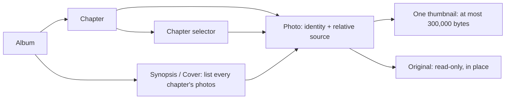
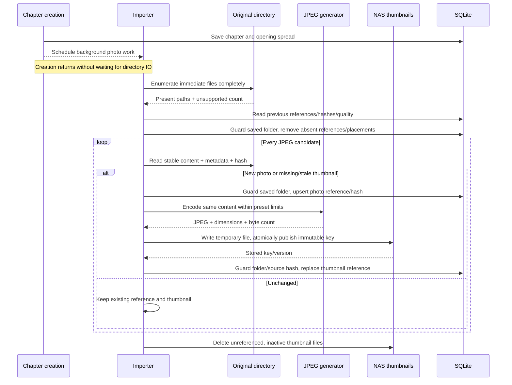

# Chapter photo import and browsing

**Date:** 2026-10-27

**Classification:** feature

**Grounded in:** Confirmed 18/210-photo spike; 228-photo Synopsis/Cover selectors; source-mutation, chronological-layout and thumbnail-only delivery checks.

## What & Why

Save a chapter and open its workspace without waiting for directory discovery or thumbnail generation. Process photos asynchronously; Synopsis and Cover show every chapter's photos.

## Domain / Design Notes



### Persisted contracts

| Record | SQLite enforcement | Application contract |
| --- | --- | --- |
| Photo | Primary key; chapter foreign key; unique chapter/source | Discover references independently of thumbnail completion; preserve identity across same-path edits. |
| Thumbnail metadata | Positive dimensions and bytes in `1..300000` via `CHECK`; ready fields all present or all absent via explicit null checks | Publish only after the thumbnail exists; never store copies of originals. |
| Placement | Photo foreign key with cascading deletion | Remove references on confirmed source deletion; preserve empty slots and their geometry. |

| Photo metadata | Persisted fields |
| --- | --- |
| Original reference | `chapter_id`, relative `source`, latest observed `source_hash`, local capture time, source dimensions. |
| Completed thumbnail | Optional key/version, `thumbnail_source_hash`, dimensions, bytes and quality; all thumbnail fields present together or absent together. |

SQLite stores references/metadata; NAS files store image bytes. Chapters have no imported flag or persisted processing lifecycle; progress/errors/unsupported counts describe current runtime work.

A missing thumbnail needs generation; a differing source hash or selected quality needs replacement. Keep the last completed thumbnail usable until its replacement commits.

Refresh hashes every JPEG's stable content, including unchanged filenames/timestamps/sizes. Regenerate on a different hash, preserving photo ID and placement.

Capture time uses nullable fixed-width ISO local date/time text with nine fractional digits; source/SQLite adapters validate representations and preserve chronological ordering.

Migrations preserve existing databases and legacy capture metadata. Populate local capture time from source EXIF, never reinterpret an epoch value using an assumed timezone.

### Domain values

```scala
enum ThumbnailQuality:
  case Low, Standard, High
```

| Value | Contract |
| --- | --- |
| Capture time | Camera-local EXIF date/time; missing/invalid dates become undated photos, not skipped JPEGs; never infer timezone or modification time. |
| Order | Capture time ascending, undated last; case-insensitive filename, exact filename, then chapter ID break ties. |
| Source | Immediate regular JPEG files (`.jpg`/`.jpeg`, case-insensitive); no recursion or symlink imports. |
| Thumbnail | One orientation-correct, uncropped JPEG; no upscale; selected quality sets resolution/byte ceilings, not target file size. |
| Ownership | Every photo belongs to exactly one chapter. Synopsis/Cover list all chapters' photos without changing ownership; chapter spreads list their chapter. |
| Counts / Refresh | Counts describe discovered references; ready images appear progressively. Synopsis/Cover Refresh reconciles every chapter's directory. |

### Thumbnail configuration and delivery

| Quality | Longest edge | Maximum encoded bytes |
| --- | ---: | ---: |
| Low | 1024px | 75,000 |
| Standard (default) | 1536px | 150,000 |
| High | 2048px | 300,000 |

```hocon
photography.thumbnails {
  quality = "standard"
  quality = ${?PHOTOGRAPHY_THUMBNAIL_QUALITY}
  root = "/thumbnails"
  root = ${?PHOTOGRAPHY_THUMBNAIL_ROOT}
}
```

PureConfig decodes the quality enum and absolute storage root at startup; unknown quality or invalid roots fail startup explicitly. Domain/use-case code receives typed settings.

Production mounts originals read-only and the thumbnail root read/write on the NAS array. SQLite stores locations/metadata only; temporary and final thumbnail writes use that same filesystem.

Refresh regenerates when source bytes or configured quality differ; ordinary opens retain completed images. Presets never create parallel published variants.

Use content/version-specific thumbnail URLs with `Cache-Control: private, max-age=31536000, immutable`; changed output receives a new URL. Inventory/status responses remain uncached.

The browser fetches thumbnails near the viewport rather than all album images eagerly. Preset ceilings bound transfer size; pixel ceilings bound decoded-image size.

### Use cases and ports

The following are effectful boundary contracts, not concrete adapter structure. Result alternatives below are closed; storage/transport representations stay at their adapters.

```scala
trait PhotoImporter[F[_]]:
  def refresh(chapter: ChapterId): F[RefreshResult]
  def recover(chapter: ChapterId): F[RecoveryResult]

trait PhotoBrowser[F[_]]:
  def listChapter(chapter: ChapterId): F[PhotoInventoryResult]
  def listAlbum(album: AlbumId): F[PhotoInventoryResult]
  def readThumbnail(photo: PhotoId, version: ThumbnailVersion): F[ThumbnailReadResult]

trait PhotoSources[F[_]]:
  def scan(folder: SourceFolder): F[SourceScanResult]
  def read(folder: SourceFolder, source: RelativeLocation): F[SourceReadResult]

trait ThumbnailGenerator[F[_]]:
  def generate(source: SourcePhoto, quality: ThumbnailQuality): F[ThumbnailGenerationResult]

trait ThumbnailFiles[F[_]]:
  def store(image: EncodedThumbnail): F[ThumbnailStoreResult]
  def read(key: ThumbnailKey): F[ThumbnailReadResult]
  def list(): F[ThumbnailListingResult]
  def delete(key: ThumbnailKey): F[ThumbnailDeleteResult]

trait PhotoRepository[F[_]]:
  def listChapter(chapter: ChapterId): F[PhotoListingResult]
  def listAlbum(album: AlbumId): F[PhotoListingResult]
  def referencedThumbnails(keys: Set[ThumbnailKey]): F[ReferencedThumbnailsResult]
  def saveSource(directory: PhotoDirectory, photo: DiscoveredPhoto): F[PhotoWriteResult]
  def saveThumbnail(directory: PhotoDirectory, source: PhotoSourceVersion, thumbnail: StoredThumbnail): F[PhotoWriteResult]
  def remove(directory: PhotoDirectory, photos: Set[PhotoId]): F[PhotoWriteResult]
```

| Contract value / result | Meaning / alternatives |
| --- | --- |
| `PhotoDirectory` | Chapter ID and saved source folder; persistence mutations check that the chapter still references that folder. |
| `SourcePhoto` | One stable read's content, hash, dimensions and optional local capture time; the encoder consumes that content, never rereads the path. |
| `DiscoveredPhoto` / `PhotoSourceVersion` | Chapter-owned identity, relative path, hash, capture time and dimensions / photo ID and expected source hash. |
| `StoredThumbnail` | Successfully stored key/version, source hash, dimensions, bytes and quality; publication checks the photo's current source hash. |
| `EncodedThumbnail` | JPEG bytes and validated positive dimensions/selected-preset byte limit. |
| `ThumbnailKey` / `ThumbnailVersion` | Managed relative file key / immutable output identifier, never original-source browser URLs. |
| `UnsupportedCount` | Nonnegative count of unsupported files in a complete scan. |
| `RefreshResult` / `RecoveryResult` | Queued or Coalesced / Resumed or Unchanged; both also distinguish ChapterNotFound and Failed. |
| `PhotoListingResult` | Found: saved directories, including empty chapters, and discovered photos with optional completed thumbnails; or NotFound / Failed. |
| `PhotoInventoryResult` | Found: listing, placement-derived counts and transient discovery/processing/error feedback; or NotFound / Failed. |
| `SourceScanResult` | Complete: candidate paths and unsupported count; or Failed. Partial enumeration is never Complete. |
| `SourceReadResult` | Read: `SourcePhoto`; or Undecodable / Unstable / Failed. Invalid EXIF dates produce a Read with absent capture time. |
| `ThumbnailGenerationResult` | Generated: `EncodedThumbnail`; or Failed. Encoding failure is not an undecodable-source skip. |
| `ThumbnailStoreResult` / `ThumbnailReadResult` | Stored: key/version / Read: JPEG bytes; or Failed. Reads also distinguish NotFound. |
| `ThumbnailListingResult` / `ThumbnailDeleteResult` | Listed keys / Deleted or AlreadyAbsent; both distinguish Failed. |
| `ReferencedThumbnailsResult` | Found: requested keys referenced anywhere in the database, across all albums; or Failed, which forbids cleanup deletion. |
| `PhotoWriteResult` | Saved / Superseded / ChapterNotFound / Failed; stale folder/source writes never change current references. |

Chapter creation saves metadata/composition and schedules photo work without waiting for enumeration, hashing, decoding or encoding, including API-only callers. The workspace opens immediately.

The importer owns runtime scheduling, coalescing, comparison and deletion decisions. Repositories atomically write supplied decisions; directory/image work stays outside the chapter-mutation lock.

First access to each directory after backend restart schedules background reconciliation, recovering even an interrupted discovery with no photo rows. Retained thumbnails display immediately.

Later opens reuse discovered references and schedule missing-thumbnail work; complete rescans require Refresh. Runtime feedback is rebuilt from current work, not a stored chapter status.

`PhotoBrowser` requests `PhotoImporter.recover` while listing, without waiting for scans; it reads repositories/thumbnail storage. HTTP consumes these use cases, never another adapter.

### Asynchronous photo processing



Per-directory runtime worker tokens reject superseded work. Folder saves invalidate tokens under the shared chapter-mutation lock, including an A-to-B-to-A change.

Before each persistence mutation, hold that lock through token validation and the atomic write. Scans, hashing and encoding run outside it; callbacks cannot revive canceled work.

Cleanup lists managed keys and queries their references across all albums before excluding in-flight keys. Publication coordinates with reference-check/deletion so cleanup cannot race a new reference.

SQLite and NAS have no shared transaction: store the file before committing its reference. A failed/superseded commit leaves an unused file for cleanup, never a dangling ready reference.

A crash after commit retains the ready image; before commit it leaves an orphan or a reference lacking a thumbnail. Next-open reconciliation recovers missing work without a chapter lifecycle.

| Event | Result |
| --- | --- |
| Folder change | Save the folder and clear previous references/placements atomically; invalidate old workers and schedule discovery without blocking on it. |
| Refresh / Retry | Start current-folder work; running imports publish ready photos progressively. |
| Complete enumeration | Remove absent references/placements; an empty directory succeeds. |
| Enumeration failure | Preserve previous references; report retryable failure, never an inferred empty folder. |
| Decode failure / unstable read | Skip replacement; keep a prior completed version, if any; no per-photo UI, at most a backend warning. |
| Overlapping requests | Coalesce per chapter; old-folder results cannot publish after a folder change. |
| Ordinary open | Show retained images immediately; schedule missing thumbnails, with background discovery on first access after restart. |
| Thumbnail replaced / reference removed | Delete unused thumbnails; protect live references and active imports; warn and retry failed cleanup on the next import. |

The spike's adapter is disposable evidence. Nonblocking discovery, progressive publication and recovery are production contracts, not claimed spike implementations.

## Acceptance Criteria

| ID | Observable outcome |
| --- | --- |
| I1 | Creation succeeds before a slow 200-file discovery unblocks; later discovery failure preserves the chapter, and work needs no browser request. |
| I2 | Folder save clears old references/placements and starts background discovery; neither creation nor save waits for scanning/image work. |
| I3 | Import immediate-folder JPEGs; count unsupported files and reject symlinks. |
| I4 | Skip undecodable JPEGs without per-photo UI; continue remaining files. |
| I5 | Ready thumbnails appear before a multi-photo import finishes. |
| I6 | Refresh detects additions and same-name edits by content hash, regenerating their thumbnails even when timestamps/file sizes are unchanged. |
| I7 | Confirmed deletion removes the photo and spread/cover placement, leaving its slot empty. |
| I8 | Empty folders succeed; failed enumeration preserves references and offers Retry. |
| I9 | Read/storage failures retain completed work and expose retryable failure. |
| I10 | Overlapping chapter requests share current work; superseded-folder results cannot publish. |
| I11 | Unstable reads warn without publishing mixed metadata/image; Refresh imports settled files. |
| I12 | Reopen displays retained thumbnails immediately; background recovery after restart includes discovery interrupted before any photo row existed. |
| I13 | Same-path edits preserve identity/placement; unchanged Refresh is idempotent. |
| T1 | Each preset accepts its exact byte ceiling and rejects ceiling + 1; no output exceeds 300,000 bytes. |
| T2 | Preserve orientation/proportions without upscaling at the stated resolution policy. |
| T3 | Browser delivery uses one thumbnail per photo; managed storage contains no copied originals or alternate variants. |
| T4 | Cleanup removes retired/crash-orphan files, preserves live/in-flight files across albums, and retries failures. |
| T5 | Environment overrides flow through HOCON/PureConfig; invalid settings fail startup, and unset quality selects Standard. |
| T6 | Quality changes regenerate on Refresh without changing photo identity/placement or publishing multiple variants. |
| T7 | Near-viewport loading and immutable version URLs permit cached reuse; changed thumbnails cannot reuse stale content URLs. |
| P1 | Collapsible left selectors show chapter photos on chapter spreads and all chapters' photos on Synopsis/Cover. |
| P2 | Every row, including the last, fills its width with whole uncropped images, small gutters and no padded cards. |
| P3 | Order displayed photos by capture time/filename with missing/invalid dates last; never reorder photos to fill gaps. |
| P4 | Mixed rows give portraits modest emphasis without cropping or nesting. |
| P5 | Show discovered photos' `unplaced / total`, derived from placements, with transient discovery/processing feedback rather than a chapter import state. |
| P6 | Compact icon button `Refresh photos` reconciles the chapter, or every chapter on Synopsis/Cover, and exposes pending status. |
| P7 | No photo preview, inspection, enlargement, click action or placement interaction. |
| P8 | One grip resizes by pointer/keyboard and collapses/restores the chosen width during workspace use. |
| P9 | Narrow layouts avoid page overflow; reduced-motion preferences are respected. |
| P10 | Malformed/failed inventory responses show retryable feedback; chapter switching recovers without reload. |
| P11 | Collapse removes hidden controls from focus order and transfers focus to the grip. |
| N1 | Noncollapsible above-editor navigation shows Synopsis, then individual spreads grouped by chapter. |
| N2 | Consistent layout miniatures have compact centered Synopsis/destination captions. |
| N3 | Captions omit chapter numbers/dates; accessible names distinguish photo spreads. |
| N4 | First/Previous/Next/Last and position count traverse without wrapping; endpoints expose accessible context. |
| N5 | Direct links, reload and Back retain selection; the selected tile stays discoverable. |
| N6 | Source folders remain editable in details, absent from workspace narration. |
| N7 | One selected country displays `Country`; multiple display `Countries`. |

## Invariants

- Preserve atomic chapter/opening-spread creation, album order/capacity, Cover and Reader behavior.

## Doc Sync

| Document | Section | Changed fact |
| --- | --- | --- |
| `specs/design.md` | Album workflow | Chapter-owned photos shown chapter-locally or across all chapters on Synopsis/Cover, accessible controls and grouped spread navigation. |
| `specs/design.md` | Values | JPEG eligibility, stable chapter/source identity, camera-local capture time and deterministic display ordering. |
| `specs/design.md` | Placements and gear | Asynchronous photo discovery/processing, thumbnail freshness, restart recovery, source-authoritative removal and single-thumbnail policy. |
| `specs/operational.md` | Production deployment | NAS read-only original/read-write thumbnail mounts, quality/root environment configuration, interrupted-import recovery and unused-thumbnail cleanup. |
