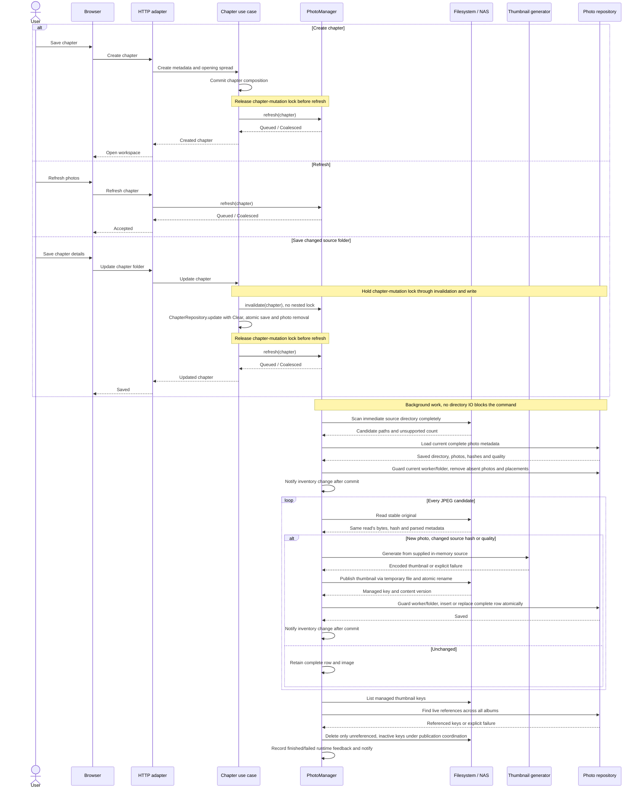
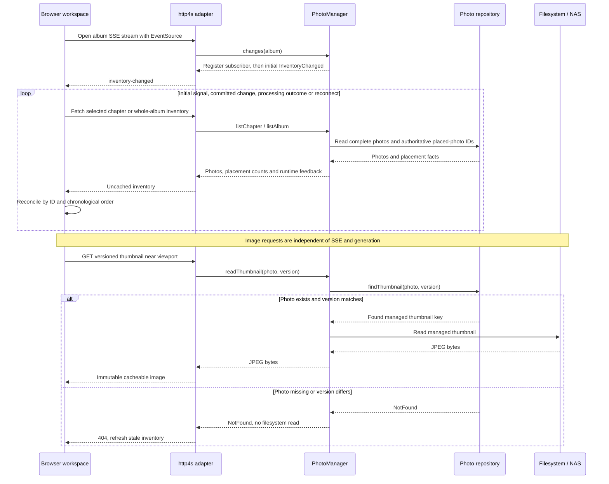

# Chapter photo import and browsing

**Date:** 2026-10-27

**Classification:** feature

**Grounded in:** Confirmed 18/210-photo spike; 228-photo Synopsis/Cover selectors; source-mutation, chronological-layout and thumbnail-only delivery checks.

## What & Why

Save a chapter and open its workspace without waiting for directory discovery or thumbnail generation. Process photos asynchronously; Synopsis and Cover show every chapter's photos.

## Domain / Design Notes

### Orchestration and boundaries

`PhotoManager` coordinates asynchronous reconciliation, browsing and change notifications. Inject the filesystem port, metadata repository and in-memory thumbnail-generator use case once at construction.

| Boundary | Owns |
| --- | --- |
| `PhotoManager[F]` use case | Schedule/coalesce work; compare hashes/quality; decide removals/replacements; publish complete rows; coordinate cleanup and notify subscribers. |
| `PhotoThumbnailGenerator` use case | Derive a thumbnail from supplied in-memory source content and injected quality settings; no filesystem/database access. |
| `PhotoFileSystem[F]` port / NAS adapter | Enumerate/read originals in place; publish/read/list/delete managed thumbnails in the separate application-owned root. Original locations are read-only. |
| `PhotoRepository[F]` port / SQLite adapter | Read photo metadata; atomically insert/replace complete rows and remove references/placements; query live thumbnail references across all albums. |
| http4s / browser adapters | Map commands, inventory, thumbnail reads and change streams to HTTP/SSE; reconcile UI inventory and fetch visible images. |

```scala
import fs2.Stream

trait PhotoManager[F[_]]:
  def refresh(chapter: ChapterId): F[RefreshResult]
  def invalidate(chapter: ChapterId): F[Unit]
  def listChapter(chapter: ChapterId): F[PhotoInventoryResult]
  def listAlbum(album: AlbumId): F[PhotoInventoryResult]
  def readThumbnail(photo: PhotoId, version: ThumbnailVersion): F[ThumbnailReadResult]
  def changes(album: AlbumId): Stream[F, PhotoEvent]

trait PhotoThumbnailGenerator:
  def generate(source: SourcePhoto): ThumbnailGenerationResult

trait PhotoFileSystem[F[_]]:
  def scan(folder: SourceFolder): F[SourceScanResult]
  def readSource(folder: SourceFolder, source: RelativeLocation): F[SourceReadResult]
  def storeThumbnail(image: EncodedThumbnail): F[ThumbnailStoreResult]
  def readThumbnail(key: ThumbnailKey): F[ThumbnailReadResult]
  def listThumbnails(): F[ThumbnailListingResult]
  def deleteThumbnail(key: ThumbnailKey): F[ThumbnailDeleteResult]

trait PhotoRepository[F[_]]:
  def listChapter(chapter: ChapterId): F[PhotoListingResult]
  def listAlbum(album: AlbumId): F[PhotoListingResult]
  def findThumbnail(photo: PhotoId, version: ThumbnailVersion): F[ThumbnailLookupResult]
  def referencedThumbnails(keys: Set[ThumbnailKey]): F[ReferencedThumbnailsResult]
  def saveReady(directory: PhotoDirectory, photo: ReadyPhoto): F[PhotoWriteResult]
  def remove(directory: PhotoDirectory, photos: Set[PhotoId]): F[PhotoWriteResult]
```

Reuse plant-journal's **Thumbnailator** library for EXIF-aware resizing/JPEG encoding. Its smallest-output fallback is unsuitable here: exceeding the selected byte ceiling fails generation explicitly.

| Existing seam | Changed contract |
| --- | --- |
| `ChapterRepository.update` | Add typed `photoReferences: PhotoReferencesChange` (`Keep` / `Clear`); one transaction commits chapter metadata/countries/order and, for Clear, deletes its photo/placement references while preserving slots. |
| `ChapterManager` | Inject PhotoManager; decide Clear only for a changed source folder. While holding the chapter-mutation lock, invalidate old workers and commit the supplied update; release before calling refresh. |
| `PhotoManager.invalidate` | Called with the chapter-mutation lock already held; invalidates tokens, marks old work canceled and notifies without reacquiring that lock. Failed chapter writes retain the old folder/photos; Refresh can restart canceled work. |
| `PhotoManager.refresh` | Acquire that same lock to read the current directory and register/coalesce work; release before scanning. Creation calls refresh only after committing and releasing its lock. |

### Creation / Refresh sequence

Chapter creation and explicit Refresh invoke the same `PhotoManager.refresh`. Folder saves schedule it after invalidating old work; Synopsis/Cover Refresh invokes it for every chapter.



Only successful generation/storage proceeds to row publication. A failed stage retains existing complete photos, records retryable failure and emits a notification; no partial row is inserted.

`refresh` returns after scheduling, including API-only callers. Scheduling failure is explicit; a committed chapter remains saved and the UI offers Refresh rather than repeating chapter creation.

### SSE inventory updates / lazy image delivery

http4s natively encodes `fs2.Stream[F, org.http4s.ServerSentEvent]` as `text/event-stream`. The HTTP adapter translates `PhotoEvent.InventoryChanged`; the core carries no SSE wire types.



| SSE contract | Guarantee |
| --- | --- |
| Subscription | One album stream per open workspace, covering chapter and Synopsis/Cover selectors; close on workspace exit/album change. |
| Signals | `InventoryChanged` invalidates inventory after committed insert/update/removal or runtime processing-state changes, including failures and completion. |
| Catch-up | Register before emitting the initial invalidation on every connection. Reconnection fetches current inventory; no durable event log or replay is required. |
| Coalescing | Bounded pending invalidation per subscriber; slow clients never block imports. Completion/failure remains visible in authoritative runtime feedback. |
| Client requests | Serialize/coalesce inventory fetches; an event during a fetch schedules another fetch. Discard responses from superseded selections; preserve selection, focus and scroll. |
| Disconnect | Show interrupted live-update feedback; `EventSource` reconnects. A stream interruption never declares processing complete or starts reconciliation. |
| Transport | HTTP/1.1 or HTTP/2; uncached SSE, heartbeat comments, proxy buffering disabled and long-lived-response timeouts configured. Thumbnail bytes never travel over SSE. |

Ordinary opens only read completed photos and current activity. After a backend crash, Refresh reruns reconciliation; opening/reconnecting does not start scanning or infer freshness from counts.

### Single photo table

Each row describes a fully parsed photo and its successfully stored thumbnail. Discovery/encoding alone inserts nothing; processing failures create no partial rows or broken-image placeholders.

```sql
CREATE TABLE photo (
  id TEXT PRIMARY KEY NOT NULL,
  chapter_id TEXT NOT NULL REFERENCES chapter (id) ON DELETE CASCADE,
  source TEXT NOT NULL,
  source_hash TEXT NOT NULL,
  captured_local TEXT,
  captured_at_ms INTEGER,
  width INTEGER NOT NULL CHECK (width > 0),
  height INTEGER NOT NULL CHECK (height > 0),
  thumbnail TEXT NOT NULL,
  thumbnail_version TEXT NOT NULL,
  thumbnail_width INTEGER NOT NULL CHECK (thumbnail_width > 0),
  thumbnail_height INTEGER NOT NULL CHECK (thumbnail_height > 0),
  thumbnail_quality TEXT NOT NULL
    CHECK (thumbnail_quality IN ('low', 'standard', 'high')),
  thumbnail_bytes INTEGER NOT NULL CHECK (thumbnail_bytes BETWEEN 1 AND
    CASE thumbnail_quality
      WHEN 'low' THEN 75000 WHEN 'standard' THEN 150000 WHEN 'high' THEN 300000
    END),
  caption TEXT,
  UNIQUE (chapter_id, source)
) STRICT;
```

`source` is relative to the chapter's directory; `thumbnail` is the managed NAS file key. `source_hash` identifies the original bytes used for this row and thumbnail.

`thumbnail_version` identifies encoded JPEG content for immutable URLs. Image bytes live on the NAS, never in SQLite; no separate thumbnail table or chapter-import lifecycle exists.

Refresh compares each stable read's hash/selected quality with the completed row. For replacements, keep the old row/image unchanged until one atomic update publishes all new metadata.

New photos insert only after the thumbnail file exists. Same-path replacements retain photo ID/caption/placement; existing photo foreign keys cascade placement deletion without deleting slots.

Capture time uses nullable fixed-width ISO local date/time text with nine fractional digits; source/SQLite adapters validate representations and preserve chronological ordering.

Migrations preserve existing databases and legacy capture metadata. Populate local capture time from source EXIF, never reinterpret an epoch value using an assumed timezone.

### Domain values

```scala
enum ThumbnailQuality:
  case Low, Standard, High

enum PhotoReferencesChange:
  case Keep, Clear
```

| Value | Contract |
| --- | --- |
| Capture time | Camera-local EXIF date/time; missing/invalid dates become undated photos, not skipped JPEGs; never infer timezone or modification time. |
| Order | Capture time ascending, undated last; case-insensitive filename, exact filename, then chapter ID break ties. |
| Source | Immediate regular JPEG files (`.jpg`/`.jpeg`, case-insensitive); no recursion or symlink imports. |
| Thumbnail | One orientation-correct, uncropped JPEG; no upscale; selected quality sets resolution/byte ceilings, not target file size. |
| Ownership | Every photo belongs to exactly one chapter. Synopsis/Cover list all chapters' photos without changing ownership; chapter spreads list their chapter. |
| Counts / Refresh | Counts describe completed photo rows; images appear progressively. Synopsis/Cover Refresh reconciles every chapter's directory. |

### Thumbnail configuration and delivery

| Quality | Longest edge | Maximum encoded bytes |
| --- | ---: | ---: |
| Low | 1024px | 75,000 |
| Standard (default) | 1536px | 150,000 |
| High | 2048px | 300,000 |

```hocon
photography.thumbnails {
  quality = "standard"
  quality = ${?PHOTOGRAPHY_THUMBNAIL_QUALITY}
  root = "/thumbnails"
  root = ${?PHOTOGRAPHY_THUMBNAIL_ROOT}
}
```

PureConfig decodes the quality enum and absolute storage root at startup; unknown quality or invalid roots fail startup explicitly. Domain/use-case code receives typed settings.

Production mounts originals read-only and the thumbnail root read/write on the NAS array. SQLite stores locations/metadata only; temporary and final thumbnail writes use that same filesystem.

Refresh regenerates when source bytes or configured quality differ; ordinary opens retain completed images. Presets never create parallel published variants.

Use content/version-specific thumbnail URLs with `Cache-Control: private, max-age=31536000, immutable`; changed output receives a new URL. Inventory/status responses remain uncached.

The browser fetches thumbnails near the viewport rather than all album images eagerly. Preset ceilings bound transfer size; pixel ceilings bound decoded-image size.

### Domain and result contracts

| Contract value / result | Meaning / alternatives |
| --- | --- |
| `PhotoDirectory` | Chapter ID and saved source folder; persistence mutations check that the chapter still references that folder. |
| `SourcePhoto` | One stable read's content, hash, dimensions and optional local capture time; the encoder consumes that content, never rereads the path. |
| `ReadyPhoto` | Chapter-owned identity, relative source, source hash, capture time, source dimensions and successfully stored thumbnail metadata; one complete row. |
| `EncodedThumbnail` | JPEG bytes and validated positive dimensions/selected-preset byte limit. |
| `ThumbnailKey` / `ThumbnailVersion` | Managed relative file key / immutable output identifier, never original-source browser URLs. |
| `PhotoReferencesChange` | Supplied chapter-write decision: Keep / Clear; use case decides whether the source folder changed, persistence atomically applies it. |
| `UnsupportedCount` | Nonnegative count of unsupported files in a complete scan. |
| `RefreshResult` | Queued / Coalesced / ChapterNotFound / Failed; acceptance means scheduled, not completed. |
| `PhotoEvent` | Closed `InventoryChanged` signal; subscribers read current inventory/activity rather than reconstructing state from event payloads. |
| `PhotoListingResult` | Found: saved directories, complete photos and placed-photo IDs derived from authoritative spread/cover placements in the requested chapter/album; or NotFound / Failed. |
| `PhotoInventoryResult` | Found: listing, placement-derived counts and transient discovery/processing/error feedback; or NotFound / Failed. |
| `ThumbnailLookupResult` | Found: managed key for the photo's current version; or NotFound for absent photo/version mismatch / Failed. Lookup failure forbids filesystem access and is not translated to NotFound. |
| `SourceScanResult` | Complete: candidate paths and unsupported count; or Failed. Partial enumeration is never Complete. |
| `SourceReadResult` | Read: `SourcePhoto`; or Undecodable / Unstable / Failed. Invalid EXIF dates produce a Read with absent capture time. |
| `ThumbnailGenerationResult` | Generated: `EncodedThumbnail`; or Failed. Encoding failure is not an undecodable-source skip. |
| `ThumbnailStoreResult` / `ThumbnailReadResult` | Stored: key/version / Read: JPEG bytes; or Failed. Reads also distinguish NotFound. |
| `ThumbnailListingResult` / `ThumbnailDeleteResult` | Listed keys / Deleted or AlreadyAbsent; both distinguish Failed. |
| `ReferencedThumbnailsResult` | Found: requested keys referenced anywhere in the database, across all albums; or Failed, which forbids cleanup deletion. |
| `PhotoWriteResult` | Saved / Superseded / ChapterNotFound / Failed; stale-folder writes never change current references. |

### Concurrency and failure boundaries

Per-directory runtime worker tokens reject superseded work. Folder saves invalidate tokens under the shared chapter-mutation lock, including an A-to-B-to-A change.

Before each persistence mutation, hold that lock through token validation and the atomic write. Scans, hashing and encoding run outside it; callbacks cannot revive canceled work.

Inventory counts derive from returned complete photos and placed-photo IDs; no stored unplaced flag or duplicated placement state. The repository reads placement facts, not placement policy.

Cleanup lists managed keys and queries their references across all albums before excluding in-flight keys. Publication coordinates with reference-check/deletion so cleanup cannot race a new reference.

SQLite and NAS have no shared transaction: store the file before committing its reference. A failed/superseded commit leaves an unused file for cleanup, never a dangling ready reference.

A crash after commit retains a complete photo. Before commit, a new photo has no row and an edited photo keeps its old row; the next Refresh retries and cleans unused files.

| Event | Result |
| --- | --- |
| Folder change | Save the folder and clear previous references/placements atomically; invalidate old workers and schedule discovery without blocking on it. |
| Refresh / Retry | Start current-folder work; running imports publish ready photos progressively. |
| Complete enumeration | Remove absent references/placements; an empty directory succeeds. |
| Enumeration failure | Preserve previous references; report retryable failure, never an inferred empty folder. |
| Decode failure / unstable read | Skip replacement; keep a prior completed version, if any; no per-photo UI, at most a backend warning. |
| Overlapping requests | Coalesce per chapter; old-folder results cannot publish after a folder change. |
| Ordinary open / restart | Show completed photos immediately; refresh inventory through SSE, and rerun interrupted processing only on explicit Refresh. |
| Thumbnail replaced / reference removed | Delete unused thumbnails; protect live references and active imports; warn and retry failed cleanup on the next import. |

The spike's adapter is disposable evidence. Production scheduling, SSE, concurrency and cleanup are specified contracts, not claimed spike implementations.

## Acceptance Criteria

| ID | Observable outcome |
| --- | --- |
| I1 | Creation succeeds before a slow 200-file discovery unblocks; later discovery failure preserves the chapter, and work needs no browser request. |
| I2 | Folder save/clearing commit atomically or roll back together; release the chapter lock before scheduling, and return without waiting for scanning/image work. |
| I3 | Import immediate-folder JPEGs; count unsupported files and reject symlinks. |
| I4 | Skip undecodable JPEGs without per-photo UI; continue remaining files. |
| I5 | Each new photo appears only after its complete row/thumbnail commit; earlier photos are browsable while others are processing. |
| I6 | Refresh detects additions and same-name edits by content hash, regenerating their thumbnails even when timestamps/file sizes are unchanged. |
| I7 | Confirmed deletion removes the photo and spread/cover placement, leaving its slot empty. |
| I8 | Empty folders succeed; failed enumeration preserves references and offers Retry. |
| I9 | Read/encoding/storage/database failures create no partial rows, retain completed photos and expose retryable failure. |
| I10 | Overlapping chapter requests share current work; superseded-folder results cannot publish. |
| I11 | Unstable reads warn without publishing mixed metadata/image; Refresh imports settled files. |
| I12 | Reopen/restart displays retained photos without scanning; explicit Refresh completes interrupted work, including a chapter with no photo rows. |
| I13 | Same-path edits retain the old complete row until atomic replacement, preserving ID/caption/placement; unchanged Refresh is idempotent. |
| T1 | Each preset accepts its exact byte ceiling and rejects ceiling + 1; no output exceeds 300,000 bytes. |
| T2 | Preserve orientation/proportions without upscaling at the stated resolution policy. |
| T3 | Browser delivery uses one thumbnail per photo; managed storage contains no copied originals or alternate variants. |
| T4 | Cleanup removes retired/crash-orphan files, preserves live/in-flight files across albums, and retries failures. |
| T5 | Environment overrides flow through HOCON/PureConfig; invalid settings fail startup, and unset quality selects Standard. |
| T6 | Quality changes regenerate on Refresh without changing photo identity/placement or publishing multiple variants. |
| T7 | Near-viewport loading and immutable version URLs permit cached reuse; changed thumbnails cannot reuse stale content URLs. |
| T8 | Thumbnail reads resolve photo/version through metadata before NAS access; missing/mismatched versions return NotFound, while lookup/storage failures remain explicit. |
| S1 | An album SSE subscription signals committed inventory changes and processing outcomes, including failures, without polling. |
| S2 | Initial connection/reconnection and changes during an inventory fetch converge to current inventory without missed updates or stale-selection responses. |
| S3 | Slow/disconnected subscribers never block processing; bounded notifications, disconnect feedback and stream teardown prevent unbounded work or leaked subscriptions. |
| P1 | Collapsible left selectors show chapter photos on chapter spreads and all chapters' photos on Synopsis/Cover. |
| P2 | Every row, including the last, fills its width with whole uncropped images, small gutters and no padded cards. |
| P3 | Order displayed photos by capture time/filename with missing/invalid dates last; never reorder photos to fill gaps. |
| P4 | Mixed rows give portraits modest emphasis without cropping or nesting. |
| P5 | Show completed photos' `unplaced / total`, derived from placements, with transient discovery/processing feedback and no broken-photo placeholders. |
| P6 | Compact circular `Refresh photos` icon matches the metadata pencil, with breathing room; reconciles the chapter or all chapters on Synopsis/Cover and exposes pending status. |
| P7 | No photo preview, inspection, enlargement, click action or placement interaction. |
| P8 | One grip resizes by pointer/keyboard and collapses/restores the chosen width during workspace use. |
| P9 | Narrow layouts avoid page overflow; reduced-motion preferences are respected. |
| P10 | Malformed/failed inventory responses show retryable feedback; chapter switching recovers without reload. |
| P11 | Collapse removes hidden controls from focus order and transfers focus to the grip. |
| N1 | Noncollapsible above-editor navigation shows Synopsis, then individual spreads grouped by chapter. |
| N2 | Consistent layout miniatures have compact centered Synopsis/destination captions. |
| N3 | Captions omit chapter numbers/dates; accessible names distinguish photo spreads. |
| N4 | First/Previous/Next/Last and position count traverse without wrapping; endpoints expose accessible context. |
| N5 | Direct links, reload and Back retain selection; the selected tile stays discoverable. |
| N6 | Source folders remain editable in details, absent from workspace narration. |
| N7 | One selected country displays `Country`; multiple display `Countries`. |

## Invariants

- Preserve atomic chapter/opening-spread creation, album order/capacity, Cover and Reader behavior.

## Doc Sync

| Document | Section | Changed fact |
| --- | --- | --- |
| `specs/design.md` | Album workflow | Chapter-owned photos shown chapter-locally or across all chapters on Synopsis/Cover, accessible controls and grouped spread navigation. |
| `specs/design.md` | Values | JPEG eligibility, stable chapter/source identity, camera-local ordering and one orientation-correct, uncropped, non-upscaled thumbnail with preset resolution/byte ceilings. |
| `specs/design.md` | Placements and gear | PhotoManager coordinates creation/Refresh processing through filesystem/metadata ports and Thumbnailator generation; complete-row publication, hash freshness, explicit restart retry and source-authoritative removal. |
| `specs/design.md` | Architecture constraints | REST commands/inventory/images plus http4s SSE invalidations; reconnect fetches authoritative inventory, independently of lazy thumbnail delivery. |
| `specs/operational.md` | Production deployment | NAS read-only original/read-write application-thumbnail mounts, quality/root configuration, Refresh after interruption, unused-thumbnail cleanup and unbuffered heartbeat-capable SSE proxy configuration. |
