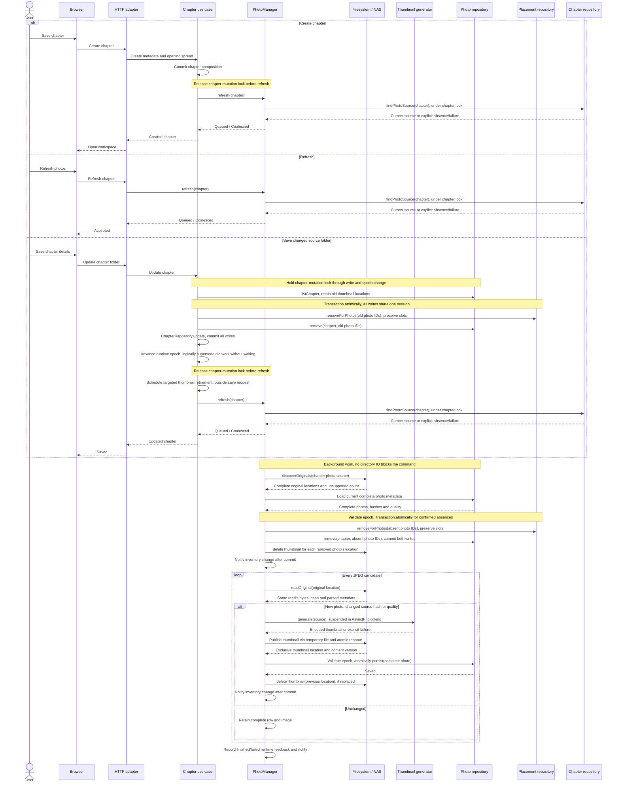
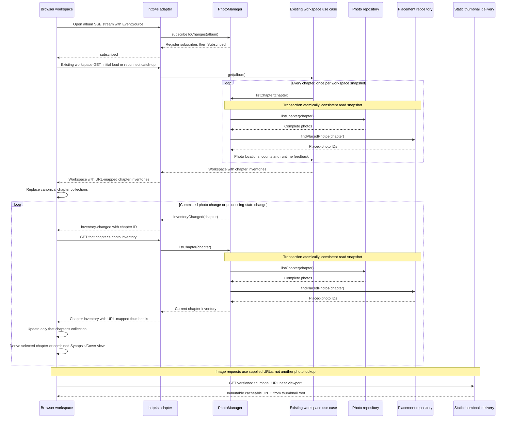

# Chapter photo import and browsing

**Date:** 2026-10-27

**Classification:** feature

**Grounded in:** Confirmed 18/210-photo spike; 228-photo Synopsis/Cover selectors; source-mutation, chronological-layout and thumbnail-only delivery checks.

## What & Why

Save a chapter and open its workspace without waiting for directory discovery or thumbnail generation. Process photos asynchronously; Synopsis and Cover show every chapter's photos.

## Domain / Design Notes

### Orchestration and boundaries

`PhotoManager` coordinates chapter reconciliation and inventory updates. Inject chapter/filesystem/photo/placement ports and the effectful thumbnail generator once; request transaction coordination through an `F` capability.

| Boundary | Owns |
| --- | --- |
| `PhotoManager[F]` use case | Schedule/coalesce work; compare hashes/quality; decide removals/replacements; publish complete rows; coordinate cleanup and notify subscribers. |
| `PhotoThumbnailGenerator[F]` use case | Generate from supplied in-memory content with injected quality settings; suspend Thumbnailator in `Async[F].blocking` (`IO.blocking` for IO), never on a compute thread. |
| `PhotoFileSystem[F]` port / NAS adapter | Discover/read originals in place; store/delete individual thumbnails in application-owned storage. Translate photo locations to filesystem paths and suspend filesystem IO; originals are read-only. |
| `PhotoRepository[F]` port / SQLite adapter | Read, persist and remove complete photo metadata only; placement and filesystem operations are outside this port. |
| `PhotoPlacementRepository[F]` port / SQLite adapter | Read placed-photo identities and remove placements for supplied photos, preserving slots; the use case selects the photos and orders these operations. |
| Existing workspace read / browser store | Load each chapter's inventory once; chapter selectors consume their collection, Synopsis/Cover combine/sort those same collections without another album-photo read. |
| http4s delivery | Adapt commands/inventory/SSE; serve versioned thumbnail URLs from the application thumbnail root through bounded static-file delivery, independently of PhotoManager. |

```scala
import fs2.Stream

trait PhotoManager[F[_]]:
  def refresh(chapter: ChapterId): F[RefreshResult]
  def listChapter(chapter: ChapterId): F[PhotoInventoryResult]
  def subscribeToChanges(album: AlbumId): Stream[F, PhotoEvent]

trait PhotoThumbnailGenerator[F[_]]:
  def generate(source: SourcePhoto): F[ThumbnailGenerationResult]
```

Driven ports supply only the filesystem and metadata operations consumed by reconciliation and chapter inventory reads:

```scala
trait PhotoFileSystem[F[_]]:
  def discoverOriginals(source: ChapterPhotoSource): F[OriginalDiscoveryResult]
  def readOriginal(location: OriginalPhotoLocation): F[OriginalPhotoReadResult]
  def storeThumbnail(image: EncodedThumbnail): F[ThumbnailStoreResult]
  def deleteThumbnail(location: ThumbnailLocation): F[ThumbnailDeleteResult]

trait PhotoRepository[F[_]]:
  def listChapter(chapter: ChapterId): F[PhotoListingResult]
  def persist(photo: Photo): F[PhotoWriteResult]
  def remove(chapter: ChapterId, photos: Set[PhotoId]): F[PhotoWriteResult]

trait PhotoPlacementRepository[F[_]]:
  def findPlacedPhotos(chapter: ChapterId): F[PlacedPhotosResult]
  def removeForPhotos(photos: Set[PhotoId]): F[PlacementRemovalResult]
```

The existing chapter repository gains `findPhotoSource(chapter: ChapterId): F[ChapterPhotoSourceResult]`, returning Found(source) / NotFound / Failed. Refresh reads this under the chapter lock, including for an empty chapter after restart.

```scala
trait Transaction[F[_]]:
  def atomically[A](
    operation: F[Either[PersistenceFailure, A]]
  ): F[Either[PersistenceFailure, A]]
```

Use cases request `Transaction` through an `F` context bound/accessor. Its scope binds chapter/photo/placement repositories to one session; Right commits, Left/error/cancellation rolls back, and inventory reads share that session's snapshot.

Participating adapters join the active session rather than independently committing. Use cases translate repository failure results into Left inside the scope; a missing session fails explicitly for transaction-required writes.

`ChapterPhotoSource` identifies the chapter's configured originals; `OriginalPhotoLocation` identifies one original within that source. Both are validated inputs, not discovery/read results; adapters resolve paths and enforce containment.

`ThumbnailLocation` identifies one application-owned thumbnail. Each stored publication has an exclusive location, even for identical content; targeted deletion therefore needs no cross-album reference scan.

Reuse plant-journal's **Thumbnailator** library for EXIF-aware resizing/JPEG encoding. Its smallest-output fallback is unsuitable here: exceeding the selected byte ceiling fails generation explicitly.

| Existing seam | Changed contract |
| --- | --- |
| `ChapterRepository.update` | Persist supplied chapter metadata/countries/order only; never invoke photo or placement operations. |
| `ChapterManager` | For a changed photo source, read old photos and coordinate placement removal, photo removal and chapter update in one transaction under the chapter lock. Advance the epoch after commit; schedule Refresh after releasing the lock. |
| `Transaction.atomically` | Enlist chapter/photo/placement operations in one session, including the existing independently committing chapter writes; commit all or roll back all. Adapters neither call each other nor decide which records to remove. |
| Internal coordination | ChapterManager and PhotoManager share application-lifetime coordination state and the existing chapter lock. Folder epochs/worker tokens reject A-to-B-to-A results; failed writes leave the epoch unchanged. No public invalidation use case. |
| `PhotoManager.refresh` | Under the same lock, read the current photo source/epoch and register/coalesce work; release before discovery. Workers hold the lock through epoch validation and writes; repositories persist supplied decisions. |
| `AlbumWorkspaceManager.get` | Include `PhotoManager.listChapter` results for every chapter in the existing workspace response; the UI stores one collection per chapter. A failed inventory is explicit, never an empty-success replacement. |

### Creation / Refresh sequence

Chapter creation and explicit Refresh invoke the same `PhotoManager.refresh`. Folder changes schedule it after commit; Synopsis/Cover Refresh invokes it for every chapter.



Only successful generation/storage proceeds to row publication. A failed stage retains existing complete photos, records retryable failure and emits a notification; no partial row is inserted.

After failed/superseded persistence, delete only that attempt's newly stored thumbnail; after successful replacement/removal, delete only the retired locations. Cleanup failure preserves the primary outcome and reports the failed location.

Source-change retirement runs under application supervision after commit, never delaying the save response or holding the chapter lock. A failed transaction retires no old thumbnails.

`refresh` returns after scheduling, including API-only callers. Scheduling failure is explicit; a committed chapter remains saved and the UI offers Refresh rather than repeating chapter creation.

### SSE inventory updates / lazy image delivery

http4s natively encodes `fs2.Stream[F, org.http4s.ServerSentEvent]` as `text/event-stream`. The adapter translates domain notifications; the core carries no SSE wire types.



| SSE contract | Guarantee |
| --- | --- |
| Subscription | One album stream per open workspace, covering chapter and Synopsis/Cover selectors; close on workspace exit/album change. |
| Signals | `InventoryChanged(chapter)` follows committed insert/update/removal or processing-state changes, including failures/completion. Subscription scope is album-wide; photo ownership and updates stay chapter-specific. |
| Catch-up | Register before emitting `Subscribed`; fetch the existing workspace once on initial connection/reconnect, not a second album-photo API. Buffer chapter invalidations arriving during that fetch, then reread affected chapters. |
| Coalescing | Coalesce pending chapter IDs per subscriber, bounded by the album's chapter set; slow clients never block processing. Outcomes remain visible in authoritative runtime feedback. |
| Client requests | Serialize/coalesce reads per chapter; an event during a read schedules another. Update chapter collections even when not selected; reject older responses and superseded-album responses, preserving focus/scroll. |
| Disconnect | Show interrupted live-update feedback; `EventSource` reconnects. A stream interruption never declares processing complete or starts reconciliation. |
| Transport | HTTP/1.1 or HTTP/2; uncached SSE, heartbeat comments, proxy buffering disabled and long-lived-response timeouts configured. Thumbnail bytes never travel over SSE. |

Ordinary opens only read completed photos and current activity. After a backend crash, Refresh reruns reconciliation; opening/reconnecting does not start scanning or infer freshness from counts.

### Single photo table

Each row describes a fully parsed photo and its successfully stored thumbnail. Discovery/encoding alone inserts nothing; processing failures create no partial rows or broken-image placeholders.

```sql
CREATE TABLE photo (
  id TEXT PRIMARY KEY NOT NULL,
  chapter_id TEXT NOT NULL REFERENCES chapter (id) ON DELETE CASCADE,
  source TEXT NOT NULL,
  source_hash TEXT NOT NULL,
  captured_local TEXT,
  captured_at_ms INTEGER,
  width INTEGER NOT NULL CHECK (width > 0),
  height INTEGER NOT NULL CHECK (height > 0),
  thumbnail TEXT NOT NULL,
  thumbnail_version TEXT NOT NULL,
  thumbnail_width INTEGER NOT NULL CHECK (thumbnail_width > 0),
  thumbnail_height INTEGER NOT NULL CHECK (thumbnail_height > 0),
  thumbnail_quality TEXT NOT NULL
    CHECK (thumbnail_quality IN ('low', 'standard', 'high')),
  thumbnail_bytes INTEGER NOT NULL CHECK (thumbnail_bytes BETWEEN 1 AND
    CASE thumbnail_quality
      WHEN 'low' THEN 75000 WHEN 'standard' THEN 150000 WHEN 'high' THEN 300000
    END),
  caption TEXT,
  UNIQUE (chapter_id, source)
) STRICT;
```

`source` is relative to the chapter's directory; `thumbnail` is the managed NAS file key. `source_hash` identifies the original bytes used for this row and thumbnail.

`thumbnail_version` identifies encoded JPEG content for immutable URLs. Image bytes live on the NAS, never in SQLite; no separate thumbnail table or chapter-import lifecycle exists.

Refresh compares each stable read's hash/selected quality with the completed row. For replacements, keep the old row/image unchanged until one atomic update publishes all new metadata.

New photos insert only after the thumbnail file exists. Same-path replacements retain photo ID/caption/placement; use cases explicitly remove placements before photo deletion in the same transaction, preserving slot geometry.

Capture time uses nullable fixed-width ISO local date/time text with nine fractional digits; source/SQLite adapters validate representations and preserve chronological ordering.

Migrations preserve existing databases and legacy capture metadata. Populate local capture time from source EXIF, never reinterpret an epoch value using an assumed timezone.

### Domain values

```scala
enum ThumbnailQuality:
  case Low, Standard, High

```

| Value | Contract |
| --- | --- |
| Capture time | Camera-local EXIF date/time; missing/invalid dates become undated photos, not skipped JPEGs; never infer timezone or modification time. |
| Order | Capture time ascending, undated last; case-insensitive filename, exact filename, then chapter ID break ties. |
| Source | Immediate regular JPEG files (`.jpg`/`.jpeg`, case-insensitive); no recursion or symlink imports. |
| Thumbnail | One orientation-correct, uncropped JPEG; no upscale; selected quality sets resolution/byte ceilings, not target file size. |
| Ownership | Every photo belongs to exactly one chapter. Synopsis/Cover list all chapters' photos without changing ownership; chapter spreads list their chapter. |
| Counts / Refresh | Counts describe completed photo rows; images appear progressively. Synopsis/Cover Refresh reconciles every chapter's directory. |

### Thumbnail configuration and delivery

| Quality | Longest edge | Maximum encoded bytes |
| --- | ---: | ---: |
| Low | 1024px | 75,000 |
| Standard (default) | 1536px | 150,000 |
| High | 2048px | 300,000 |

```hocon
photography.thumbnails {
  quality = "standard"
  quality = ${?PHOTOGRAPHY_THUMBNAIL_QUALITY}
  root = "/thumbnails"
  root = ${?PHOTOGRAPHY_THUMBNAIL_ROOT}
}
```

PureConfig decodes the quality enum and absolute storage root at startup; unknown quality or invalid roots fail startup explicitly. Domain/use-case code receives typed settings.

Production mounts originals read-only and the thumbnail root read/write on the NAS array. SQLite stores locations/metadata only; temporary and final thumbnail writes use that same filesystem.

Refresh regenerates when source bytes or configured quality differ; ordinary opens retain completed images. Presets never create parallel published variants.

Use immutable content-versioned file keys/URLs with `Cache-Control: private, max-age=31536000, immutable`; changed output receives a new key/URL. Inventory/status responses remain uncached.

Inventories include versioned application thumbnail URLs, never NAS/original paths. http4s static-file delivery serves only the thumbnail root, rejects traversal/symlink escapes and needs no photo-ID lookup or generator call.

The browser fetches those URLs near the viewport. Missing files return 404, read failures remain explicit; neither starts processing. Preset byte/pixel ceilings bound transfer and decoded-image size.

### Domain and result contracts

| Contract value / result | Meaning / alternatives |
| --- | --- |
| `ChapterPhotoSource` / `OriginalPhotoLocation` | Configured original-photo source / one original identified within that source; the location carries its source, so reading needs no separate root argument. |
| `SourcePhoto` | One stable read's content, hash, dimensions and optional local capture time; the encoder consumes that content, never rereads the path. |
| `Photo` | Chapter-owned identity, original location/hash, capture time/dimensions and successfully stored thumbnail metadata; a complete value, never a partial processing result. |
| `EncodedThumbnail` | JPEG bytes and validated positive dimensions/selected-preset byte limit. |
| `ThumbnailLocation` / `ThumbnailVersion` | Exclusive application-owned publication location / immutable output identifier; adapters translate locations to stored keys or browser URLs. |
| `UnsupportedCount` | Nonnegative count of unsupported files in a complete scan. |
| `RefreshResult` | Queued / Coalesced / ChapterNotFound / Failed; acceptance means scheduled, not completed. |
| `PhotoEvent` | `Subscribed` / `InventoryChanged(chapter: ChapterId)`; notifications trigger authoritative reads, not reconstruction from event history. |
| `PhotoListingResult` | Found: complete chapter photos; or NotFound / Failed. |
| `PlacedPhotosResult` / `PlacementRemovalResult` | Found: chapter photo IDs referenced by spread/cover placements; or Failed. Removal returns Removed / Failed, including already-empty selections as Removed. |
| `PhotoInventoryResult` | Found: photos with versioned thumbnail locations, placement-derived counts and transient work/error feedback; or NotFound / Failed. HTTP maps managed locations to application URLs. |
| `OriginalDiscoveryResult` | Complete: validated original locations and unsupported count; or Failed. Partial enumeration is never Complete. |
| `OriginalPhotoReadResult` | Read: `SourcePhoto`; or Undecodable / Unstable / Failed. Invalid EXIF dates produce a Read with absent capture time. |
| `ThumbnailGenerationResult` | Generated: `EncodedThumbnail`; or Failed. Encoding failure is not an undecodable-source skip. |
| `ThumbnailStoreResult` | Stored: exclusive thumbnail location/version; or Failed. |
| `ThumbnailDeleteResult` | Deleted / AlreadyAbsent / Failed. |
| `PhotoWriteResult` | Saved / ChapterNotFound / Failed; use-case epoch checks reject superseded work before persistence. |
| `PersistenceFailure` | ChapterNotFound / Failed; transaction failure channel populated from repository outcomes by the use case. |

### Concurrency and failure boundaries

Folder saves advance runtime epochs under the shared chapter-mutation lock, rejecting A-to-B-to-A results. Supersession only changes runtime state; it never waits for a worker.

Hold that lock through epoch validation and each atomic write. Scans/encoding run outside it; application-owned supervision handles physical termination/finalization without delaying saves or holding the chapter lock.

Inventory counts derive from complete photos and the placement repository's authoritative IDs, read in one consistent snapshot; no stored unplaced flag or duplicated placement state.

Cleanup is per-photo compensation or retirement, using locations already known to the use case. Exclusive publication locations prevent one photo's cleanup from deleting another photo's thumbnail.

Stored-file ownership and commit/retirement handoffs are cancellation-safe. Before a proven commit, cancellation finalizes the attempt's file; after commit, that file is live and only previous locations pass to supervised retirement.

Register retirement before exposing a committed result to cancellation; cleanup outlives the originating request/worker. Resolve commit outcome before compensation, never treating cancellation alone as proof of rollback.

SQLite and NAS have no shared transaction: store the file before committing its reference. Failed/superseded persistence triggers deletion of that attempt's file, never the existing photo's thumbnail.

A crash after commit retains a complete photo. Before commit, a new photo has no row and an edited photo keeps its old row; the next Refresh retries import, without a global storage sweep.

Only complete enumeration permits absence deletion; failed enumeration preserves photos. Undecodable/unstable files skip replacement, retaining any previous version; thumbnail deletion failures explicitly report retained files.

The spike's adapter is disposable evidence. Production scheduling, SSE, concurrency and cleanup are specified contracts, not claimed spike implementations.

## Acceptance Criteria

| ID | Observable outcome |
| --- | --- |
| I1 | Creation succeeds before a slow 200-file discovery unblocks; later discovery failure preserves the chapter, and work needs no browser request. |
| I2 | Folder save/clearing commit atomically or roll back together; release the lock before scheduling, without waiting for old/new scanning or image work. |
| I3 | Import immediate-folder JPEGs; count unsupported files and reject symlinks. |
| I4 | Skip undecodable JPEGs without per-photo UI; continue remaining files. |
| I5 | Each new photo appears only after its complete row/thumbnail commit; earlier photos are browsable while others are processing. |
| I6 | Refresh detects additions and same-name edits by content hash, regenerating their thumbnails even when timestamps/file sizes are unchanged. |
| I7 | Confirmed deletion removes the photo and spread/cover placement, leaving its slot empty. |
| I8 | Empty folders succeed; failed enumeration preserves references and offers Retry. |
| I9 | Read/encoding/storage/database failures create no partial rows, retain completed photos and expose retryable failure. |
| I10 | Overlapping chapter requests share current work; superseded-folder results cannot publish. |
| I11 | Unstable reads warn without publishing mixed metadata/image; Refresh imports settled files. |
| I12 | Reopen/restart displays retained photos without scanning; explicit Refresh completes interrupted work, including a chapter with no photo rows. |
| I13 | Same-path edits retain the old complete row until atomic replacement, preserving ID/caption/placement; unchanged Refresh is idempotent. |
| T1 | Each preset accepts its exact byte ceiling and rejects ceiling + 1; no output exceeds 300,000 bytes. |
| T2 | Preserve orientation/proportions without upscaling at the stated resolution policy. |
| T3 | Browser delivery uses one thumbnail per photo; managed storage contains no copied originals or alternate variants. |
| T4 | Cancellation at storage/commit/retirement handoffs preserves live files and completes targeted cleanup; rollback deletes only the new file, commit retires only previous files, and deletion failures remain explicit. |
| T5 | Environment overrides flow through HOCON/PureConfig; invalid settings fail startup, and unset quality selects Standard. |
| T6 | Quality changes regenerate on Refresh without changing photo identity/placement or publishing multiple variants. |
| T7 | Near-viewport loading and immutable version URLs permit cached reuse; changed thumbnails cannot reuse stale content URLs. |
| T8 | Supplied thumbnail URLs serve only managed files without photo lookup or generation; missing files return 404, and traversal/symlink escapes cannot expose originals. |
| T9 | Thumbnail generation is suspended in F's blocking facility; while a generation call is blocked, unrelated compute-fiber work remains responsive. |
| S1 | One album SSE subscription identifies changed chapters and processing outcomes; UI updates each chapter collection and derives Synopsis/Cover without a separate album-photo read. |
| S2 | Initial connection/reconnection and changes during an inventory fetch converge to current inventory without missed updates or stale-selection responses. |
| S3 | Slow/disconnected subscribers never block processing; bounded notifications, disconnect feedback and stream teardown prevent unbounded work or leaked subscriptions. |
| P1 | Collapsible left selectors show chapter photos on chapter spreads and all chapters' photos on Synopsis/Cover. |
| P2 | Every row, including the last, fills its width with whole uncropped images, small gutters and no padded cards. |
| P3 | Order displayed photos by capture time/filename with missing/invalid dates last; never reorder photos to fill gaps. |
| P4 | Mixed rows give portraits modest emphasis without cropping or nesting. |
| P5 | Show completed photos' `unplaced / total`, derived from placements, with transient discovery/processing feedback and no broken-photo placeholders. |
| P6 | Compact circular `Refresh photos` icon matches the metadata pencil, with breathing room; reconciles the chapter or all chapters on Synopsis/Cover and exposes pending status. |
| P7 | No photo preview, inspection, enlargement, click action or placement interaction. |
| P8 | One grip resizes by pointer/keyboard and collapses/restores the chosen width during workspace use. |
| P9 | Narrow layouts avoid page overflow; reduced-motion preferences are respected. |
| P10 | Malformed/failed inventory responses show retryable feedback; chapter switching recovers without reload. |
| P11 | Collapse removes hidden controls from focus order and transfers focus to the grip. |
| N1 | Noncollapsible above-editor navigation shows Synopsis, then individual spreads grouped by chapter. |
| N2 | Consistent layout miniatures have compact centered Synopsis/destination captions. |
| N3 | Captions omit chapter numbers/dates; accessible names distinguish photo spreads. |
| N4 | First/Previous/Next/Last and position count traverse without wrapping; endpoints expose accessible context. |
| N5 | Direct links, reload and Back retain selection; the selected tile stays discoverable. |
| N6 | Source folders remain editable in details, absent from workspace narration. |
| N7 | One selected country displays `Country`; multiple display `Countries`. |

## Invariants

- Preserve atomic chapter/opening-spread creation, album order/capacity, Cover and Reader behavior.

## Tradeoffs Accepted

A crash between file publication and metadata persistence or retirement can leave an unused thumbnail. Operators retain that storage cost; this feature performs targeted deletion, not global orphan collection.

## Doc Sync

| Document | Section | Changed fact |
| --- | --- | --- |
| `specs/design.md` | Album workflow | Chapter-owned photos shown chapter-locally or across all chapters on Synopsis/Cover, accessible controls and grouped spread navigation. |
| `specs/design.md` | Values | JPEG eligibility, stable chapter/source identity, camera-local ordering and one orientation-correct, uncropped, non-upscaled thumbnail with preset resolution/byte ceilings. |
| `specs/design.md` | Placements and gear | PhotoManager coordinates creation/Refresh processing through filesystem/metadata ports and Thumbnailator generation; complete-row publication, hash freshness, explicit restart retry and source-authoritative removal. |
| `specs/design.md` | Architecture constraints | Effectful blocking thumbnail generation; initial workspace chapter inventories, chapter-addressed http4s SSE catch-up and derived album views, independently of lazy static thumbnail delivery. |
| `specs/operational.md` | Production deployment | NAS read-only original/read-write application-thumbnail mounts, quality/root configuration, Refresh after interruption, unused-thumbnail cleanup and unbuffered heartbeat-capable SSE proxy configuration. |
