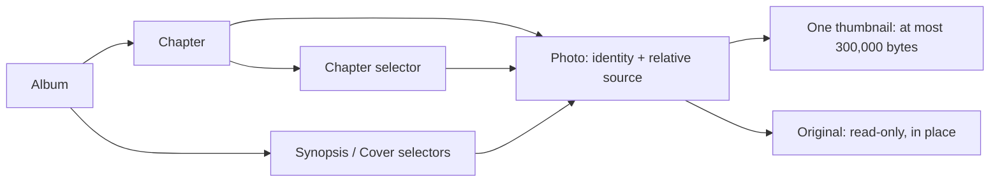
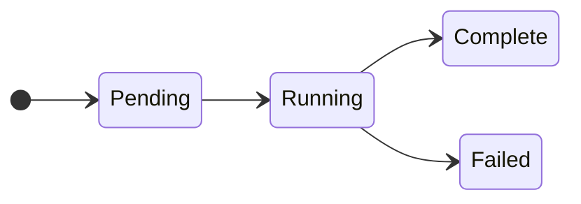

# Chapter photo import and browsing

**Date:** 2026-10-27

**Classification:** feature

**Grounded in:** Confirmed 18/210-photo spike; 228-photo Synopsis/Cover selectors; source-mutation, chronological-layout and thumbnail-only delivery checks.

## What & Why

Chapters currently store only a source folder. Import photo references and thumbnails for chapter browsing, with album-wide selectors for Synopsis and Cover.

## Domain / Design Notes



### Persisted contracts

| Record | SQLite enforcement | Application contract |
| --- | --- | --- |
| Photo | Primary key; chapter foreign key; unique chapter/source | Stable identity across same-path edits; relative source stays inside its chapter folder. |
| Thumbnail metadata | Positive dimensions and bytes in `1..300000` via `CHECK`; ready fields all present or all absent via explicit null checks | Publish only after the thumbnail exists; never store copies of originals. |
| Import state | Chapter primary/foreign key; nonnegative generation/count and closed statuses via `CHECK` | Persist pending/running/complete/failed state; reject superseded-generation writes. |
| Placement | Photo foreign key with cascading deletion | Remove references on confirmed source deletion; preserve empty slots and their geometry. |

```sql
CREATE TABLE chapter_photo_import (
  chapter_id TEXT PRIMARY KEY NOT NULL
    REFERENCES chapter (id) ON DELETE CASCADE,
  generation INTEGER NOT NULL CHECK (generation >= 0),
  status TEXT NOT NULL
    CHECK (status IN ('pending', 'running', 'complete', 'failed')),
  unsupported_count INTEGER NOT NULL CHECK (unsupported_count >= 0)
) STRICT;
```

Photo metadata retains the source content hash. Current-generation checks and photo writes are atomic; source hashes detect changed bytes, not just timestamps or sizes.

Capture time uses nullable fixed-width ISO local date/time text with nine fractional digits; source/SQLite adapters validate representations and preserve chronological ordering.

Migrations preserve existing databases and legacy capture metadata. Populate local capture time from source EXIF, never reinterpret an epoch value using an assumed timezone.

### Domain values

```scala
enum PhotoScope:
  case Chapter(id: ChapterId)
  case Album(id: AlbumId)

enum ImportStatus:
  case Pending, Running, Complete, Failed
```

| Value | Contract |
| --- | --- |
| Capture time | Camera-local EXIF date/time; missing/invalid dates become undated photos, not skipped JPEGs; never infer timezone or modification time. |
| Order | Capture time ascending, undated last; case-insensitive filename, exact filename, then chapter ID break ties. |
| Source | Immediate regular JPEG files (`.jpg`/`.jpeg`, case-insensitive); no recursion or symlink imports. |
| Thumbnail | One orientation-correct, uncropped JPEG; no upscale; useful detail up to a 2048px longest edge within the byte limit. |
| Selector scope | Chapter for chapter spreads; all album chapters for Synopsis and Cover; counts and Refresh use the same scope. |

### Import lifecycle



| Event | Result |
| --- | --- |
| Folder change | Atomically clear previous photo references/placements and advance the import generation with the saved folder. |
| Refresh / Retry | Start current-folder work; running imports publish ready photos progressively. |
| Complete enumeration | Remove absent references/placements; an empty directory succeeds. |
| Enumeration failure | Preserve previous references; report retryable failure, never an inferred empty folder. |
| Decode failure / unstable read | Skip replacement; keep a prior completed version, if any; no per-photo UI, at most a backend warning. |
| Overlapping requests | Coalesce per chapter; old-folder results cannot publish after a folder change. |
| Ordinary open | Read retained inventory; recover interrupted imports, otherwise rescan only on Refresh. |
| Thumbnail replaced / reference removed | Delete unused thumbnails; protect live references and active imports; warn and retry failed cleanup on the next import. |

The spike's adapter is disposable evidence. Backend-triggered import, progressive publication and durable coordination are production contracts, not claimed spike implementations.

## Acceptance Criteria

| ID | Observable outcome |
| --- | --- |
| I1 | Chapter creation starts import without a browser request; unavailable folders do not undo chapter creation. |
| I2 | Saving a changed folder clears old references/placements and starts its import. |
| I3 | Import immediate-folder JPEGs; count unsupported files and reject symlinks. |
| I4 | Skip undecodable JPEGs without per-photo UI; continue remaining files. |
| I5 | Ready thumbnails appear before a multi-photo import finishes. |
| I6 | Refresh detects additions and changed bytes, including unchanged filenames, timestamps and file sizes. |
| I7 | Confirmed deletion removes the photo and spread/cover placement, leaving its slot empty. |
| I8 | Empty folders succeed; failed enumeration preserves references and offers Retry. |
| I9 | Read/storage failures retain completed work and expose retryable failure. |
| I10 | Overlapping chapter requests share current work; superseded-folder results cannot publish. |
| I11 | Unstable reads warn without publishing mixed metadata/image; Refresh imports settled files. |
| I12 | Completed thumbnails survive reload/restart; next open recovers interrupted work. |
| I13 | Same-path edits preserve identity/placement; unchanged Refresh is idempotent. |
| T1 | Accept thumbnails up to 300,000 bytes; reject 300,001-byte output. |
| T2 | Preserve orientation/proportions without upscaling at the stated resolution policy. |
| T3 | Browser delivery uses one thumbnail per photo; managed storage contains no copied originals or alternate variants. |
| T4 | Replacement/deletion retires old thumbnails; unused-file cleanup retries after failure. |
| P1 | Chapter, Synopsis and Cover each expose their scoped collapsible left photo selector. |
| P2 | Every row, including the last, fills its width with whole uncropped images, small gutters and no padded cards. |
| P3 | Apply scoped capture-time/filename order with missing/invalid dates last; never reorder photos to fill gaps. |
| P4 | Mixed rows give portraits modest emphasis without cropping or nesting. |
| P5 | Show scope-wide `unplaced / total`, derived from spread/cover placements, with pending import status. |
| P6 | Compact workspace-style icon button `Refresh photos` reconciles every scoped chapter and exposes pending status. |
| P7 | No photo preview, inspection, enlargement, click action or placement interaction. |
| P8 | One grip resizes by pointer/keyboard and collapses/restores the chosen width during workspace use. |
| P9 | Narrow layouts avoid page overflow; reduced-motion preferences are respected. |
| P10 | Malformed/failed inventory responses show retryable feedback; chapter switching recovers without reload. |
| P11 | Collapse removes hidden controls from focus order and transfers focus to the grip. |
| N1 | Noncollapsible above-editor navigation shows Synopsis, then individual spreads grouped by chapter. |
| N2 | Consistent layout miniatures have compact centered Synopsis/destination captions. |
| N3 | Captions omit chapter numbers/dates; accessible names distinguish photo spreads. |
| N4 | First/Previous/Next/Last and position count traverse without wrapping; endpoints expose accessible context. |
| N5 | Direct links, reload and Back retain selection; the selected tile stays discoverable. |
| N6 | Source folders remain editable in details, absent from workspace narration. |
| N7 | One selected country displays `Country`; multiple display `Countries`. |

## Invariants

- Preserve atomic chapter/opening-spread creation, album order/capacity, Cover and Reader behavior.

## Doc Sync

| Document | Section | Changed fact |
| --- | --- | --- |
| `specs/design.md` | Album workflow | Scoped chapter/album photo selectors, accessible resize/collapse/Refresh, grouped spread navigation and metadata presentation. |
| `specs/design.md` | Values | JPEG scope, stable source identity, camera-local capture time and deterministic scoped ordering. |
| `specs/design.md` | Placements and gear | Progressive import lifecycle, coordination, original-authoritative reference removal and single-thumbnail policy. |
| `specs/contracts.md` | Contract inventory | Authoritative photo/import SQLite constraints and inventory/status/Refresh/thumbnail HTTP contracts. |
| `specs/operational.md` | Local service | Read-only sources, thumbnail storage configuration, interrupted-import recovery and unused-thumbnail cleanup. |
