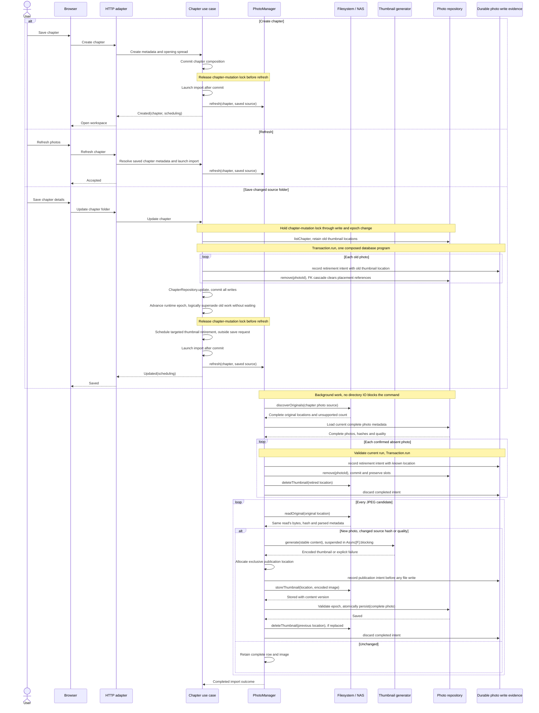
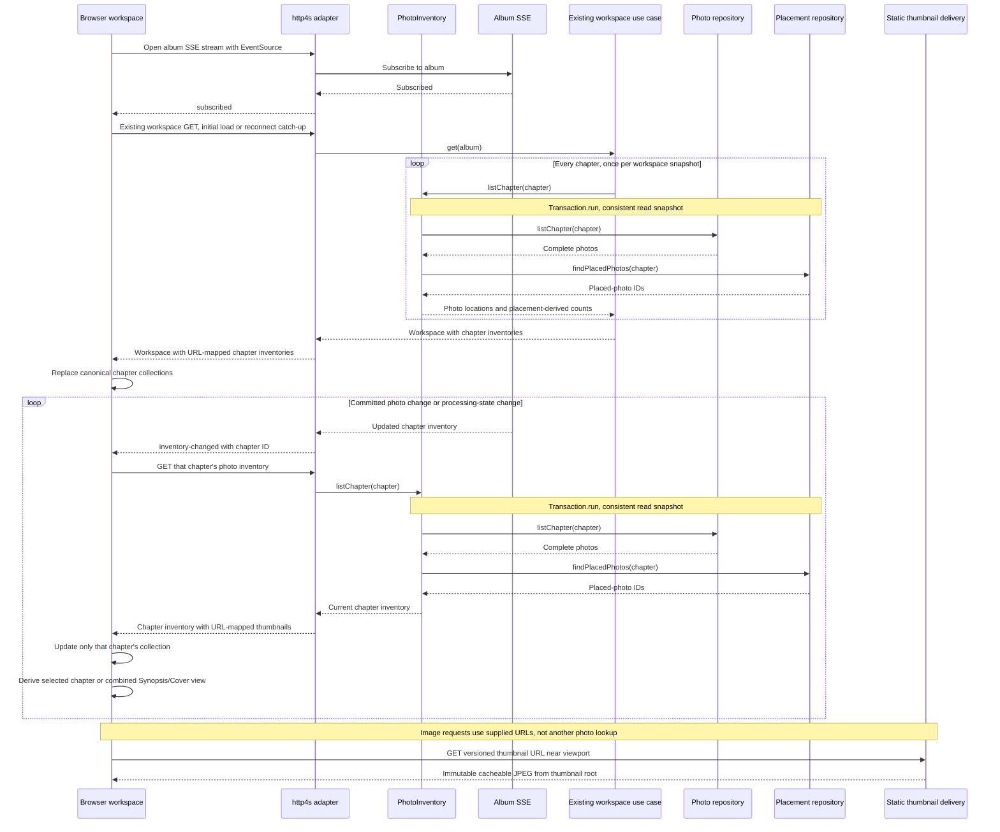

# Chapter photo import and browsing

**Date:** 2026-10-27

**Classification:** feature

**Grounded in:** Confirmed 18/210-photo spike; 228-photo Synopsis/Cover selectors; source-mutation, chronological-layout and thumbnail-only delivery checks.

## What & Why

Save a chapter and open its workspace without waiting for directory discovery or thumbnail generation. Process photos asynchronously; Synopsis and Cover show every chapter's photos.

## Domain / Design Notes

### Orchestration and boundaries

`PhotoManager` composes filesystem, photo repository and thumbnail generator. The caller supplies chapter/source metadata and launches import; inventory reads and album SSE remain separate.

| Boundary | Owns |
| --- | --- |
| `PhotoManager[F]` use case | Reconcile supplied chapter/source metadata: compare hashes/quality, generate/store thumbnails and persist complete photos through its three collaborators. |
| `PhotoInventory[F]` use case | Compose photo/placement reads in one database snapshot, order the returned view and derive counts. |
| `PhotoThumbnailGenerator[F]` use case | Generate from supplied in-memory content with injected quality settings; suspend Thumbnailator in `Async[F].blocking` (`IO.blocking` for IO), never on a compute thread. |
| `PhotoStorage[F]` port / NAS adapter | Discover/read originals in place; store/delete individual thumbnails in application-owned storage. Translate photo locations to filesystem paths and suspend filesystem IO; originals are read-only. |
| `PhotoRepository[Db]` port / SQLite adapter | Read/save/remove complete photos and durable photo-write evidence; placement and filesystem operations remain separate. |
| `PhotoPlacementRepository[F]` port / SQLite adapter | Read authoritative placed-photo identities for counts. Existing foreign-key cascades enforce reference integrity on photo deletion, preserving slots; no placement-write API is needed. |
| Durable photo write evidence | Photo persistence records per-photo publication/retirement intents before effects; startup finalization consumes them, following plant-journal. This is technical write evidence, not chapter import status. |
| Existing workspace read / browser store | Load each chapter's inventory once; chapter selectors consume their collection, Synopsis/Cover combine/sort those same collections without another album-photo read. |
| http4s delivery | Adapt commands/inventory/SSE; serve versioned thumbnail URLs from the application thumbnail root through bounded static-file delivery, independently of PhotoManager. |

```scala
trait PhotoManager[F[_]]:
  def refresh(chapter: ChapterId, source: PhotoSource): F[RefreshResult]

trait PhotoInventory[F[_]]:
  def listChapter(chapter: ChapterId): F[PhotoInventoryResult]

trait PhotoThumbnailGenerator[F[_]]:
  def quality: ThumbnailQuality
  def generate(content: PhotoContent): F[ThumbnailGenerationResult]
```

Driven ports supply only the filesystem and metadata operations consumed by reconciliation and chapter inventory reads:

```scala
trait PhotoStorage[F[_]]:
  def discoverOriginals(source: PhotoSource): F[OriginalDiscoveryResult]
  def readOriginal(location: OriginalPhotoLocation): F[OriginalPhotoReadResult]
  def storeThumbnail(location: ThumbnailLocation, image: EncodedThumbnail): F[ThumbnailStoreResult]
  def deleteThumbnail(location: ThumbnailLocation): F[ThumbnailDeleteResult]

trait PhotoRepository[Db[_]]:
  def listChapter(chapter: ChapterId): Db[PhotoListingResult]
  def save(photo: Photo): Db[PhotoWriteResult]
  def remove(photo: PhotoId): Db[PhotoRemovalResult]

trait PhotoPlacementRepository[Db[_]]:
  def findPlacedPhotos(chapter: ChapterId): Db[PlacedPhotosResult]
```

Chapter creation already has the saved identity/source metadata and passes it directly to photo import. Explicit Refresh resolves it at the application boundary; PhotoManager never rereads the chapter.

```scala
trait Transaction[Db[_], F[_]]:
  def run[A](program: Db[A]): F[A]
```

Repositories express composable database programs in abstract `Db`; use cases sequence them with `Monad[Db]`, then execute once through `Transaction[Db, F]`. Database-library types stay outside the core.

The transaction interpreter commits a successful program and rolls back errors/cancellation. Expected write rejections must occur before mutation or abort the program; adapters never independently commit its individual operations.

`PhotoSource` replaces the domain name `SourceFolder`, retaining its validation. `OriginalPhotoLocation` contains the source and refined immediate filename; adapters resolve paths and enforce containment.

Existing chapter JSON keeps `sourceFolder` for the editable source setting; the HTTP adapter translates it to PhotoSource. No second parallel domain wrapper is introduced.

Allocate each exclusive `ThumbnailLocation` before journaling or storage; even identical content has separate publication ownership. `storeThumbnail` consumes that location, ensuring startup can identify a file even if storage never returned.

Result names in the sketches denote operation-owned companion sum types, not top-level workflow envelopes. `PhotoContent` contains immutable encoded original bytes; generation consumes no chapter, hash or capture-date metadata.

Reuse plant-journal's **Thumbnailator** library for EXIF-aware resizing/JPEG encoding. Its smallest-output fallback is unsuitable here: exceeding the selected byte ceiling fails generation explicitly.

| Existing seam | Changed contract |
| --- | --- |
| `ChapterRepository.update` | Persist supplied chapter metadata/countries/order only; never invoke photo or placement operations. |
| `ChapterManager` | For a changed source, read old photos; journal their retirement, remove each photo and update chapter metadata in one transaction under the chapter lock. Advance the epoch after commit; schedule Refresh after releasing the lock. |
| `ChapterManager` results | Created(chapterId, scheduling) / Updated(scheduling), retaining existing precommit rejection/failure alternatives. Scheduling is Queued / Coalesced / NotRequested / Failed; a scheduling failure never turns a committed chapter into Failed. |
| `Transaction.run` | Execute a composed database program once, sharing its connection across independent repositories; no ambient session or per-operation commits. |
| Application execution | Own supervision, overlap handling and source-change cancellation outside PhotoManager; pass saved source metadata to each run. Superseded-folder results cannot publish. |
| `PhotoManager.refresh` | Await the import flow for supplied chapter/source metadata; filesystem/image effects suspend the fiber. Its application caller launches it without delaying the save response. |
| `AlbumWorkspaceManager.get` | Include `PhotoInventory.listChapter` results for every chapter; the UI stores one collection per chapter. A failed inventory is explicit, never an empty-success replacement. |

### Creation / Refresh sequence

Chapter creation and explicit Refresh invoke the same `PhotoManager.refresh`. Folder changes schedule it after commit; Synopsis/Cover Refresh invokes it for every chapter.



Only successful generation/storage proceeds to row publication. A failed stage retains existing complete photos and returns retryable failure; no partial row is inserted.

After failed/superseded persistence, delete only that attempt's newly stored thumbnail; after successful replacement/removal, delete only the retired locations. Cleanup failure preserves the primary outcome and reports the failed location.

Source-change retirement runs under application supervision after commit, never delaying the save response or holding the chapter lock. A failed transaction rolls back its retirement intents and retires no old thumbnails.

PhotoManager awaits its import flow. The application caller schedules that effect after commit and returns without waiting, including API-only callers; scheduling failure keeps the chapter saved and offers Refresh rather than repeated creation.

Unchanged-source metadata updates return NotRequested and do not rescan. Creation and changed-source saves map postcommit launch failure to scheduling Failed, preserving the saved chapter identity.

### SSE inventory updates / lazy image delivery

http4s natively encodes `fs2.Stream[F, org.http4s.ServerSentEvent]` as `text/event-stream`. The adapter translates domain notifications; the core carries no SSE wire types.



| SSE contract | Guarantee |
| --- | --- |
| Subscription | One album stream per open workspace, covering chapter and Synopsis/Cover selectors; close on workspace exit/album change. |
| Signals | `InventoryChanged(chapter)` follows committed insert/update/removal or processing-state changes, including failures/completion. Subscription scope is album-wide; photo ownership and updates stay chapter-specific. |
| Catch-up | Register before emitting `Subscribed`; fetch the existing workspace once on initial connection/reconnect, not a second album-photo API. Buffer chapter invalidations arriving during that fetch, then reread affected chapters. |
| Coalescing | Coalesce pending chapter IDs per subscriber, bounded by the album's chapter set; slow clients never block processing. Outcomes remain visible in authoritative runtime feedback. |
| Client requests | Serialize/coalesce reads per chapter; an event during a read schedules another. Update chapter collections even when not selected; reject older responses and superseded-album responses, preserving focus/scroll. |
| Disconnect | Show interrupted live-update feedback; `EventSource` reconnects. A stream interruption never declares processing complete or starts reconciliation. |
| Transport | HTTP/1.1 or HTTP/2; uncached SSE, heartbeat comments, proxy buffering disabled and long-lived-response timeouts configured. Thumbnail bytes never travel over SSE. |

Ordinary opens only read completed photos and current activity. After a backend crash, Refresh reruns reconciliation; opening/reconnecting does not start scanning or infer freshness from counts.

### HTTP and runtime feedback

| Operation | Success contract |
| --- | --- |
| Existing `GET /api/albums/{albumId}/workspace` | 200; add `photoInventories`, keyed by chapter ID, to the existing envelope. Each value has the chapter inventory shape below; it is not a second album-photo endpoint. |
| `GET /api/chapters/{chapterId}/photos` | 200 `{photos, counts: {unplaced, total}, processing}`; an existing empty chapter returns `photos: []` and zero counts. Missing chapter returns 404. |
| `POST /api/chapters/{chapterId}/photos/refresh` | No body; 202 `{scheduling: "queued" \| "coalesced"}`; missing chapter 404, scheduling/read failure 500. |
| `GET /api/albums/{albumId}/photo-events` | Validate album existence before opening 200 `text/event-stream`; `subscribed` carries `{}`, `inventory-changed` carries `{chapterId}`. Missing album returns 404 before streaming. |
| Existing chapter POST / PUT | Preserve 201 / 200 and `{id}`, adding `scheduling: "queued" \| "coalesced" \| "not-requested" \| "failed"`; a postcommit scheduling failure keeps this success status and offers Refresh-only retry. |

Each photo is `{id, filename, capturedLocal, width, height, caption, thumbnail: {url, width, height}}`; capturedLocal/caption are nullable. Photo payloads contain no source/storage paths.

`processing` contains `state`, `unsupportedCount`, `skippedCount` and `issues: [{stage, code, filename}]`; filename is null for chapter-wide issues. Counts are nonnegative; safe issue codes exclude internal paths and exception details.

Issue stages are discovery/read/generation/storage/persistence/cleanup/scheduling. Codes are unreadable_source, undecodable, unstable, encoding_failed, storage_failed, persistence_failed, cleanup_failed or scheduling_failed.

State is `idle` / `queued` / `running` / `completed` / `failed`; completed can include skipped unsupported/undecodable/unstable files, while I/O/encoding/storage/database failures yield failed after remaining candidates finish.

Runtime feedback is chapter-local and resets to idle on restart; source discovery is never inferred from stored photo counts. Notifications follow these state transitions as well as committed photo changes.

Canonical UUID parsing and JSON errors follow existing HTTP conventions: malformed/missing identities return the corresponding 404 code, adapter failures return 500 `{"code":"service_failure"}`. Inventory failures never masquerade as empty photos.

### Per-photo write journal

Follow plant-journal's durable per-photo intents, immediate compensation and startup reconciliation pattern. Photo persistence owns the intent records; adapt them to originals referenced in place and one versioned thumbnail, without source copies or global scans.

| Intent | Durable contents and flow |
| --- | --- |
| Publication | Intent ID, chapter/photo ID, new exclusive thumbnail location and optional previous location. Record before storage; persist the photo only after storage succeeds; discard only after rollback compensation or committed retirement finishes. |
| Retirement | Intent ID, chapter/photo ID and retired location. Record in the same transaction as photo removal/source change; after commit delete that location and discard. Rolled-back removals leave neither retirement intent nor deleted files. |
| Startup | `listPending` before accepting requests/workers. For each intent, read its chapter's complete photo metadata and compare exact locations; preserve the currently referenced location and delete only journaled unused locations, then discard. |

Startup reconciles known intents, never enumerates the thumbnail root or scans original sources. It neither generates thumbnails nor publishes unfinished photos; explicit Refresh remains the import retry.

A failed journal record prevents the corresponding effects. Failed file deletion/discard retains the intent for retry; listing/reference-read/cleanup failures are explicit and block readiness until resolved, never guessed as successful absence.

Journal entries are technical write evidence in SQLite, separate from the single photo-record table and transient chapter processing state. Startup and live finalization use the same per-location ownership rule; all operations are idempotent.

An exclusive publication location also identifies its temporary files; deleting it removes those artifacts without listing other publications. Failed storage therefore follows the same journaled compensation path as failed persistence.

### Single photo table

Each row describes a fully parsed photo and its successfully stored thumbnail. Discovery/encoding alone inserts nothing; processing failures create no partial rows or broken-image placeholders.

```sql
CREATE TABLE photo (
  id TEXT PRIMARY KEY NOT NULL,
  chapter_id TEXT NOT NULL REFERENCES chapter (id) ON DELETE CASCADE,
  source TEXT NOT NULL,
  source_hash TEXT NOT NULL,
  captured_local TEXT,
  captured_at_ms INTEGER,
  width INTEGER NOT NULL CHECK (width > 0),
  height INTEGER NOT NULL CHECK (height > 0),
  thumbnail TEXT NOT NULL,
  thumbnail_version TEXT NOT NULL,
  thumbnail_width INTEGER NOT NULL CHECK (thumbnail_width > 0),
  thumbnail_height INTEGER NOT NULL CHECK (thumbnail_height > 0),
  thumbnail_quality TEXT NOT NULL
    CHECK (thumbnail_quality IN ('low', 'standard', 'high')),
  thumbnail_bytes INTEGER NOT NULL CHECK (thumbnail_bytes BETWEEN 1 AND
    CASE thumbnail_quality
      WHEN 'low' THEN 75000 WHEN 'standard' THEN 150000 WHEN 'high' THEN 300000
    END),
  caption TEXT,
  UNIQUE (chapter_id, source)
) STRICT;
```

`source` is relative to the chapter's directory; `thumbnail` is the managed NAS file key. `source_hash` identifies the original bytes used for this row and thumbnail.

`thumbnail_version` identifies encoded JPEG content for immutable URLs. Image bytes live on the NAS, never in SQLite; no separate thumbnail table or chapter-import lifecycle exists.

Refresh compares each stable read's hash/selected quality with the completed row. For replacements, keep the old row/image unchanged until one atomic update publishes all new metadata.

New photos insert only after the thumbnail file exists. Same-path replacements retain photo ID/caption/placement; deleting a photo uses the existing placement foreign-key cascade, preserving slot records and geometry.

Capture time uses nullable fixed-width ISO local date/time text with nine fractional digits; source/SQLite adapters validate representations and preserve chronological ordering.

The undeployed photo schema breaks compatibility, with no legacy-row upgrade. Development databases require explicit recreation; this spec work never changes databases or retained spike data.

### Domain values

```scala
enum ThumbnailQuality:
  case Low, Standard, High
```

| Value | Contract |
| --- | --- |
| Capture time | Camera-local EXIF date/time; missing/invalid dates become undated photos, not skipped JPEGs; never infer timezone or modification time. |
| Order | Capture time ascending, undated last; case-insensitive filename, exact filename, then chapter ID break ties. |
| Source | Immediate regular JPEG files (`.jpg`/`.jpeg`, case-insensitive); no recursion or symlink imports. |
| Thumbnail | One orientation-correct, uncropped JPEG; no upscale; selected quality sets resolution/byte ceilings, not target file size. |
| Ownership | Every photo belongs to exactly one chapter. Synopsis/Cover list all chapters' photos without changing ownership; chapter spreads list their chapter. |
| Counts / Refresh | Counts describe completed photo rows; images appear progressively. Synopsis/Cover Refresh reconciles every chapter's directory. |

### Thumbnail configuration and delivery

| Quality | Longest edge | Maximum encoded bytes |
| --- | ---: | ---: |
| Low | 1024px | 75,000 |
| Standard (default) | 1536px | 150,000 |
| High | 2048px | 300,000 |

```hocon
photography.thumbnails {
  quality = "standard"
  quality = ${?PHOTOGRAPHY_THUMBNAIL_QUALITY}
  root = "/thumbnails"
  root = ${?PHOTOGRAPHY_THUMBNAIL_ROOT}
}
```

PureConfig decodes the quality enum and absolute storage root at startup; unknown quality or invalid roots fail startup explicitly. Domain/use-case code receives typed settings.

Production mounts originals read-only and the thumbnail root read/write on the NAS array. SQLite stores locations/metadata only; temporary and final thumbnail writes use that same filesystem.

Refresh regenerates when source bytes or configured quality differ; ordinary opens retain completed images. Presets never create parallel published variants.

Use immutable content-versioned file keys/URLs with `Cache-Control: private, max-age=31536000, immutable`; changed output receives a new key/URL. Inventory/status responses remain uncached.

Inventories include versioned application thumbnail URLs, never NAS/original paths. http4s static-file delivery serves only the thumbnail root, rejects traversal/symlink escapes and needs no photo-ID lookup or generator call.

The browser fetches those URLs near the viewport. Missing files return 404, read failures remain explicit; neither starts processing. Preset byte/pixel ceilings bound transfer and decoded-image size.

### Domain and result contracts

| Contract value / result | Meaning / alternatives |
| --- | --- |
| `PhotoSource` / `OriginalPhotoLocation` | Existing validated source value, renamed from SourceFolder / self-contained source plus refined immediate filename; reading needs no separate root argument. |
| `PhotoContent` / `SourcePhoto` | Immutable original bytes / one stable read's content, hash, dimensions and optional local capture time. The generator receives only content and never rereads the source. |
| `Photo` | Chapter-owned identity, original location/hash, capture time/dimensions and successfully stored thumbnail metadata; a complete value, never a partial processing result. |
| `EncodedThumbnail` | JPEG bytes and validated positive dimensions/selected-preset byte limit. |
| `ThumbnailLocation` / `ThumbnailVersion` | Exclusive application-owned publication location / immutable output identifier; adapters translate locations to stored keys or browser URLs. |
| `UnsupportedCount` | Nonnegative count of unsupported files in a complete scan. |
| `RefreshResult` | Completed import outcome with unsupported/skipped/failure information; application scheduling is a separate result owned by its caller. |
| Album SSE | The workspace's album stream supplies updates; PhotoManager has no subscription or notification API. |
| `PhotoListingResult` | Listed: complete photos matching the chapter ID, including empty; or Failed. The driving application boundary checks chapter existence. |
| `PlacedPhotosResult` | Found: chapter photo IDs referenced by spread/cover placements, including empty; or Failed. |
| `PhotoInventoryResult` | Photos with versioned thumbnail locations and placement-derived counts, or Failed. The application adds execution feedback and maps missing chapters; HTTP maps managed locations to URLs. |
| `OriginalDiscoveryResult` | Complete: validated original locations and unsupported count; or Failed. Partial enumeration is never Complete. |
| `OriginalPhotoReadResult` | Read: `SourcePhoto`; or Undecodable / Unstable / Failed. Invalid EXIF dates produce a Read with absent capture time. |
| `ThumbnailGenerationResult` | Generated: `EncodedThumbnail`; or Failed. Encoding failure is not an undecodable-source skip. |
| `ThumbnailStoreResult` | Stored: complete validated thumbnail descriptor; or Failed. The invocation supplies its preallocated exclusive location. |
| `ThumbnailDeleteResult` | Deleted / AlreadyAbsent / Failed. |
| `PhotoWriteResult` | Saved / ChapterNotFound / Failed; use-case epoch checks reject superseded work before persistence. |
| `PhotoRemovalResult` | Removed / AlreadyAbsent / Failed; global PhotoId alone identifies the target, with no chapter-specific alternative. |
| `PhotoWriteIntent` | Publication / Retirement as above; location ownership survives a crash without partial photo records. |
| `JournalRecordResult` / `JournalDiscardResult` / `JournalListingResult` | Recorded / Failed; Discarded / Failed; Pending(intents) / Failed. Each operation owns its sum; repeated discard succeeds when already absent. |

### Concurrency and failure boundaries

Application-owned execution invalidates superseded source runs, including A-to-B-to-A changes, without waiting for source scanning or image generation. PhotoManager receives the saved source metadata rather than rereading the chapter.

Validate the current source generation through each atomic write; scans/encoding run outside the chapter-mutation lock. Application-owned supervision handles physical termination/finalization without delaying saves or holding that lock.

Inventory counts derive from complete photos and the placement repository's authoritative IDs, read in one consistent snapshot; no stored unplaced flag or duplicated placement state.

Cleanup is per-photo compensation or retirement, using locations already known to the use case. Exclusive publication locations prevent one photo's cleanup from deleting another photo's thumbnail.

Stored-file ownership and commit/retirement handoffs are cancellation-safe. Before a proven commit, cancellation finalizes the attempt's file; after commit, that file is live and only previous locations pass to supervised retirement.

Register retirement before exposing a committed result to cancellation; cleanup outlives the originating request/worker. Resolve commit outcome before compensation, never treating cancellation alone as proof of rollback.

SQLite and NAS have no shared transaction: store the file before committing its reference. Failed/superseded persistence triggers deletion of that attempt's file, never the existing photo's thumbnail.

A crash after commit retains a complete photo. Before commit, a new photo has no row and an edited photo keeps its old row; startup reconciles journaled files and the next Refresh retries import.

Only complete enumeration permits absence deletion; failed enumeration preserves photos. Undecodable/unstable files skip replacement, retaining any previous version; thumbnail deletion failures explicitly report retained files.

The spike's adapter is disposable evidence. Production scheduling, SSE, concurrency and cleanup are specified contracts, not claimed spike implementations.

## Acceptance Criteria

| ID | Observable outcome |
| --- | --- |
| I1 | Creation succeeds before a slow 200-file discovery unblocks; later discovery failure preserves the chapter, and work needs no browser request. |
| I2 | Folder save/clearing commit atomically or roll back together; release the lock before scheduling, without waiting for old/new scanning or image work. |
| I3 | Import immediate-folder JPEGs; count unsupported files and reject symlinks. |
| I4 | Skip undecodable JPEGs without per-photo UI; continue remaining files. |
| I5 | Each new photo appears only after its complete row/thumbnail commit; earlier photos are browsable while others are processing. |
| I6 | Refresh detects additions and same-name edits by content hash, regenerating their thumbnails even when timestamps/file sizes are unchanged. |
| I7 | Confirmed deletion removes the photo and spread/cover placement, leaving its slot empty. |
| I8 | Empty folders succeed; failed enumeration preserves references and offers Retry. |
| I9 | Read/encoding/storage/database failures create no partial rows, retain completed photos and expose retryable failure. |
| I10 | Overlapping chapter requests share current work; superseded-folder results cannot publish. |
| I11 | Unstable reads warn without publishing mixed metadata/image; Refresh imports settled files. |
| I12 | Reopen/restart displays retained photos without scanning; explicit Refresh completes interrupted work, including a chapter with no photo rows. |
| I13 | Same-path edits retain the old complete row until atomic replacement, preserving ID/caption/placement; unchanged Refresh is idempotent. |
| I14 | A committed chapter whose scheduling fails remains saved with its ID and a Refresh-only retry; precommit failures remain failures and unchanged-source updates do not rescan. |
| T1 | Each preset accepts its exact byte ceiling and rejects ceiling + 1; no output exceeds 300,000 bytes. |
| T2 | Preserve orientation/proportions without upscaling at the stated resolution policy. |
| T3 | Browser delivery uses one thumbnail per photo; managed storage contains no copied originals or alternate variants. |
| T4 | Cancellation at storage/commit/retirement handoffs preserves live files and completes targeted cleanup; rollback deletes only the new file, commit retires only previous files, and deletion failures remain explicit. |
| T5 | Environment overrides flow through HOCON/PureConfig; invalid settings fail startup, and unset quality selects Standard. |
| T6 | Quality changes regenerate on Refresh without changing photo identity/placement or publishing multiple variants. |
| T7 | Near-viewport loading and immutable version URLs permit cached reuse; changed thumbnails cannot reuse stale content URLs. |
| T8 | Supplied thumbnail URLs serve only managed files without photo lookup or generation; missing files return 404, and traversal/symlink escapes cannot expose originals. |
| T9 | Thumbnail generation is suspended in F's blocking facility; while a generation call is blocked, unrelated compute-fiber work remains responsive. |
| T10 | Restart resolves pending per-photo publication/retirement intents without scanning originals or thumbnail storage, preserves committed images and retries failed cleanup without discarding evidence. |
| S1 | One album SSE subscription identifies changed chapters and processing outcomes; UI updates each chapter collection and derives Synopsis/Cover without a separate album-photo read. |
| S2 | Initial connection/reconnection and changes during an inventory fetch converge to current inventory without missed updates or stale-selection responses. |
| S3 | Slow/disconnected subscribers never block processing; bounded notifications, disconnect feedback and stream teardown prevent unbounded work or leaked subscriptions. |
| P1 | Collapsible left selectors show chapter photos on chapter spreads and all chapters' photos on Synopsis/Cover. |
| P2 | Every row, including the last, fills its width with whole uncropped images, small gutters and no padded cards. |
| P3 | Order displayed photos by capture time/filename with missing/invalid dates last; never reorder photos to fill gaps. |
| P4 | Mixed rows give portraits modest emphasis without cropping or nesting. |
| P5 | Show completed photos' `unplaced / total`, derived from placements, with transient discovery/processing feedback and no broken-photo placeholders. |
| P6 | Compact circular `Refresh photos` icon matches the metadata pencil, with breathing room; reconciles the chapter or all chapters on Synopsis/Cover and exposes pending status. |
| P7 | No photo preview, inspection, enlargement, click action or placement interaction. |
| P8 | One grip resizes by pointer/keyboard and collapses/restores the chosen width during workspace use. |
| P9 | Narrow layouts avoid page overflow; reduced-motion preferences are respected. |
| P10 | Malformed/failed inventory responses show retryable feedback; chapter switching recovers without reload. |
| P11 | Collapse removes hidden controls from focus order and transfers focus to the grip. |
| N1 | Noncollapsible above-editor navigation shows Synopsis, then individual spreads grouped by chapter. |
| N2 | Consistent layout miniatures have compact centered Synopsis/destination captions. |
| N3 | Captions omit chapter numbers/dates; accessible names distinguish photo spreads. |
| N4 | First/Previous/Next/Last and position count traverse without wrapping; endpoints expose accessible context. |
| N5 | Direct links, reload and Back retain selection; the selected tile stays discoverable. |
| N6 | Source folders remain editable in details, absent from workspace narration. |
| N7 | One selected country displays `Country`; multiple display `Countries`. |

## Invariants

- Preserve atomic chapter/opening-spread creation, album order/capacity, Cover and Reader behavior.

## Doc Sync

| Document | Section | Changed fact |
| --- | --- | --- |
| `specs/design.md` | Album workflow | Chapter-owned photos shown chapter-locally or across all chapters on Synopsis/Cover, accessible controls and grouped spread navigation. |
| `specs/design.md` | Values | JPEG eligibility, stable chapter/source identity, camera-local ordering and one orientation-correct, uncropped, non-upscaled thumbnail with preset resolution/byte ceilings. |
| `specs/design.md` | Placements and gear | PhotoManager coordinates creation/Refresh processing through filesystem/metadata ports and Thumbnailator generation; complete-row publication, hash freshness, explicit restart retry and source-authoritative removal. |
| `specs/design.md` | Architecture constraints | Effectful blocking thumbnail generation; initial workspace chapter inventories, chapter-addressed http4s SSE catch-up and derived album views, independently of lazy static thumbnail delivery. |
| `specs/operational.md` | Production deployment | NAS mounts, quality/root settings, journal reconciliation before readiness, explicit Refresh after interruption and unbuffered heartbeat-capable SSE proxy configuration. |
| `specs/contracts.md` | Contract inventory | Breaking undeployed photo schema, single complete-photo table with technical write journal, inventory/Refresh/SSE and saved-with-scheduling outcomes. |
| `specs/http-api.openapi.json` | Workspace/chapter operations and photo schemas | Inventory fields/runtime states, scheduling outcomes, canonical-ID errors, SSE events and managed-thumbnail responses defined above. |
