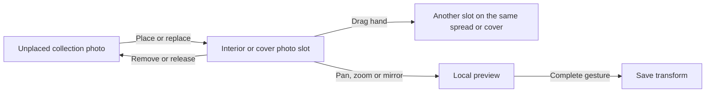

# Photo placement

**Date:** 2026-10-30

**Classification:** feature

**Grounded in:**

- Confirmed runnable spike, 2026-10-30: real photographs, on-slot drag, live zoom/pan, saved transforms and read-only Reader.
- Native-browser checks exposed and repaired hand dragging, used-photo filtering and retained-photo rendering after template changes.
- Cover extension requested by the maintainer; existing cover slots and stored transforms reuse the confirmed interaction without another spike.

## What & Why

The composition already stores photo placements; HTTP and browser editing are missing. Deliver placement in existing interior and cover slots, keeping photographs primary and editing chrome quiet.

## Domain / Design Notes



### Composition and ownership

| Contract | Guarantee |
| --- | --- |
| Collection | Synopsis and Cover use album photos; chapter openings and photo spreads use their chapter's photos. |
| Placement | One photo occupies one slot; replacement releases the previous photo without deleting it. |
| Initial transform | Centered, unmirrored, zoom 1; scale to fill the slot while preserving image proportions. |
| Adjustment | Zoom 1–5 relative to initial fill; pan is bounded to keep the slot covered; horizontal mirror preserves the crop. |
| Move or swap | Within one spread or between cover sides, photos carry transforms; geometry stays with slots. Spread caption corners travel with photos. |
| Different geometry | Retain stored transforms on movement; bound the displayed crop to the destination's geometry. |

Template changes retain the approved [spread-lifecycle contract](../../http-api.openapi.json): match by photo-slot order, keeping photo and caption corner while resetting transforms. New slots receive new identities; unmatched photos return to selection.

### Commit and recovery

```mermaid
sequenceDiagram
  actor Editor
  participant Browser
  participant Application
  participant Storage
  Editor->>Browser: Place, replace, move, remove or finish adjustment
  Browser->>Application: Request saved change
  Application->>Application: Coordinate and validate current ownership and targets
  Application->>Storage: Commit complete change atomically
  Application-->>Browser: Saved composition
  opt Collection or workspace refresh fails
    Browser-->>Editor: Saved; current view needs recovery
    Editor->>Browser: Retry
    Browser->>Application: Read authoritative state only
  end
```

| Owner | Enforced guarantee |
| --- | --- |
| SQLite | `UNIQUE` photo and slot references prevent duplicates; foreign keys and cascades preserve references and release deleted placements. |
| SQLite | Kind-specific `CHECK` constraints require the appropriate slot reference and caption-corner shape. |
| Application | Validate album/chapter membership, current slot ownership, source placement and finite transform values before writing. |
| Application | Coordinate the full read/decision/write with structural edits and photo reconciliation on the supported single backend. |
| Persistence | Replacement, removal and both sides of a swap commit together or leave saved state unchanged. |
| Browser | Sequence completed adjustments so an older response cannot replace a newer preview or become the final saved adjustment. |

The database does not enforce collection membership, crop bounds or editing coordination. Reuse authoritative placement state and existing application boundaries; selection is a projection, not a second placed flag.

Requests use current saved state, not an editing lease: concurrent valid edits resolve in application order. Other workspaces observe changes on reload.

## Invariants

- Original photographs remain read-only; placement never changes chapter ownership.
- Spread identity, ordering, owner text and template geometry remain governed by existing structural editing.
- Cover keeps back on the left, front on the right, saved spine ownership and existing title/credits.
- Reader presents the same saved composition without editing controls.

## Acceptance Criteria

### Place and arrange

- Drag an unplaced photo onto an empty slot to place it; dropping onto an occupied slot replaces its photo.
- Keyboard users can choose a collection photo and activate the destination slot.
- Placement is available in Synopsis, chapter openings, photo spreads and both cover sides, using the collection ownership above.
- Placed photos disappear from selection across the relevant collection, including placements on other spreads or Cover.
- Removal returns the photo to selection; placing it again uses the initial transform.
- Replacement returns the displaced photo to selection and initializes the incoming photo's transform.
- Compact move, mirror and remove actions appear on slot hover or keyboard focus, with hints and accessible names.
- Drag the hand icon directly to another slot to move or swap; mouse clicks do not arm two-slot selection.
- Keyboard users can activate the hand action and then the destination, with an announced pending choice.
- Cancelled or invalid drops leave the saved composition unchanged; drag previews show the photo rather than an empty outline.
- Cover uses the same on-slot actions, gestures, keyboard equivalents and save/recovery behavior as interior placement.
- Move or swap between front and back preserves transforms; cover placement leaves title/credits visible.

### Adjust and save

- Wheel zoom and pointer pan preview continuously within the slot, without external fieldsets, sliders or swap dropdowns.
- Horizontal mirroring is reversible; zoom and pan have keyboard equivalents.
- Pan saves on pointer release; wheel and keyboard adjustments save after the input burst or focus departure.
- Pointer cancellation restores the pre-gesture view without saving the cancelled adjustment.
- Live gesture events neither write per event nor refresh or reconstruct the workspace.
- Slow saves preserve responsive preview; successful completion persists the latest completed adjustment.
- Navigation and mode changes finish pending adjustments or visibly resolve unsaved state before discarding it.
- Failed adjustment saves retain the unsaved preview, identify it as unsaved and offer retry.
- Failed structural saves show recoverable feedback and preserve the last confirmed composition.
- Reloading the album or entering Reader shows saved placement and transforms.

### Structural changes and recovery

- Occupied template changes require confirmation; cancellation preserves placements and adjustments.
- Confirmed template changes follow the existing ordered mapping and transform reset, releasing photos that cannot fit.
- Retained photos appear immediately after template change, without placing another photo or reloading the page.
- Released-photo selection and counts agree with saved placements after removal, replacement, template change or spread deletion.
- Wrong-owner photos, already-used photos and foreign or obsolete slot identities are rejected without partial writes.
- Missing spreads, cover slots and vanished move sources show stale-state feedback and offer an authoritative reload.
- Concurrent placement attempts for one photo leave exactly one placement; rejected attempts remain recoverable.
- Acknowledged saves followed by failed reads show saved-but-unrefreshed feedback; Retry reads without replaying the mutation.
- An uncertain write outcome is reconciled from saved state before another attempt; read failures never masquerade as an empty composition.
- Pending structural saves prevent conflicting placement actions and explain their temporary unavailability.
- Focus and selected-part navigation remain usable after success, cancellation and recovery.

## Doc Sync

- `specs/design.md` — Editing journey: integrate persisted photo editing and local-preview/save recovery into the composition lifecycle.
- `specs/design.md` — Architectural decisions: replace the undelivered-placement limitation with coordinated browser delivery through existing boundaries.
- `specs/http-api.openapi.json` — Define interior/cover placement reads, mutations, transforms, placement-aware inventory and failure contracts.

## Out of Scope

- Caption editing; dedicated Reset and general undo.
