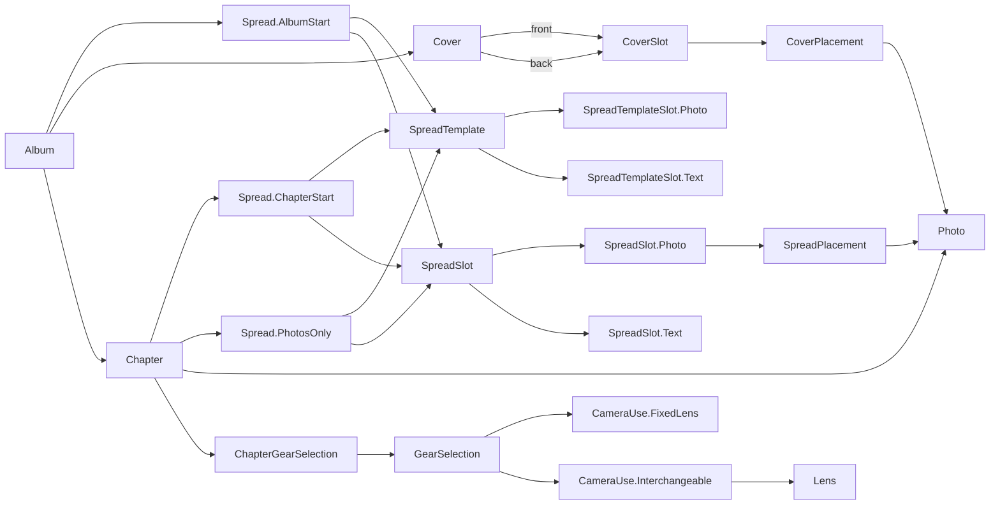

# Photography domain model

> Standard: [Agentic Engineering Standards](https://github.com/Adobe-AIFoundations/agentic-workflow-standards) v1.2.0. Lifetime: open from creation through implementation, archived per [the SDD skill's Archive PR phase](../../../.agents/skills/sdd/SKILL.md).

**Date:** 2026-10-06

**Classification:** feature

**Grounded in:** The Rust composition model and SQLite constraints were reconciled with the user-confirmed cover rules; the shared source surface/slot model cannot express the cover's fixed front/back panels and spine-dependent geometry.

## What & Why

Define the domain model for the album layout tool.

## Domain / Design Notes

```scala
opaque type AlbumId = UUID
opaque type ChapterId = UUID
opaque type PhotoId = UUID
opaque type SpreadId = UUID
opaque type SpreadTemplateId = UUID
opaque type PhotoSpreadSlotId = UUID
opaque type TextSpreadSlotId = UUID
opaque type CoverSlotId = UUID
opaque type CountryId = UUID
opaque type DestinationId = UUID
opaque type CameraId = UUID
opaque type LensId = UUID
opaque type EditorId = UUID
opaque type SessionId = UUID
opaque type SpreadPlacementId = UUID
opaque type CoverPlacementId = UUID

opaque type AlbumName = String
opaque type SpreadTemplateName = String
opaque type CountryName = String
opaque type DestinationName = String
opaque type CameraName = String
opaque type LensName = String
opaque type CountryCode = String
opaque type CameraExifCode = String
opaque type LensExifCode = String
opaque type RelativeLocation = String
opaque type AbsoluteLocation = String

opaque type PixelCount = Int
opaque type PositionInAlbum = Int
opaque type PositionInChapter = Int
opaque type InDesignPoints = BigDecimal
opaque type PositionOnSpread = InDesignPoints
opaque type DistanceWithinSpread = InDesignPoints
opaque type Zoom = BigDecimal

final case class Album(id: AlbumId, title: AlbumName, synopsis: String)
final case class Chapter(
  id: ChapterId,
  album: AlbumId,
  destination: DestinationId,
  description: String,
  period: VisitPeriod,
  position: PositionInAlbum,
  sourceFolder: RelativeLocation
)
final case class Photo(
  id: PhotoId,
  chapter: ChapterId,
  source: RelativeLocation,
  maybeThumbnail: Option[RelativeLocation],
  capturedAt: Instant,
  dimensions: PhotoDimensions,
  maybeCaption: Option[String]
)
final case class PhotoDimensions(width: PixelCount, height: PixelCount)
final case class VisitPeriod(start: Instant, end: Instant)

enum SpreadTemplateKind:
  case AlbumStart, ChapterStart, PhotosOnly

enum SpreadTemplateSlot:
  case Photo(box: SlotBox)
  case Text(box: SlotBox)

final case class SpreadTemplate(
  id: SpreadTemplateId,
  name: SpreadTemplateName,
  kind: SpreadTemplateKind,
  slots: NonEmptySet[SpreadTemplateSlot]
)

enum SpreadEdge:
  case Top, Bottom, Left, Right

opaque type Bleed = Set[SpreadEdge]

final case class SlotBox(
  x: PositionOnSpread,
  y: PositionOnSpread,
  width: DistanceWithinSpread,
  height: DistanceWithinSpread
)

enum SpreadSlot:
  case Photo(
    id: PhotoSpreadSlotId,
    spread: SpreadId,
    box: SlotBox,
    bleed: Bleed
  )
  case Text(id: TextSpreadSlotId, spread: SpreadId, box: SlotBox)

enum SpreadOwner:
  case Album(id: AlbumId)
  case Chapter(id: ChapterId)

sealed trait Spread:
  def id: SpreadId
  def template: SpreadTemplateId
  def kind: SpreadTemplateKind
  def owner: SpreadOwner

object Spread:
  final case class AlbumStart(id: SpreadId, album: AlbumId, template: SpreadTemplateId) extends Spread:
    val kind = SpreadTemplateKind.AlbumStart
    val owner = SpreadOwner.Album(album)

  final case class ChapterStart(id: SpreadId, chapter: ChapterId, template: SpreadTemplateId) extends Spread:
    val kind = SpreadTemplateKind.ChapterStart
    val owner = SpreadOwner.Chapter(chapter)

  final case class PhotosOnly(id: SpreadId, chapter: ChapterId, position: PositionInChapter, template: SpreadTemplateId) extends Spread:
    val kind = SpreadTemplateKind.PhotosOnly
    val owner = SpreadOwner.Chapter(chapter)

enum SpineOwner:
  case Front, Back

final case class Cover(
  album: AlbumId,
  spineOwner: SpineOwner,
  front: CoverSlot,
  back: CoverSlot
)
final case class CoverSlot(id: CoverSlotId)

final case class Shift(x: InDesignPoints, y: InDesignPoints)
final case class PhotoTransform(shift: Shift, mirrored: Boolean, zoom: Zoom)
enum CaptionCorner:
  case TopLeft, TopRight, BottomLeft, BottomRight

final case class SpreadPlacement(
  id: SpreadPlacementId,
  slot: PhotoSpreadSlotId,
  photo: PhotoId,
  transform: PhotoTransform,
  captionCorner: CaptionCorner
)
final case class CoverPlacement(
  id: CoverPlacementId,
  slot: CoverSlotId,
  photo: PhotoId,
  transform: PhotoTransform
)

final case class Country(
  id: CountryId,
  code: CountryCode,
  name: CountryName,
  flag: AbsoluteLocation
)
final case class Destination(id: DestinationId, name: DestinationName, country: CountryId)

enum CameraKind:
  case FixedLens, InterchangeableLens
final case class Camera(
  id: CameraId,
  code: CameraExifCode,
  friendlyName: CameraName,
  kind: CameraKind
)
final case class Lens(
  id: LensId,
  code: LensExifCode,
  friendlyName: LensName,
  camera: CameraId
)
enum CameraUse:
  case FixedLens
  case Interchangeable(lenses: NonEmptySet[LensId])
type GearSelection = NonEmptyMap[CameraId, CameraUse]
final case class ChapterGearSelection(chapter: ChapterId, selection: GearSelection)

final case class EditorSession(id: SessionId, owner: EditorId, lastHeartbeat: Instant)
enum EditingTarget:
  case Spread(id: SpreadId)
  case Cover(album: AlbumId)
final case class EditingLock(target: EditingTarget, session: SessionId)

enum DomainRejection:
  case DuplicatePhotoSource
  case DuplicateReferenceCode
  case PhotoAlreadyPlaced
  case SlotOccupied
  case PhotoFromDifferentChapter
  case InvalidGearSelection
  case IncompleteCover
```



## Invariants

- Each `Chapter` belongs to one `Album`; each `Photo` belongs to one `Chapter`.
- Chapter source folders are relative to the album photo root, and photo sources are relative to their chapter folder; locations cannot escape their owning root. Photo source locations are unique within a chapter.
- Photo dimensions are positive pixel counts. Country codes contain two uppercase ASCII letters. Domain-specific names are nonempty.
- Country codes are unique across countries; camera EXIF codes are unique among cameras; lens EXIF codes are unique among lenses.
- Each slot has at most one placement.
- `AlbumStart` and `ChapterStart` have no position field and occupy implicit position zero; `PhotosOnly.position` begins at one. A chapter spread may use only its chapter's photos; `AlbumStart` may use any photo in its album.
- `PositionInChapter` values are unique within a chapter.
- Album-start and chapter-start templates have exactly one text slot; photos-only templates have only photo slots.
- An editor session is live from its last heartbeat through its derived expiry, excluding the expiry instant.

## Acceptance Criteria

- `Cover` is keyed by its album; a cover slot ID cannot be used by a spread placement, a text-slot ID cannot be used by a photo placement, and each placement type refers only to its matching slot type.
- `Album` has exactly one `AlbumStart` and one `Cover`. Each `Chapter` has exactly one `ChapterStart`; an album has at most 20 chapters with unique positions `0..19`. Each spread retains its `SpreadTemplateId`, and its kind matches that template's kind.
- Applying a spread template creates the corresponding typed spread slots and copies each template slot's `SlotBox`. Spread-slot order is spatial; no separate slot-order value is stored.
- Text slots render their owning album or chapter fields and have no separate text placement.
- Every `SlotBox` uses absolute positions and positive distances in InDesign points and fits within the fixed `42 × 28 in` Blurb spread.
- A cover always has front and back slots with distinct `CoverSlotId`s. Their geometry derives from fixed Blurb print dimensions and `SpineOwner`; cover slots have no `SlotBox` or `Bleed`. Cover placements are separate entities created only when a photo is assigned. A cover may be incomplete while composed, but completion requires different photos placed in both slots.
- Each photo has at most one placement in an album. Cover placements may use any photo in the album. A placed photo's transform consists of two-axis point shift, mirroring, and positive zoom with no independent upper limit; accepted transforms keep the entire slot covered.
- A `VisitPeriod` has two instants with `start < end`. Country flags are absolute filesystem locations.
- A `ChapterGearSelection` associates a Chapter with a `GearSelection`. Every Lens belongs to an `InterchangeableLens` Camera. A fixed-lens camera has no lens selection; an interchangeable-lens camera may select only lenses belonging to that camera.
- An editor session is identified by its UUID and owner UUID and stores only its last heartbeat. An editing lock targets a spread or cover.
- Business-rule rejections are `DomainRejection` cases. Missing records, lock/session outcomes, infrastructure failures, and changed/unchanged mutation reporting belong to the use-case layer.

## Doc Sync

- `specs/design.md` — Domain model: document UUID-backed identities; Album–Chapter–Photo ownership and their names, capture, dimension, period, and location values; Country/Destination references and absolute flag locations; Camera/Lens kinds, unique EXIF codes, and the nonempty, camera-kind-safe chapter gear selection; the three `Spread` cases linked to `SpreadTemplate`; typed photo/text template and spread slots; one `AlbumStart` and `Cover` per Album and one `ChapterStart` per Chapter; distinct front/back cover slots, spine-dependent geometry, and completion placements; the 20-chapter position bound, InDesign-point slot boxes, photo-placement uniqueness and ownership; strict `VisitPeriod`; heartbeat-based session liveness with derived expiry; Spread/Cover lock targets; and business-rule rejections versus use-case outcomes.

## Out of Scope

- TypeScript projections of the Scala domain model.
