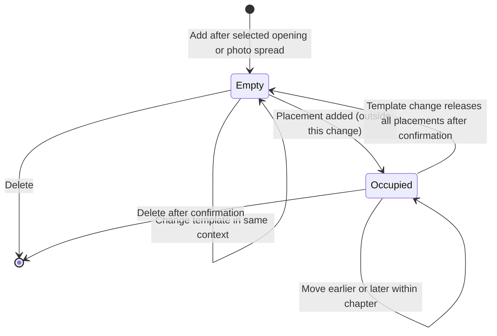

# Spread lifecycle

**Date:** 2026-10-29

**Classification:** feature

**Grounded in:**

- Local spike (uncommitted on `5507df1`): insertion, template, reorder, delete and metadata interactions; accepted 2026-10-29.
- Naming of 99 layouts (68 photo, 4 Synopsis, 27 chapter opening) accepted 2026-10-29; photo layouts from the sibling Saal catalog.
- Code: `spread` models `photos_only`; `spread_template` has no `photos_only` seeds; placements cascade from spread slots; workspace spreads lack `templateId`.

Chapter photo spreads can be added, reordered, re-templated and deleted, with templates chosen by spread context.

## What & Why

Workspace spreads are read-only today, and photo layouts are not persisted. Editors shape each chapter's spreads; photos stay in the chapter collection.



| Spread context | Catalog | Templates | Photo-slot range |
|---|---|---|---|
| Photo spread | `photos_only` | 68 | 1–24 |
| Synopsis (album opening) | `album_start` | 4 | 1–5 |
| Chapter opening | `chapter_start` | 27 | 2–12 |

## Domain / Design Notes

Confirmation sequence, shared by occupied template changes and deletes:

```mermaid
sequenceDiagram
  Editor->>API: PUT template or DELETE spread
  API-->>Editor: 409 spread_occupied with placements count
  Editor->>API: Repeat with confirmPlacements=true
  API-->>Editor: 200 or 204; released placements return photos to unplaced pool
```

| Method and path | Request | Success | Errors |
|---|---|---|---|
| `POST /api/albums/{id}/chapters/{chapterId}/spreads` | `{afterSpreadId}` | `201 {id}` | `400 {message}`; `404 chapter_not_found`, `spread_not_found` |
| `PUT /api/albums/{id}/spreads/{spreadId}/template?confirmPlacements=true` | `{templateId}` | `200 {id, templateId}` | `400 {message}`; `404 spread_not_found`; `409 spread_occupied` |
| `POST /api/albums/{id}/spreads/{spreadId}/move` | `{direction}`: `earlier` or `later` | `200 {id}` | `400 {message}`; `404 spread_not_found` |
| `DELETE /api/albums/{id}/spreads/{spreadId}?confirmPlacements=true` | — | `204` | `400 {message}`; `404 spread_not_found`; `409 spread_occupied` |
| `GET /api/templates/photos-only`, `GET /api/templates/chapter-start` | — | `200 {templates}`, as `album-start` | `500 service_failure` |

- Album routes also return `404 album_not_found` and `500 service_failure`; an add target that is not a chapter opening or photo spread returns `400`.
- `spread_occupied` carries `placements` as an integer count; unconfirmed requests change nothing.
- Template IDs are UUIDs; the default photo layout is the seeded layout with catalog ID `8-4x2`; workspace spreads gain `templateId`.

| Rule | Enforced by |
|---|---|
| Spread positions unique per chapter; openings at zero | Database unique constraint and kind check |
| Template context equals spread context | Application validation |
| At most 65 interior spreads | Application validation |
| One placement per photo and per slot; placements removed with their spread | Database unique constraint and cascade |
| Movement stays within one chapter's photo spreads | Application validation |
| Occupied confirmation | Application validation under the chapter-mutation lock |
| Each action commits atomically | Persistence transaction |

On an occupied template change, photo slots match by template order; a retained placement keeps its photo and caption corner and resets its transform; unmatched photos return to the unplaced pool. New slots get new IDs.

Concurrency: each action runs under one backend instance's chapter-mutation lock. Clients reload the workspace after an action; stale targets fail with `404`.

## Invariants

- The album opening is first; chapter blocks follow chronologically with Home last.
- Each photo and photo slot holds at most one placement; photos stay in their chapter.
- Opening defaults stay: Synopsis `2×2 L + Synopsis R`; chapter opening `Text + 2P + 2L`.
- Photo explorer, Reader, URL selection, chapter editing, date validation and live photo updates keep their current behavior.

## Tradeoffs Accepted

- Other open workspaces update on reload, not live; collaborating editors bear this cost.

## Acceptance Criteria

### Adding and ordering

- Add inserts the default layout after the selected opening or photo spread.
- Add selects the inserted spread.
- Add is unavailable on the Album opening; its reason is a hover and accessible hint.
- Add is unavailable at 65 interior spreads; its reason is visible.
- Move earlier or later swaps with the chapter neighbour.
- Disabled moves state their reason on hover and to assistive technology.
- No spread action changes chapter blocks, opening positions or Home's last position.

### Templates

- Selectors offer only the spread's context (68 photo, 4 Synopsis, 27 chapter opening).
- Cover has no template selector.
- Categories are one per photo-slot count 1–9 and 10+.
- Text slots are excluded from the count.
- Empty categories are hidden.
- There is no All category.
- Template change keeps the spread's identity, chapter and position.
- Template change highlights the applied template.
- Changing an occupied spread's template warns and requires confirmation.
- Confirmed template changes keep placements matched by photo-slot order.
- Confirmed template changes release unmatched placements.

### Deletion

- Deleting an empty spread removes it immediately.
- Deleting an occupied spread warns with its placement count.
- Confirmed deletion removes the spread and its placements.
- Released photos remain in the chapter collection as unplaced.
- Inventory counts update after a deletion.
- Deleting the selected spread selects its chapter opening.

### Failures

- Unconfirmed occupied requests return `409` and change nothing.
- Stale or foreign spread IDs return `404 spread_not_found`.
- Context mismatch, opening move or delete, and capacity violations return `400` with readable feedback.
- Warnings support keyboard use.
- Cancel leaves the spread unchanged.
- Cancel returns focus to its control.
- Service failures keep the workspace usable.
- Service failures offer retry.

### Layout

- The template selector sits above the canvas, in the right-hand column.
- The spread navigator sits below the canvas, in the right-hand column.
- Template and navigator names are hover hints and accessible labels.
- The action toolbar is centered.
- Every toolbar control has a hover hint.
- Movement controls stay visible.
- Metadata is one centered block of two lines: Chapter spread, Album spread, Location, Country (Countries when several), Period.
- Positions are 1-based.
- Positions count openings and exclude Cover.
- Positions update after each action.
- Periods display `dd/mm - dd/mm`.
- Home shows `Throughout the year`.
- Editing keeps full dates.
- The workspace heading shows the saved album title.

## Doc Sync

- `specs/design.md` — Album workflow: prune statements this change makes stale (navigator placement, heading, period format, metadata captions).
- `specs/design.md` — Album composition: photo spreads can be added, moved, re-templated and deleted within their chapter.
- `specs/design.md` — Album composition: chapter deletion and reordering remain unavailable.
- `specs/design.md` — Album composition: occupied template changes and deletes require confirmation.
- `specs/design.md` — Album composition: template change matches placements by photo-slot order, keeps photo and caption corner, resets transforms, releases unmatched photos and assigns new slot IDs.
- `specs/design.md` — Album composition: spread state and confirmation sequence diagrams from this proposal.
- `specs/design.md` — Templates and covers: context-scoped catalogs of 68 photo, 4 Synopsis and 27 chapter-opening layouts.
- `specs/design.md` — Templates and covers: naming grammar (`P`, `L`, `Text`, `+`, `/`, `x`; never `1 x`).
- `specs/contracts.md` — Contract inventory: seeded photo layouts beside the existing four and 27.
- `specs/contracts.md` — Contract inventory: pointer to the OpenAPI spread routes and template listings.
- `specs/http-api.openapi.json` — Paths: spread action routes and photo and chapter-start template listings.
- `specs/http-api.openapi.json` — Schemas: `templateId` on workspace spreads and the `spread_occupied` response.

## Out of Scope

- Undo (planned separately) and photo placement itself, including bleed toggles.
