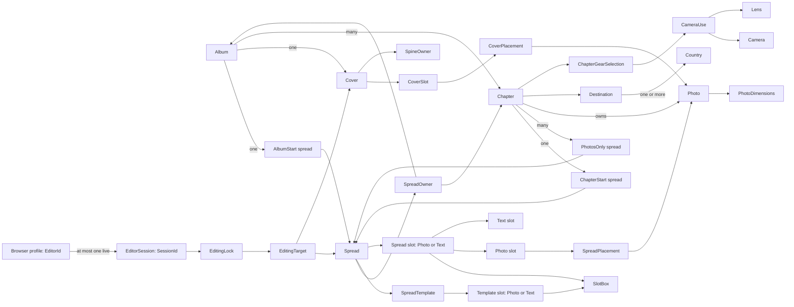

# Photography design

> Standard: Agentic Engineering Standards v1.2.0

## Overview

The application manages persisted albums through a SolidJS dashboard and serves the frontend and backend API on one origin.

## Album workflow

The dashboard at `/` shows existing albums newest-first, six per page, with 42:28 cover placeholders and directional pagination that retains the current cards while loading. An empty collection leaves the album area blank.

A single top-right Add album action opens a centered dialog requiring an unused year, initially the browser's current year. Creation generates `Journey of the Shepherds <year>`; rename accepts any nonblank title and trims surrounding whitespace. Invalid or duplicate years and failed saves retain entered values with readable feedback. Deletion requires confirmation and falls back to the last available page.

Dialogs expose pending status, prevent duplicate submissions, support keyboard/pointer use and Escape/cancel, and restore focus when closed. Text formatting and line breaks remain stable during saving, retries and closing, including deletion confirmation.

Selecting a card opens `/albums/{id}` with one heading, `A year in photographs / <year>`, beneath Back to albums. The application serves its site favicon. Creation and opening are separate actions. Loading and retryable failures precede usable content; missing albums retain the dashboard return path.

The outline starts with Synopsis, then numbered chapter blocks. Add chapter initially offers a type selector; once Home exists it opens directly as a vacation. Vacation details are location/name, countries, first/last day and photo folder; Home exposes countries and folder with `Throughout the year`. One trailing pencil opens the selected chapter's details and receives focus when the dialog closes.

Vacation periods display `dd/mm/yyyy - dd/mm/yyyy`; date years initially use the album year but support same-day, cross-year and outside-year trips. New chapters default to Romania; multi-country search matches names/codes locally with keyboard selection and explicit no-match feedback. Folder suggestions follow the album year and destination name while preserving manual overrides. Saved details and composition survive reload; creating a chapter selects its opening.

Selection is URL-addressable: absent `part` selects the album opening (Synopsis), `?part=cover` selects Cover, a chapter ID selects its opening, and a spread ID selects that spread. Direct links, reload and Back restore selection; missing or foreign parts offer feedback and Go to Synopsis. Spreads / Cover remembers the last interior selection; direct Cover loads return to the album opening when none exists. Cover hides the outline.

Read-only canvases render persisted full-spread geometry and owner text: album title and synopsis, or chapter name and description. Empty photo areas remain unlabeled. Compact headers, comfortable gutters and thin framing leave room for the canvas. Metadata distinguishes labels from values, shows full folder paths and keeps values and the trailing pencil on one row when space permits, wrapping on narrow screens.

A vertical grip with centered embossed dots shares the chapter panel's straight edge; hover feedback stays within its visible bounds. Collapse leaves only the keyboard/pointer-accessible grip, removes the panel's outer box and resizes the canvas. Collapsed controls are inaccessible and focus transfers to the grip without changing selection. Collapse/reopen is animated, vertical on narrow screens and immediate for reduced-motion users. Workspace and dialogs remain usable without horizontal page overflow.

One global Reader control, left of Spreads / Cover, enters browser fullscreen from either view, hiding workspace chrome and metadata. It fits each canvas without stretching or cropping. Left/right navigation traverses Cover, the album opening and persisted chapter spreads without wrapping. Controls appear on hover or focus; Previous spread and Next spread are disabled at their endpoints without explanatory text.

Escape or Exit reader retains the current part, restores chrome and returns focus to Reader. Fullscreen failures show readable feedback while leaving the workspace usable.

## Domain model

The Scala domain package defines records, identities, refined scalar types, and closed alternatives. Use cases enforce cross-record and lifecycle rules; adapters validate external values and route mutations through use cases.

Each album has a required immutable year identifying at most one album and a freely editable title. Each chapter owns its destination name and nonempty set of reference countries; album countries derive from those destinations, independently of the complete selectable catalog.

### Album composition

- Each album has one `AlbumStart` and one `Cover`; each chapter belongs to an album and has one `ChapterStart`; each photo belongs to a chapter.
- An album's spreads are non-empty and ordered; the first spread is an `AlbumStart`, followed by chapter blocks, each a `ChapterStart` followed by zero or more `PhotosOnly` spreads.
- Interior capacity is 65 spreads (130 pages), including album/chapter openings and photo spreads, excluding Cover. At 64 spreads a chapter opening can be added; at 65 creation is unavailable with a visible reason and rejected saves leave state unchanged.
- Chapter blocks sort by first day, last day and chapter ID; the unique Home chapter remains last and spans the album year. Chapter positions are unique; start spreads use position zero, and `PhotosOnly` positions are unique from one. Chapter deletion and manual ordering are not workspace actions.
- Creation atomically initializes an empty synopsis, one `AlbumStart` with the lowest-ID template's slots and no placements, and both empty cover sides with front-owned spine.
- Chapter creation atomically saves metadata, country associations, a default opening's complete slots and chronological positions. Metadata updates preserve identity, type and composition. One backend instance's shared chapter-mutation lock covers concurrent editors' read/decision/write sequence; persistence transactions commit supplied changes atomically.

### Values

- Album years are integers from 1900 through 2100.
- Each chapter requires a full backend-visible absolute source-folder path, unique within its album, without parent traversal; the folder need not exist yet. Suggestions use `<photoRoot>/<year>/selection/<destination>`. Photo paths remain relative to their chapter folder and cannot escape that root.
- Visit periods expose inclusive calendar days in `YYYY-MM-DD` form, with last day not preceding first day; storage runs from UTC midnight on the first day to midnight after the last. Dimensions are positive; names are nonempty after trimming; country codes are two uppercase ASCII letters; country flags are absolute.
- Country, camera, and lens reference codes are unique within their kinds.

### Templates and covers

- Start templates have exactly one text slot; `PhotosOnly` templates contain only photo slots; every template is nonempty.
- Spreads retain a matching template ID and kind; applying a template copies geometry into typed slots.
- The 27 seeded chapter-start layouts use the lowest-ID default, `Text + 2P + 2L`, with four photo slots and one text column. Chapter creation copies the complete default geometry into an empty opening; existing slot IDs, geometry and matching templates survive metadata changes.
- New photo slots have no bleed; only photo slots can have bleed, and slot order is spatial. Text slots render owner fields without separate placements.
- Slot boxes use nonnegative positions and positive sizes. Seeded start layouts retain percentages of the full spread axes; previews use the Saal `2381.102 × 765.354 pt` aspect ratio independently of occupied-slot extrema.
- Spread coordinates use the top-left of the full two-page spread as the origin; x increases right and y increases down.
- Cover front and back slots have distinct IDs, separate from spread-slot IDs; cover slots have no geometry or bleed.
- Interior pages equal twice the spread count, up to 130; choose the smallest listed Saal specification that fits.
- Derive cover geometry from that specification; `SpineOwner` selects the panel extending across the spine. A cover is complete only when both slots are placed (`IncompleteCover`).
- Workspace Cover presents the saved album title with back on the left and front on the right. Credits read `by Cosmin & Mara` through 2025 and `by Cosmin, Mara & Iacob` from 2026; this preview does not promise print-accurate cover geometry.

### Placements and gear

- Each photo and slot can be placed at most once per album.
- Chapter spreads accept photos only from their chapter; album-start and cover placements accept any photo in the album.
- Transforms use two-axis shifts, mirroring, and positive uncapped zoom; the image must cover the full slot.
- Fixed-lens cameras use `CameraUse.FixedLens`; interchangeable-lens cameras require a nonempty set of their own lenses.

### Editor sessions

- `EditorId` is a persistent pseudonymous browser-profile identity, stable across tabs and reconnects; it is not User-Agent metadata or authentication. A profile has at most one live `SessionId`.
- The first tab creates a session; a second tab offers takeover or keep-existing. Keeping leaves the new tab inactive without a session.
- Takeover atomically replaces the session, releases its locks, and creates one for the same profile; the old ID cannot edit or renew. Expiry is exclusive.

Missing records, lock/session outcomes, infrastructure failures, and changed/unchanged mutation reporting belong to use cases.

## Architecture constraints

- The backend is Scala 3 and follows Typelevel and Tagless Final principles.
- The application maintains the SQLite schema with Flyway on startup.
- All backend APIs use REST over HTTP.
- Readiness is available only after SQLite migration and recorded-photo-write recovery succeed and the HTTP listener starts. Recovery precedes worker creation, preserves exact live thumbnail references and only removes journaled unused locations.
