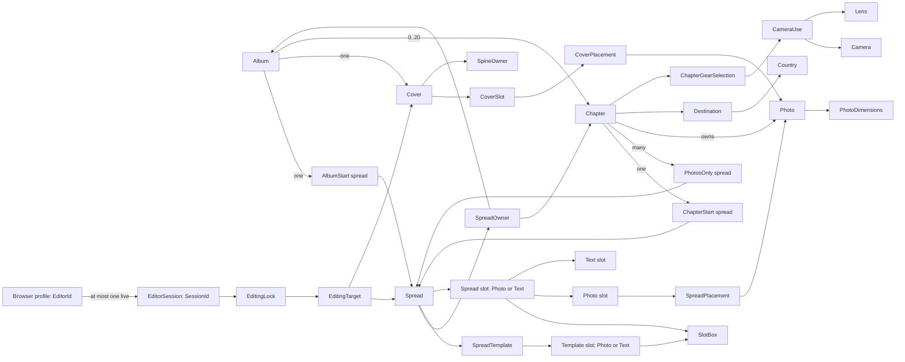

# Photography design

> Standard: Agentic Engineering Standards v1.2.0

## Overview

The application manages persisted albums through a SolidJS dashboard and serves the frontend and backend API on one origin.

## Album workflow

The dashboard at `/` shows existing albums newest-first, six per page, with 42:28 cover placeholders and directional pagination that retains the current cards while loading. An empty collection leaves the album area blank.

A single top-right Add album action opens a centered dialog. Creation and rename trim titles, reject blank input and preserve input on failure; deletion requires confirmation and falls back to the last available page. Dialogs support keyboard and pointer use and restore focus when closed.

Selecting a card opens `/albums/{id}`; direct links and reloads load the same read-only title and synopsis beneath navigation. Creation and opening are separate actions. Failed reads show no partial metadata; service failures offer Retry, and missing albums link back to the dashboard.

## Domain model

The Scala domain package defines records, identities, refined scalar types, and closed alternatives. Use cases enforce cross-record and lifecycle rules; adapters validate external values and route mutations through use cases.

### Album composition

- Each album has one `AlbumStart` and one `Cover`; each chapter belongs to an album and has one `ChapterStart`; each photo belongs to a chapter.
- An album's spreads are non-empty and ordered; the first spread is an `AlbumStart`, followed by chapter blocks, each a `ChapterStart` followed by zero or more `PhotosOnly` spreads.
- Albums have at most 20 chapters at unique positions `0..19`; start spreads use position zero, and `PhotosOnly` positions are unique from one.
- Creation atomically initializes an empty synopsis, one `AlbumStart` with the lowest-ID template's slots and no placements, and both empty cover sides with front-owned spine.

### Values

- Chapter folders are relative to the album's photo root; photo paths are relative to their chapter folder. Paths cannot escape their owner roots and are unique within those roots.
- Visit periods require `start < end`; dimensions are positive; names are nonempty; country codes are two uppercase ASCII letters; country flags are absolute.
- Country, camera, and lens reference codes are unique within their kinds.

### Templates and covers

- Start templates have exactly one text slot; `PhotosOnly` templates contain only photo slots; every template is nonempty.
- Spreads retain a matching template ID and kind; applying a template copies geometry into typed slots.
- New photo slots have no bleed; only photo slots can have bleed, and slot order is spatial. Text slots render owner fields without separate placements.
- Slot boxes use nonnegative positions and positive sizes. The seeded `AlbumStart` catalog retains per-axis percentage coordinates for the Saal `2381.102 × 765.354 pt` spread.
- Spread coordinates use the top-left of the full two-page spread as the origin; x increases right and y increases down.
- Cover front and back slots have distinct IDs, separate from spread-slot IDs; cover slots have no geometry or bleed.
- Interior pages equal twice the spread count; choose the smallest listed Saal specification that fits, or the 130-page specification above 130.
- Derive cover geometry from that specification; `SpineOwner` selects the panel extending across the spine. A cover is complete only when both slots are placed (`IncompleteCover`).

### Placements and gear

- Each photo and slot can be placed at most once per album.
- Chapter spreads accept photos only from their chapter; album-start and cover placements accept any photo in the album.
- Transforms use two-axis shifts, mirroring, and positive uncapped zoom; the image must cover the full slot.
- Fixed-lens cameras use `CameraUse.FixedLens`; interchangeable-lens cameras require a nonempty set of their own lenses.

### Editor sessions

- `EditorId` is a persistent pseudonymous browser-profile identity, stable across tabs and reconnects; it is not User-Agent metadata or authentication. A profile has at most one live `SessionId`.
- The first tab creates a session; a second tab offers takeover or keep-existing. Keeping leaves the new tab inactive without a session.
- Takeover atomically replaces the session, releases its locks, and creates one for the same profile; the old ID cannot edit or renew. Expiry is exclusive.

Missing records, lock/session outcomes, infrastructure failures, and changed/unchanged mutation reporting belong to use cases.

## Architecture constraints

- The backend is Scala 3 and follows Typelevel and Tagless Final principles.
- The application maintains the SQLite schema with Flyway on startup.
- All backend APIs use REST over HTTP.
- Readiness is available only after SQLite migration succeeds and the HTTP listener starts.
