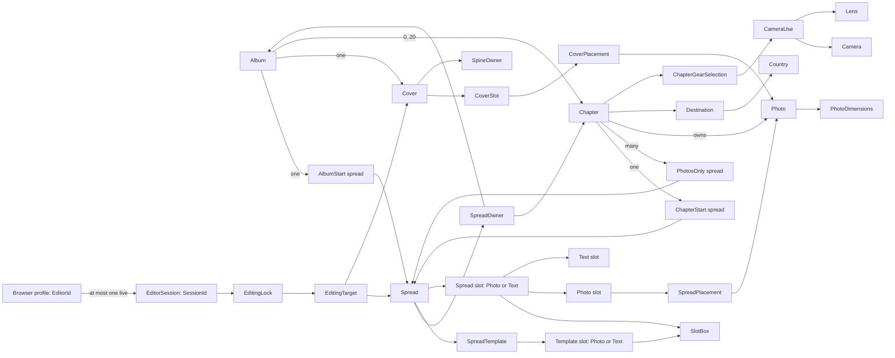

# Photography design

> Standard: Agentic Engineering Standards v1.2.0

## Overview

This repository is the starting point for a photography application. Product concepts and user workflows will be recorded here when established by reviewed change specs.

## Domain model

The Scala domain package defines records, identities, refined scalar types, and closed alternatives. Use cases enforce cross-record and lifecycle rules; adapters validate external values and route mutations through use cases.

- **Composition:** Each album has one `AlbumStart` and cover; each chapter belongs to an album and has one `ChapterStart`; photos belong to chapters. Albums have at most 20 chapters at unique positions `0..19`; start spreads use position zero, and `PhotosOnly` positions are unique from one.
- **Values and sources:** Visit periods require `start < end`; dimensions are positive, names nonempty, country codes two uppercase ASCII letters, and flags absolute. Paths are relative to owner roots, cannot escape them, and are unique within their owner. Country, camera, and lens reference codes are unique by kind.
- **Templates and slots:** Start templates have exactly one text slot; `PhotosOnly` templates contain only photo slots; templates are nonempty. Spreads retain a matching template ID and kind. Instantiation copies geometry into typed slots; photo slots start without bleed, only photo slots can have bleed, and slots are spatially ordered. Text renders owner fields without a separate placement. Slot boxes fit within the Saal `2381.102 × 765.354 pt` spread, using nonnegative positions and positive InDesign-point distances.
- **Covers:** Front and back IDs are distinct from each other and from spread-slot IDs; cover slots have no boxes or bleed. Interior pages equal twice the spread count; choose the smallest listed Saal specification that fits, or the 130-page specification above 130. Derive geometry from that specification; `SpineOwner` selects the panel extending over the spine. Completion requires both slots (`IncompleteCover`).
- **Placements and gear:** Each photo and slot is placed at most once per album. Chapter spreads accept photos only from their chapter; album-start and cover placements accept any photo in the album. Transforms use two-axis shifts, mirroring, and positive uncapped zoom, and must cover the slot. Fixed-lens cameras use `CameraUse.FixedLens`; interchangeable-lens cameras require a nonempty set of their own lenses.
- **Editor sessions:** `EditorId` is a persistent pseudonymous browser-profile identity, stable across tabs and reconnects, not User-Agent metadata or authentication; `SessionId` identifies the live session. The first tab creates a session. A second tab offers takeover or keep-existing; keeping leaves it inactive without a session. Takeover replaces the session, releases its locks, and creates one for the same profile; the old ID cannot edit or renew. Expiry is exclusive.

Use `DomainRejection` for business-rule failures. Missing records, lock/session outcomes, infrastructure failures, and changed/unchanged mutation reporting belong to use cases.

## Architecture constraints

- The backend is Scala 3 and follows Typelevel and Tagless Final principles.
- The frontend is intended to use SolidJS and TypeScript.
