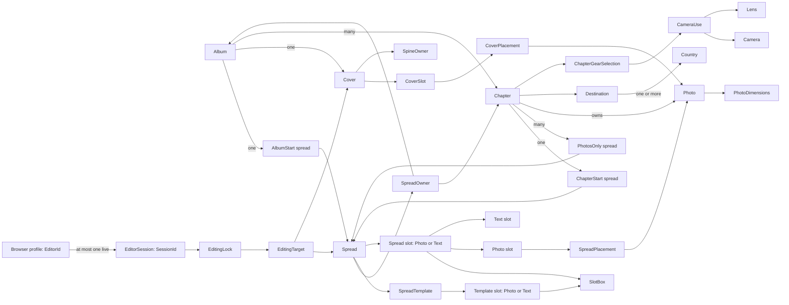
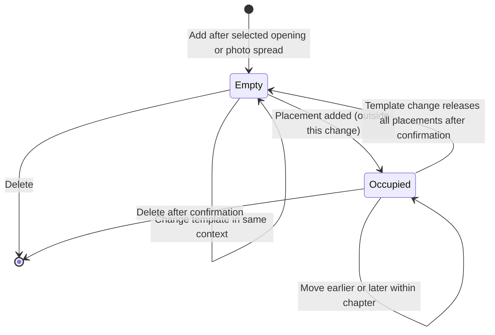

# Photography design

> Standard: Agentic Engineering Standards v1.2.0

## Overview

The application manages persisted albums through a SolidJS dashboard and serves the frontend and backend API on one origin.

## Album workflow

The dashboard at `/` shows existing albums newest-first, six per page, with 42:28 cover placeholders and directional pagination that retains the current cards while loading. An empty collection leaves the album area blank.

A single top-right Add album action opens a centered dialog requiring an unused year, initially the browser's current year. Creation generates `Journey of the Shepherds <year>`; rename accepts any nonblank title and trims surrounding whitespace. Invalid or duplicate years and failed saves retain entered values with readable feedback. Deletion requires confirmation and falls back to the last available page.

Dialogs expose pending status, prevent duplicate submissions, support keyboard/pointer use and Escape/cancel, and restore focus when closed. Text formatting and line breaks remain stable during saving, retries and closing, including deletion confirmation.

Selecting a card opens `/albums/{id}` with the saved album title and Back to album catalog in one inline row, with consistent typography aligned beneath the site title. The browser tab title is `Album Layout Studio`; the application serves its site favicon. UI headings, controls and hints use sentence case while preserving proper names and user/catalog content. Creation and opening are separate actions. Loading and retryable failures precede usable content; missing albums retain the dashboard return path.

The context-scoped template selector sits above the canvas in the right-hand editor; the noncollapsible spread navigator sits below it, in the same column. The navigator shows Synopsis, then spread miniatures grouped by chapter with symmetric vertical separators; both strips expose names through hover hints and accessible labels. The strips scroll horizontally and keep selection discoverable. The centered action toolbar groups first/previous/position/next/last, Add spread/Add chapter and shift-left/shift-right controls; photo spreads also offer Delete spread. Every control has a hover hint. Movement controls stay visible with accessible disabled reasons. Add spread is unavailable on the album opening with a hover/accessibility hint, and at capacity with visible feedback.

Add spread inserts and selects the default photo layout after the selected chapter opening or photo spread. Shifts swap photo spreads only within their chapter. Successful actions reload authoritative workspace state and update positions and inventory counts; deletion selects the successor at the deleted spread's album-wide position, or the predecessor when deleting the last spread. Failures leave the workspace usable with explicit retry; a failed reload retries the read rather than repeating a saved mutation. Occupied actions open keyboard-usable confirmation with the placement count; cancel leaves state unchanged and restores focus to its control.

Add chapter initially offers a type selector; once Home exists it opens directly as a vacation. Vacation details are location/name, countries, first/last day and photo folder; Home exposes countries and folder with `Throughout the year`. One trailing pencil opens the selected chapter's details and receives focus when the dialog closes.

Vacation periods display `dd/mm - dd/mm`; editing retains full dates and explicit calendar controls. Date years initially use the album year but support same-day, cross-year and outside-year trips. New chapters default to Romania; multi-country search matches names/codes locally with keyboard selection and explicit no-match feedback. Folder suggestions follow the album year and destination name while preserving manual overrides. Saved details and composition survive reload; creating a chapter selects its opening.

Selection is URL-addressable: absent `part` selects the album opening (Synopsis), `?part=cover` selects Cover, a chapter ID selects its opening, and a spread ID selects that spread. Direct links, reload and Back restore selection; missing or foreign parts offer feedback and Go to Synopsis. Spreads / Cover remembers the last interior selection; direct Cover loads return to the album opening when none exists. Cover hides the spread navigator.

Canvases render persisted full-spread geometry and owner text: album title and synopsis, or chapter name and description. Empty photo areas remain unlabeled. Compact headers, comfortable gutters and thin framing leave room for the canvas. Metadata forms one centered block of two aligned lines beneath the canvas: Chapter spread, Album spread, Location, Country (Countries for several) and Period, then their values. Positions are 1-based, count openings and exclude Cover; Home displays `Throughout the year`. The block remains aligned on narrow screens. Source folders remain editable in details, absent from workspace narration.

The full-height left photo explorer shows the selected chapter's photos, or all chapters' photos on Synopsis/Cover. Normal text is Photos with authoritative `unplaced / total` counts directly beneath; active processing and genuine failures retain explicit feedback. Whole uncropped images fill chronological rows, including the last, with small gutters and modest portrait emphasis. Photos have no preview, enlargement or placement action.

A compact circular Refresh photos control reconciles the selected chapter, or every chapter on Synopsis/Cover, exposing pending status separately from processing. Creation and changed-folder saves schedule import after commit; a scheduling failure keeps the chapter saved and offers Refresh-only retry. Inventory failures remain retryable without inventing empty photos; interrupted live updates retain displayed images with explicit feedback.

One outlined sharp-cut trapezoid grip resizes the explorer by pointer or Alt+Left/Right and collapses/restores its chosen workspace-local width. Plain Left/Right navigate spreads, respecting editing and dialog focus. Its full height and directional chevrons remain in both states. Hidden controls leave the focus order and focus transfers to the grip without changing selection. Narrow layouts avoid horizontal page overflow; reduced-motion preferences are respected.

One global icon with `Reader mode` accessibility and hover text, left of Spreads / Cover, enters browser fullscreen from either view, hiding workspace chrome and metadata. It fits each canvas without stretching or cropping. Left/right navigation traverses Cover, the album opening and persisted chapter spreads without wrapping. Controls appear on hover or focus; Previous spread and Next spread are disabled at their endpoints without explanatory text.

Escape or Exit reader retains the current part, restores chrome and returns focus to Reader. Fullscreen failures show readable feedback while leaving the workspace usable.

## Domain model



The Scala domain package defines records, identities, refined scalar types, and closed alternatives. Use cases enforce cross-record and lifecycle rules; adapters validate external values and route mutations through use cases.

Each album has a required immutable year identifying at most one album and a freely editable title. Each chapter owns its destination name and nonempty set of reference countries; album countries derive from those destinations, independently of the complete selectable catalog.

### Album composition

- Each album has one `AlbumStart` and one `Cover`; each chapter belongs to an album and has one `ChapterStart`; each photo belongs to a chapter.
- An album's spreads are non-empty and ordered; the first spread is an `AlbumStart`, followed by chapter blocks, each a `ChapterStart` followed by zero or more `PhotosOnly` spreads.
- Interior capacity is 65 spreads (130 pages), including album/chapter openings and photo spreads, excluding Cover. At 64 spreads a chapter opening can be added; at 65 creation is unavailable with a visible reason and rejected saves leave state unchanged.
- Chapter blocks sort by first day, last day and chapter ID; the unique Home chapter remains last and spans the album year. Chapter positions are unique; start spreads use position zero, and `PhotosOnly` positions are unique from one.
- Creation atomically initializes an empty synopsis, one `AlbumStart` with the lowest-ID template's slots and no placements, and both empty cover sides with front-owned spine.
- Chapter creation atomically saves metadata, country associations, a default opening's complete slots and chronological positions. Metadata updates preserve identity, type and composition. One backend instance's shared chapter-mutation lock covers concurrent editors' read/decision/write sequence; persistence transactions commit supplied changes atomically.
- Photo spreads can be added, moved, re-templated and deleted within their chapter. Template changes preserve spread identity, chapter and position, including on Synopsis and chapter openings. Chapter deletion and reordering remain unavailable.
- Occupied template changes and deletes require explicit confirmation through `409 spread_occupied` with an integer placement count; unconfirmed requests change nothing. Template changes match placements by photo-slot order, retain each matched photo and caption corner, reset transforms, release unmatched photos to the unplaced pool and assign new slot IDs. Deletion removes the spread and its placements while retaining its photos in the chapter collection.
- Every spread action uses the same chapter-mutation lock for the read/decision/write sequence and commits atomically. Stale or foreign spread targets fail with `404 spread_not_found`; clients reload after actions, while other open workspaces see changes on reload.



```mermaid
sequenceDiagram
  Editor->>API: PUT template or DELETE spread
  API-->>Editor: 409 spread_occupied with placements count
  Editor->>API: Repeat with confirmPlacements=true
  API-->>Editor: 200 or 204; released placements return photos to unplaced pool
```

### Values

- Album years are integers from 1900 through 2100.
- Each chapter requires a full backend-visible absolute source-folder path, unique within its album, without parent traversal; the folder need not exist yet. Suggestions use `<photoRoot>/<year>/selection/<destination>`. Photo locations combine that source folder with one validated immediate filename, rejecting separators and parent-traversal names.
- Sources contain immediate regular JPEG files (`.jpg`/`.jpeg`, case-insensitive); discovery reports unsupported files. Original files are referenced in place, read-only. Same-path replacements retain photo identity, caption and placement.
- Capture time uses camera-local EXIF values, with missing/invalid dates treated as undated rather than inferred from file timestamps or a timezone. Order is capture time ascending, undated last, then case-insensitive filename, exact filename and chapter ID.
- Each complete photo has one orientation-correct, uncropped JPEG thumbnail, never upscaled. Low permits at most 1024px/75,000 bytes, Standard 1536px/150,000 bytes and High 2048px/300,000 bytes. These are ceilings; bounded adaptive encoding lowers JPEG quality and then dimensions when needed, explicitly failing if no output fits.
- Visit periods expose inclusive calendar days in `YYYY-MM-DD` form, with last day not preceding first day; storage runs from UTC midnight on the first day to midnight after the last. Dimensions are positive; names are nonempty after trimming; country codes are two uppercase ASCII letters; country flags are absolute.
- Country, camera, and lens reference codes are unique within their kinds.

### Templates and covers

- Start templates have exactly one text slot; `PhotosOnly` templates contain only photo slots; every template is nonempty.
- Spreads retain a matching template ID and kind; applying a template copies geometry into typed slots.
- Context-scoped catalogs offer 68 photo layouts (1–24 photo slots), four Synopsis layouts (1–5) and 27 chapter-opening layouts (2–12). The selector groups by photo-slot counts 1–9 and 10+, excludes text slots, hides empty groups and highlights the applied template. Cover has no template selector.
- Catalog names use `P` for portrait, `L` for landscape and `Text` for owner text; `+` joins horizontal groups, `/` stacks vertically and `x` repeats horizontally, omitting `1 x`. The [reference seeds](../backend/src/main/resources/db/V2__seed_reference_catalogs.sql) own the complete names, identities and geometry.
- Defaults use the lowest-ID opening templates and photo layout `8-4x2` (named `4 x (L/L)`). Chapter creation copies complete default geometry into an empty opening; existing slot IDs, geometry and matching templates survive metadata changes.
- New photo slots have no bleed; only photo slots can have bleed, and slot order is spatial. Text slots render owner fields without separate placements.
- Slot boxes use nonnegative positions and positive sizes. Seeded start layouts retain percentages of the full spread axes; previews use the Saal `2381.102 × 765.354 pt` aspect ratio independently of occupied-slot extrema.
- Spread coordinates use the top-left of the full two-page spread as the origin; x increases right and y increases down.
- Cover front and back slots have distinct IDs, separate from spread-slot IDs; cover slots have no geometry or bleed.
- Interior pages equal twice the spread count, up to 130; choose the smallest listed Saal specification that fits.
- Derive cover geometry from that specification; `SpineOwner` selects the panel extending across the spine. A cover is complete only when both slots are placed (`IncompleteCover`).
- Workspace Cover presents the saved album title with back on the left and front on the right. Credits read `by Cosmin & Mara` through 2025 and `by Cosmin, Mara & Iacob` from 2026; this preview does not promise print-accurate cover geometry.

### Placements and gear

PhotoManager coordinates creation/Refresh reconciliation through original/thumbnail filesystem ports, photo metadata persistence and in-memory thumbnail generation. Each photo becomes visible only after its complete row and managed thumbnail are committed; processing publishes completed photos progressively without partial rows or broken-image placeholders.

Refresh compares stable original-content hashes and configured quality, detecting same-name edits even when size/timestamps are unchanged. Unchanged photos retain their thumbnail URLs; replacements atomically preserve identity/caption/placement and the old complete version until publication. Complete enumeration authorizes removal of confirmed-absent photos and their placement references, preserving empty slots; failed enumeration preserves inventory.

Changed source folders atomically clear old photo/placement references with the chapter update. Superseded work, including A-to-B-to-A changes, cannot publish. Undecodable/unstable files skip replacement; read/encoding/storage/database failures retain completed photos and remain explicit. Ordinary opens and reconnects read saved state; explicit Refresh retries work interrupted by restart.

Per-photo durable publication/retirement intents precede filesystem effects and survive cancellation/crashes. Store the new thumbnail before committing its reference; failed/superseded publication deletes only that attempt's file, while committed replacement/removal retires only previous locations. Startup reconciles journaled locations without scanning originals or enumerating thumbnail storage.

- Each photo and slot can be placed at most once per album.
- Chapter spreads accept photos only from their chapter; album-start and cover placements accept any photo in the album.
- Transforms use two-axis shifts, mirroring, and positive uncapped zoom; the image must cover the full slot.
- Fixed-lens cameras use `CameraUse.FixedLens`; interchangeable-lens cameras require a nonempty set of their own lenses.

### Editor sessions

- `EditorId` is a persistent pseudonymous browser-profile identity, stable across tabs and reconnects; it is not User-Agent metadata or authentication. A profile has at most one live `SessionId`.
- The first tab creates a session; a second tab offers takeover or keep-existing. Keeping leaves the new tab inactive without a session.
- Takeover atomically replaces the session, releases its locks, and creates one for the same profile; the old ID cannot edit or renew. Expiry is exclusive.

Missing records, lock/session outcomes, infrastructure failures, and changed/unchanged mutation reporting belong to use cases.

## Architecture constraints

- The backend is Scala 3 and follows Typelevel and Tagless Final principles.
- The application maintains the SQLite schema with Flyway on startup.
- All backend APIs use REST over HTTP.
- Readiness is available only after SQLite migration and pending photo-write reconciliation succeed and the HTTP listener starts.
- Image decoding, transformation and encoding run through the effect runtime's blocking facility; source scanning/image work never holds the chapter-mutation lock or delays a committed chapter's save response.
- Workspace reads include one canonical inventory per chapter. The browser derives Synopsis/Cover from those collections rather than fetching another album-photo inventory.
- One album-scoped http4s SSE stream per open browser workspace reports chapter invalidations and processing changes. Subscribe before initial/reconnect workspace catch-up, buffer invalidations during it, serialize/coalesce chapter reads and reject superseded responses; independent browsers/tabs own separate subscriptions.
- Lazy images use supplied immutable versioned thumbnail URLs unchanged. Inventory/status and SSE are uncached; image delivery neither looks up photo metadata nor starts generation. One thumbnail-storage instance owns the backing namespace for recovery, import and HTTP delivery.
